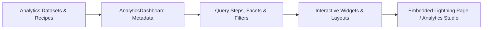

## Architectural Overview

While the standard [Dashboard](/docs/metadata/dashboard-metadata-type/) metadata type handles operational CRM dashboards backed by up to 20 standard [Report](/docs/metadata/report-metadata-type/) components, enterprise business intelligence requires multi-dataset faceting, dynamic bindings, and high-volume aggregation. The `AnalyticsDashboard` metadata type represents these advanced analytics dashboards in Metadata API.

Architecturally, managing `AnalyticsDashboard` definitions in SFDX allows BI engineers and Salesforce architects to review query logic, widget layouts, and dataset references in Git pull requests before promoting executive dashboards to production.



## SFDX Directory & File Suffix

| Property | Value |
| :--- | :--- |
| **Metadata Type Name** | `AnalyticsDashboard` |
| **SFDX Directory** | `force-app/main/default/analyticsDashboards/` |
| **File Suffix** | `.analyticsDashboard-meta.xml` |
| **API Version Introduced** | `58.0` (Verified on `68.0` / Winter '27) |

## Key Metadata Fields

| Field Name | Type | Required | Architectural Purpose |
| :--- | :--- | :--- | :--- |
| `masterLabel` | `string` | Yes | The user-facing title of the analytics dashboard. |
| `developerName` | `string` | No | Unique API identifier used across Metadata API and embedded Lightning components. |
| `application` | `string` | No | DeveloperName of the parent Analytics Application folder that governs sharing access. |
| `description` | `string` | No | Summarizes the executive KPIs, refresh cadence, and dataset lineage of the dashboard. |

> [!NOTE]
> Users viewing an `AnalyticsDashboard` embedded on a Lightning Record Page must hold the appropriate Analytics view license via a [PermissionSet](/docs/metadata/permission-set-metadata-type/) and have Viewer access to the parent `application` folder.

## Declarative XML & `package.xml` Examples

### Sample `.analyticsDashboard-meta.xml`

```xml title="force-app/main/default/analyticsDashboards/Executive_Revenue_Velocity_Dashboard.analyticsDashboard-meta.xml"
<?xml version="1.0" encoding="UTF-8"?>
<AnalyticsDashboard xmlns="http://soap.sforce.com/2006/04/metadata">
    <application>Executive_Sales_Analytics</application>
    <description>Multi-touch pipeline velocity, quota attainment, and regional YoY bookings analytics dashboard.</description>
    <masterLabel>Executive Revenue Velocity</masterLabel>
</AnalyticsDashboard>
```

### Sample `package.xml` Manifest

```xml title="manifest/package.xml"
<?xml version="1.0" encoding="UTF-8"?>
<Package xmlns="http://soap.sforce.com/2006/04/metadata">
    <types>
        <members>Executive_Revenue_Velocity_Dashboard</members>
        <name>AnalyticsDashboard</name>
    </types>
    <version>68.0</version>
</Package>
```

## SFDX CLI Retrieval & Deployment

Retrieve and deploy `AnalyticsDashboard` metadata via the Salesforce CLI:

```bash
# Retrieve all AnalyticsDashboard components
sf project retrieve start --metadata "AnalyticsDashboard:*"

# Deploy a specific AnalyticsDashboard to the target org
sf project deploy start --metadata "AnalyticsDashboard:Executive_Revenue_Velocity_Dashboard"
```

## Senior Architect Best Practices & Gotchas

- **Avoid Hardcoded Dataset Version IDs:** When promoting dashboards across sandboxes, ensure dataset references resolve by `DeveloperName` (alias) rather than org-specific dataset version IDs (`0Fb...` / `0Fc...`).
- **Deploy Parent Application Folder First:** Always include the parent Analytics Application folder in your deployment manifest; deploying an `AnalyticsDashboard` that references a missing `application` will fail validation.
- **Row-Level Security Predicates:** Verify that the underlying datasets referenced by your `AnalyticsDashboard` enforce row-level security predicates or sharing inheritance before embedding the dashboard on broad Lightning App Pages.

> [!TIP]
> Use filter mappings on Lightning Record Pages to pass the current record's `Id` (for example, `Account.Id`) dynamically into your embedded `AnalyticsDashboard` so reps see contextualized account metrics without leaving the record page.
