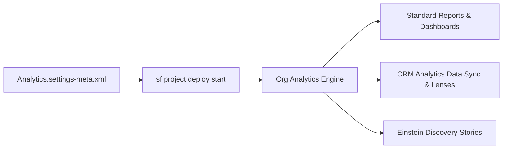

## Architectural Overview

The `AnalyticsSettings` metadata type manages org-wide preferences governing standard Salesforce Reports and Dashboards, CRM Analytics (formerly Tableau CRM / Einstein Analytics), and Einstein Discovery. For a Senior Salesforce Technical Architect, managing `AnalyticsSettings` through version control ensures consistent analytical capabilities, data replication rules, and data export security across sandboxes and production environments.

Because `AnalyticsSettings` is part of the `Settings` metadata family, its declarative flags directly control whether sensitive data can be downloaded from CRM Analytics lenses, whether dashboard components inherit sharing rules, and whether automated data sync (replication) runs in the background.



## Directory Location and File Suffix

| Property | Value |
| :--- | :--- |
| **Metadata Type Name** | `Settings` (member: `Analytics`) |
| **XML Root Element** | `<AnalyticsSettings>` |
| **SFDX Directory** | `force-app/main/default/settings/` |
| **File Name & Suffix** | `Analytics.settings-meta.xml` |

> [!NOTE]
> Unlike standalone metadata types, all org settings are retrieved and deployed under the `Settings` type name in `package.xml`, using `<members>Analytics</members>`.

## Key Metadata Fields

| Field | Type | Description & Architectural Significance |
| :--- | :--- | :--- |
| `enableAnalyticsSharing` | `boolean` | Enables standard Salesforce sharing inheritance for CRM Analytics datasets so row-level security aligns with core object sharing. |
| `enableAutoCompleteCombo` | `boolean` | Enables auto-complete suggestions on report filter lookup and picklist fields in Lightning Experience. |
| `enableCVEs` | `boolean` | Allows custom visual extensions and third-party visualization widgets inside analytics dashboards. |
| `enableDashboardComponentSnapshot` | `boolean` | Permits users to post snapshots of individual dashboard components to Chatter feeds. |
| `enableDashboardFlexiTable` | `boolean` | Enables the Lightning Table component inside the Lightning Dashboard Builder. |
| `enableEmailReportsToAnyUser` | `boolean` | Allows report subscriptions and scheduled report emails to be sent to arbitrary users within the org. |
| `enableFloatingReportHeaders` | `boolean` | Pins column and row headers when scrolling through large matrix and summary reports. |
| `enableInsights` | `boolean` | Master toggle that activates CRM Analytics (Insights) across the Salesforce organization. |
| `enableNullDimension` | `boolean` | Allows grouping and filtering by `null` dimension values in CRM Analytics datasets and recipes. |
| `enablePowerInsights` | `boolean` | Enables Einstein Discovery story creation and predictive analytics integration. |
| `enableQueryLiveConnectors` | `boolean` | Permits live direct queries to external data warehouses such as Snowflake or Google BigQuery without staging data locally. |
| `enableRemoveHeaderFooterForSub` | `boolean` | Removes promotional headers and footers from subscribed report notification emails for cleaner executive exports. |
| `enableS1Analytics` | `boolean` | Exposes CRM Analytics dashboards and lenses inside the Salesforce Mobile App. |
| `enableSmartDataDiscovery` | `boolean` | Activates automated Einstein Discovery insights and model capabilities within the org. |
| `enableWaveReplication` | `boolean` | Turns on CRM Analytics Data Sync (replication), extracting incremental changes from Salesforce objects on a separate schedule from dataflows. |
| `enableWaveTemplate` | `boolean` | Allows packaging and instantiating CRM Analytics templated apps inside the org. |
| `maxHoursAppInProgress` | `int` | Defines the maximum number of hours a CRM Analytics application creation job can remain in progress before timing out (default `24`). |

## Declarative XML and Package Manifest Examples

Below is a production-hardened `Analytics.settings-meta.xml` file along with its corresponding `package.xml` manifest.

```xml title="force-app/main/default/settings/Analytics.settings-meta.xml"
<?xml version="1.0" encoding="UTF-8"?>
<AnalyticsSettings xmlns="http://soap.sforce.com/2006/04/metadata">
    <enableAnalyticsSharing>true</enableAnalyticsSharing>
    <enableAutoCompleteCombo>true</enableAutoCompleteCombo>
    <enableDashboardComponentSnapshot>false</enableDashboardComponentSnapshot>
    <enableDashboardFlexiTable>true</enableDashboardFlexiTable>
    <enableFloatingReportHeaders>true</enableFloatingReportHeaders>
    <enableInsights>true</enableInsights>
    <enableNullDimension>true</enableNullDimension>
    <enablePowerInsights>true</enablePowerInsights>
    <enableQueryLiveConnectors>true</enableQueryLiveConnectors>
    <enableRemoveHeaderFooterForSub>true</enableRemoveHeaderFooterForSub>
    <enableS1Analytics>true</enableS1Analytics>
    <enableSmartDataDiscovery>true</enableSmartDataDiscovery>
    <enableWaveReplication>true</enableWaveReplication>
    <enableWaveTemplate>true</enableWaveTemplate>
    <maxHoursAppInProgress>12</maxHoursAppInProgress>
</AnalyticsSettings>
```

```xml title="manifest/package.xml"
<?xml version="1.0" encoding="UTF-8"?>
<Package xmlns="http://soap.sforce.com/2006/04/metadata">
    <types>
        <members>Analytics</members>
        <name>Settings</name>
    </types>
    <version>68.0</version>
</Package>
```

## SFDX CLI Retrieval and Deployment Commands

Because `AnalyticsSettings` is a pure declarative settings metadata type and not directly queryable via SOQL, use the Salesforce CLI (`sf`) to inspect, retrieve, and deploy changes:

```bash
# Retrieve AnalyticsSettings from the target org
sf project retrieve start --metadata Settings:Analytics --target-org my-org

# Validate and deploy AnalyticsSettings changes
sf project deploy start --metadata Settings:Analytics --target-org my-prod-org --dry-run
```

> [!TIP]
> When building CI/CD pipelines for scratch orgs that deploy `AnalyticsSettings`, include `"Wave"` or `"AnalyticsAdminPerms"` in the `features` array of your `config/project-scratch-def.json` file so CRM Analytics fields do not fail validation.

## Senior Architect Best Practices and Gotchas

1. **Sharing Inheritance Governance:** Enabling `enableAnalyticsSharing` is only the first step. You must also enable sharing inheritance per dataset and configure a security predicate fallback for objects whose sharing descriptors exceed 3,000 shares per record.
2. **Data Sync (`enableWaveReplication`) Lifecycle:** Once `enableWaveReplication` is enabled and existing dataflows are migrated to use synced objects, turning it back to `false` in XML will fail deployment if active recipes or dataflows still depend on replicated `SFDC_LOCAL` connectors.
3. **Null Dimension Grouping Impacts SAQL:** Enabling `enableNullDimension` changes how CRM Analytics indexes missing text fields. Existing SAQL queries and recipes that implicitly filtered out null dimension rows should be regression-tested in a Full Sandbox before enabling in production.
4. **Environment Drift on Unlicensed Sandboxes:** If a developer sandbox lacks Einstein Discovery or CRM Analytics Plus licenses, deploying `enablePowerInsights` or `enableQueryLiveConnectors` can throw `Problem: Property 'enablePowerInsights' not valid in version 68.0`. Strip unlicensed tags in your CI pre-deployment script when targeting lightweight developer orgs.
