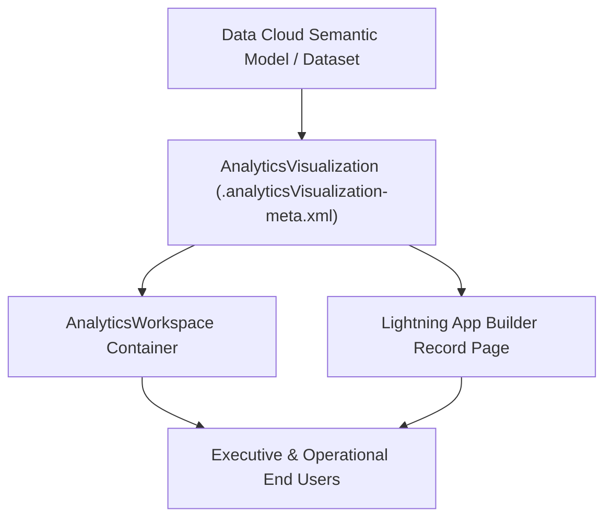

## Architectural Overview

The `AnalyticsVisualization` metadata type represents a saved, reusable visualization asset within Salesforce's Unified Analytics and Data Cloud reporting architecture. While traditional CRM Analytics embeds lenses and charts directly inside monolithic `WaveDashboard` JSON blobs, `AnalyticsVisualization` decouples individual visual views so architects can govern, version, and embed single-purpose charts across multiple workspaces and Lightning Record Pages.

From an enterprise architecture standpoint, modularizing charts as `AnalyticsVisualization` metadata reduces merge conflicts in Git. Multiple analytics engineers can iterate on separate KPI visualizations simultaneously without overwriting a single massive dashboard definition.



## Directory Location and File Suffix

| Property | Value |
| :--- | :--- |
| **Metadata Type Name** | `AnalyticsVisualization` |
| **XML Root Element** | `<AnalyticsVisualization>` |
| **SFDX Directory** | `force-app/main/default/analyticsVisualizations/` |
| **File Suffix** | `.analyticsVisualization-meta.xml` |

> [!RELEASE] Winter '27
> Verified against API version `68.0`. Ensure your `sfdx-project.json` sets `"sourceApiVersion": "68.0"` when retrieving Unified Analytics visualization components.

## Key Metadata Fields

| Field | Type | Required | Description & Architectural Significance |
| :--- | :--- | :--- | :--- |
| `masterLabel` | `string` | Yes | The human-readable title of the visualization displayed in the Unified Analytics UI and Lightning App Builder. |
| `description` | `string` | No | Documents the business KPI, underlying semantic model, and grain of the visualization for governance audits. |
| `folderName` | `string` | No | The developer name of the analytics folder or `AnalyticsWorkspace` that governs sharing and visibility for this visualization. |
| `visualizationType` | `string` | No | Specifies the chart rendering engine type (for example, `Bar`, `Line`, `Combo`, `Metric`, or `PivotTable`). |
| `definition` | `string` | No | Serialized JSON payload defining the query measures, dimensions, filters, and conditional formatting rules. |

## Declarative XML and Package Manifest Examples

Below is an example of an `AnalyticsVisualization` metadata file defining a quarterly ARR breakdown chart, along with the `package.xml` manifest used to deploy it.

```xml title="force-app/main/default/analyticsVisualizations/Quarterly_ARR_By_Segment.analyticsVisualization-meta.xml"
<?xml version="1.0" encoding="UTF-8"?>
<AnalyticsVisualization xmlns="http://soap.sforce.com/2006/04/metadata">
    <masterLabel>Quarterly ARR by Segment</masterLabel>
    <description>Tracks net-new and expansion ARR grouped by enterprise segment from the Revenue Semantic Model.</description>
    <folderName>Executive_Revenue_Workspace</folderName>
    <visualizationType>StackedBar</visualizationType>
</AnalyticsVisualization>
```

```xml title="manifest/package.xml"
<?xml version="1.0" encoding="UTF-8"?>
<Package xmlns="http://soap.sforce.com/2006/04/metadata">
    <types>
        <members>Quarterly_ARR_By_Segment</members>
        <name>AnalyticsVisualization</name>
    </types>
    <version>68.0</version>
</Package>
```

## SFDX CLI Retrieval and Tooling Inspection

Use the Salesforce CLI to retrieve and deploy `AnalyticsVisualization` assets across environments:

```bash
# Retrieve a specific AnalyticsVisualization asset
sf project retrieve start \
  --metadata AnalyticsVisualization:Quarterly_ARR_By_Segment \
  --target-org analytics-sandbox

# Retrieve all AnalyticsVisualization metadata in the org
sf project retrieve start \
  --metadata "AnalyticsVisualization:*" \
  --target-org analytics-sandbox
```

## Senior Architect Best Practices and Gotchas

1. **Deploy Semantic Models First:** An `AnalyticsVisualization` references fields and measures from its underlying dataset or Data Cloud Semantic Model. Always order your CI/CD deployment pipeline so Data Cloud data model objects (DMOs), calculated insights, and semantic models deploy prior to `AnalyticsVisualization` components.
2. **Workspace Folder Permissions:** Access to an `AnalyticsVisualization` is inherited from its parent container (`folderName` or `AnalyticsWorkspace`). If users see an "Insufficient Privileges" banner on an embedded Lightning page, verify both their [PermissionSet](/docs/metadata/permission-set-metadata-type/) license assignments and folder viewer shares.
3. **Avoid Hardcoded Record IDs in Filters:** When configuring default filters inside a visualization's definition, filter by stable external keys or picklist API names rather than 18-character Salesforce Record IDs, which change across sandboxes.
