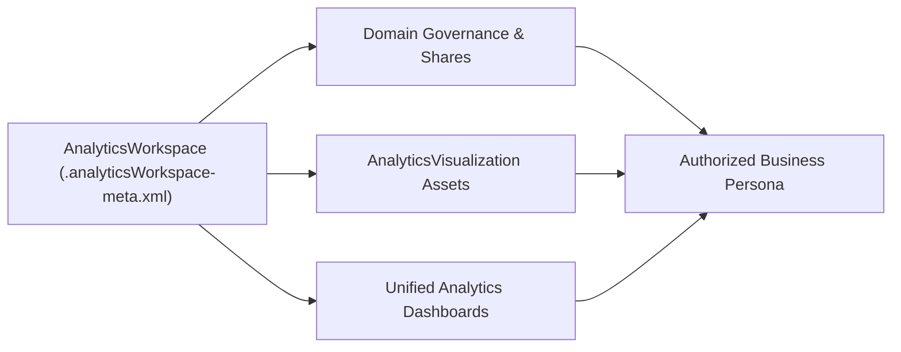

## Architectural Overview

The `AnalyticsWorkspace` metadata type defines a top-level collaborative container in Salesforce Unified Analytics. Architects use `AnalyticsWorkspace` to partition analytical assets—such as dashboards, semantic models, and `AnalyticsVisualization` components—by business domain (for example, Revenue Operations, Service Delivery, or Supply Chain).

By managing `AnalyticsWorkspace` definitions in Git, platform teams prevent "analytics sprawl" in production. Every visualization and dashboard belongs to a version-controlled workspace with clear ownership and lifecycle boundaries.



## Directory Location and File Suffix

| Property | Value |
| :--- | :--- |
| **Metadata Type Name** | `AnalyticsWorkspace` |
| **XML Root Element** | `<AnalyticsWorkspace>` |
| **SFDX Directory** | `force-app/main/default/analyticsWorkspaces/` |
| **File Suffix** | `.analyticsWorkspace-meta.xml` |

## Key Metadata Fields

| Field | Type | Required | Description & Architectural Significance |
| :--- | :--- | :--- | :--- |
| `masterLabel` | `string` | Yes | The display name of the workspace shown to users in the Unified Analytics home experience. |
| `description` | `string` | No | Explains the purpose, data steward, and intended audience of the workspace. |
| `shares` | `FolderShare[]` | No | Defines user, role, or public group access levels (`View`, `Edit`, `Manage`) for assets inside the workspace. |

> [!TIP]
> Grant workspace access to **Public Groups** or **Roles** rather than individual usernames (`<sharedToType>Group</sharedToType>`). Individual usernames frequently differ between sandboxes and production, causing deployment failures.

## Declarative XML and Package Manifest Examples

The following example defines an executive revenue workspace shared with a public group, along with its `package.xml` manifest.

```xml title="force-app/main/default/analyticsWorkspaces/Executive_Revenue_Workspace.analyticsWorkspace-meta.xml"
<?xml version="1.0" encoding="UTF-8"?>
<AnalyticsWorkspace xmlns="http://soap.sforce.com/2006/04/metadata">
    <masterLabel>Executive Revenue Workspace</masterLabel>
    <description>Curated ARR, pipeline velocity, and NRR visualizations for RevOps leadership.</description>
</AnalyticsWorkspace>
```

```xml title="manifest/package.xml"
<?xml version="1.0" encoding="UTF-8"?>
<Package xmlns="http://soap.sforce.com/2006/04/metadata">
    <types>
        <members>Executive_Revenue_Workspace</members>
        <name>AnalyticsWorkspace</name>
    </types>
    <version>68.0</version>
</Package>
```

## SFDX CLI Retrieval and Deployment Commands

Retrieve and deploy `AnalyticsWorkspace` definitions using the Salesforce CLI:

```bash
# Retrieve a specific AnalyticsWorkspace
sf project retrieve start \
  --metadata AnalyticsWorkspace:Executive_Revenue_Workspace \
  --target-org my-org

# Deploy workspace and child visualizations together
sf project deploy start \
  --metadata AnalyticsWorkspace:Executive_Revenue_Workspace AnalyticsVisualization:Quarterly_ARR_By_Segment \
  --target-org my-prod-org
```

## Senior Architect Best Practices and Gotchas

1. **Bundle Workspace and Child Assets:** When promoting new analytics features through a CI/CD pipeline, include both the `AnalyticsWorkspace` and its child `AnalyticsVisualization` components in the same deployment transaction to avoid unresolved parent references.
2. **Delete Protection:** Salesforce prevents deleting an `AnalyticsWorkspace` via `destructiveChanges.xml` while it still contains active visualizations or dashboards. Empty or reassign all child assets before attempting destructive removal.
3. **Standardize Naming Conventions:** Prefix workspace API names by department (`RevOps_`, `FinOps_`, `CS_`) so admins and release engineers can use wildcard patterns or modular SFDX package directories per business unit.
