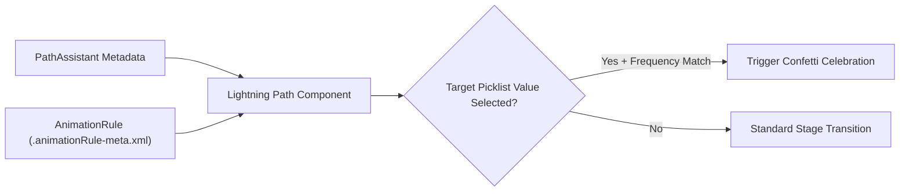

## Architectural Overview

The `AnimationRule` metadata type configures the celebratory virtual confetti animation displayed in Lightning Experience when a user moves a [PathAssistant](/docs/metadata/path-assistant-metadata-type/) component to a designated milestone value (such as `Closed Won` on an Opportunity or `Resolved` on a Case).

While `AnimationRule` appears to be a minor UI flourish, in source-driven SFDX orgs it is decoupled from the `PathAssistant` XML file itself. If an architect deploys a `PathAssistant` to production without including its corresponding `AnimationRule` in `package.xml`, the Path stages and guidance fields will deploy, but the celebration settings configured in Setup will be missing.



## Directory Location and File Suffix

| Property | Value |
| :--- | :--- |
| **Metadata Type Name** | `AnimationRule` |
| **XML Root Element** | `<AnimationRule>` |
| **SFDX Directory** | `force-app/main/default/animationRules/` |
| **File Suffix** | `.animationRule-meta.xml` |

## Key Metadata Fields

| Field | Type | Required | Description & Architectural Significance |
| :--- | :--- | :--- | :--- |
| `animationFrequency` | `AnimationFrequency` | Yes | Controls how often confetti displays when the target value is reached. Valid values: `always`, `often`, `sometimes`, `rarely`. |
| `developerName` | `string` | Yes | Unique API name of the animation rule in the org. Can contain only underscores and alphanumeric characters. |
| `isActive` | `boolean` | Yes | Indicates whether the celebration rule is currently active (`true`) or disabled (`false`). |
| `masterLabel` | `string` | Yes | The human-readable label for the animation rule. |
| `recordTypeContext` | `string` | Yes | Record type context indicator. Use `Master` when the object has no record types, or `Custom` when bound to a specific record type. |
| `recordTypeName` | `string` | No | The `DeveloperName` of the specific `RecordType` when `recordTypeContext` is `Custom` (or `__MASTER__` for master record type). |
| `sobjectType` | `string` | Yes | The API name of the standard or custom object (for example, `Opportunity`, `Lead`, or `Onboarding_Project__c`). |
| `targetField` | `string` | Yes | The API name of the picklist field driving the Path (for example, `StageName` or `Status__c`). |
| `targetFieldChangeToValues` | `string` | Yes | Comma-separated list of picklist API values that trigger the confetti animation (for example, `Closed Won`). |

## Declarative XML and Package Manifest Examples

The following example triggers a confetti animation every time an Enterprise Sales Opportunity transitions to `Closed Won`.

```xml title="force-app/main/default/animationRules/Enterprise_Opportunity_Closed_Won.animationRule-meta.xml"
<?xml version="1.0" encoding="UTF-8"?>
<AnimationRule xmlns="http://soap.sforce.com/2006/04/metadata">
    <animationFrequency>always</animationFrequency>
    <developerName>Enterprise_Opportunity_Closed_Won</developerName>
    <isActive>true</isActive>
    <masterLabel>Enterprise Opportunity Closed Won</masterLabel>
    <recordTypeContext>Custom</recordTypeContext>
    <recordTypeName>Enterprise_Sales</recordTypeName>
    <sobjectType>Opportunity</sobjectType>
    <targetField>StageName</targetField>
    <targetFieldChangeToValues>Closed Won</targetFieldChangeToValues>
</AnimationRule>
```

```xml title="manifest/package.xml"
<?xml version="1.0" encoding="UTF-8"?>
<Package xmlns="http://soap.sforce.com/2006/04/metadata">
    <types>
        <members>Enterprise_Opportunity_Closed_Won</members>
        <name>AnimationRule</name>
    </types>
    <types>
        <members>Enterprise_Opportunity_Path</members>
        <name>PathAssistant</name>
    </types>
    <version>68.0</version>
</Package>
```

## Querying AnimationRule via SOQL

You can audit active `AnimationRule` records across your org using standard SOQL or the Tooling API:

```soql
SELECT Id, DeveloperName, MasterLabel, SobjectType, TargetField,
       RecordTypeContext, TargetFieldChangeToValues, AnimationFrequency, IsActive
FROM AnimationRule
WHERE IsActive = true
ORDER BY SobjectType, DeveloperName
```

## Senior Architect Best Practices and Gotchas

1. **Always Retrieve Alongside `PathAssistant`:** When an admin enables celebrations inside the Path Setup wizard (`Setup -> Path Settings`), Salesforce silently creates or updates an `AnimationRule` metadata component. Always run `sf project retrieve start --metadata PathAssistant AnimationRule` together so celebration rules are not left behind in a sandbox.
2. **Picklist Value Dependency:** If you rename or deactivate a picklist value on `targetField` without updating `targetFieldChangeToValues` in the `AnimationRule`, deployments to clean scratch orgs will fail with a picklist validation error.
3. **Client-Side Trigger Only:** `AnimationRule` only fires when a user updates the Path stage interactively in Lightning Experience. Bulk updates via Apex, Flow, or Data Loader never trigger client-side animations.
