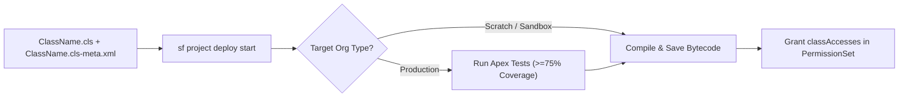

## Overview

The `ApexClass` metadata type represents a server-side Apex class in your Salesforce org. Every Apex class in an SFDX project consists of two paired files inside `force-app/main/default/classes/`: the source code file (`ClassName.cls`) and its accompanying XML metadata file (`ClassName.cls-meta.xml`).

The `.cls-meta.xml` file controls three vital execution attributes: the pinned `apiVersion` (which governs SOQL behavior, sharing defaults, and runtime semantics), the lifecycle `status` (`Active` or `Deleted`), and `packageVersions` bindings when referencing managed packages. Because `ApexClass` is exposed in both the standard Object Reference and the Tooling API, you can query class sizes, API versions, compilation validity, and test coverage directly via SOQL.



As shown in the deployment workflow above, deploying an `ApexClass` compiles the source pair into platform bytecode, enforces the 75% org-wide code coverage gate in production, and requires `classAccesses` assignment in a [PermissionSet](/docs/metadata/permission-set-metadata-type/) for UI or REST execution.

## Prerequisites

- **Permissions:** "Author Apex" and "Modify Metadata Through Metadata API Functions" permissions.
- **Test Coverage for Production:** At least 75% of all executable lines across the org must be covered by passing unit tests, and every trigger executed must have >0% coverage.
- **API Version:** Verified against API version `68.0` (Winter '27).

## ApexClass XML Metadata Structure

The `ClassName.cls-meta.xml` file is concise, containing only three top-level elements:

| Field | Type | Required | Description & Architectural Notes |
| :--- | :--- | :--- | :--- |
| `apiVersion` | `double` | ✅ Yes | Binds the class to a specific Salesforce release (e.g., `68.0`). Keep classes updated to avoid legacy runtime quirks and ICU locale issues. |
| `status` | `ApexCodeUnitStatus` | ✅ Yes | Either `Active` or `Deleted`. (`Inactive` is **not** valid on `ApexClass`; it is only valid on [ApexTrigger](/docs/metadata/apex-trigger-metadata-type/)). |
| `packageVersions` | `PackageVersion[]` | No | Pins the `namespace`, `majorNumber`, and `minorNumber` of an installed managed package referenced by this class. |

> [!TIP]
> Salesforce enforces a minimum API version of `45.0` for all classes and triggers when enabling ICU Locale Formats. Regularly audit and upgrade old classes to the current release (`68.0`).

## Querying ApexClass and Code Coverage via SOQL

Unlike most metadata types, `ApexClass` is directly queryable in **standard SOQL** as well as the **Tooling API**.

### 1. Audit Classes on Legacy API Versions and Check Code Size (Standard SOQL)
Find all unmanaged classes running on older API versions or consuming excessive character limits toward the 6 MB org ceiling:

```soql
SELECT Id, Name, ApiVersion, Status, IsValid,
       LengthWithoutComments, LastModifiedDate, LastModifiedBy.Name
FROM ApexClass
WHERE NamespacePrefix = null
  AND ApiVersion < 60.0
ORDER BY LengthWithoutComments DESC
```

### 2. Calculate Org-Wide Character Usage Against the 6 MB Limit (Standard SOQL)
Test classes (`@IsTest`) do not count toward the 6 MB (6,000,000 characters) org Apex limit. Query non-test classes by inspecting `LengthWithoutComments`:

```soql
SELECT SUM(LengthWithoutComments) totalCharactersUsed
FROM ApexClass
WHERE NamespacePrefix = null
```

### 3. Inspect Class-by-Class Test Coverage via Tooling API
Run this query with `sf data query --use-tooling-api` to identify classes with fewer than 75% covered lines before a production deployment:

```soql
SELECT ApexClassOrTrigger.Name, NumLinesCovered, NumLinesUncovered
FROM ApexCodeCoverageAggregate
WHERE NumLinesUncovered > 0
ORDER BY NumLinesUncovered DESC
```

## Example

The following example pairs a bulkified, user-mode service class (`InvoiceBillingService.cls`) with its `68.0` metadata file (`InvoiceBillingService.cls-meta.xml`) and a 100%-coverage unit test (`InvoiceBillingServiceTest.cls`).

```xml title="force-app/main/default/classes/InvoiceBillingService.cls-meta.xml"
<?xml version="1.0" encoding="UTF-8"?>
<ApexClass xmlns="http://soap.sforce.com/2006/04/metadata">
    <apiVersion>68.0</apiVersion>
    <status>Active</status>
</ApexClass>
```

```apex title="force-app/main/default/classes/InvoiceBillingService.cls"
public with sharing class InvoiceBillingService {

    /**
     * Marks open accounts as Priority when annual revenue exceeds threshold.
     * Enforces CRUD and FLS via WITH USER_MODE and as user DML.
     */
    @AuraEnabled
    public static List<Account> elevateHighValueAccounts(Set<Id> accountIds, Decimal revenueThreshold) {
        if (accountIds == null || accountIds.isEmpty()) {
            return new List<Account>();
        }

        List<Account> eligibleAccounts = [
            SELECT Id, Name, AnnualRevenue, Rating
            FROM Account
            WHERE Id IN :accountIds
              AND AnnualRevenue >= :revenueThreshold
            WITH USER_MODE
        ];

        for (Account acc : eligibleAccounts) {
            acc.Rating = 'Hot';
        }

        if (!eligibleAccounts.isEmpty()) {
            update as user eligibleAccounts;
        }
        return eligibleAccounts;
    }
}
```

```apex title="force-app/main/default/classes/InvoiceBillingServiceTest.cls"
@IsTest
private class InvoiceBillingServiceTest {

    @IsTest
    static void elevatesHighValueAccountsInBulk() {
        Account highAcc = new Account(Name = 'Enterprise Corp', AnnualRevenue = 2500000);
        Account lowAcc = new Account(Name = 'Startup LLC', AnnualRevenue = 50000);
        insert new List<Account>{ highAcc, lowAcc };

        Test.startTest();
        List<Account> updated = InvoiceBillingService.elevateHighValueAccounts(
            new Set<Id>{ highAcc.Id, lowAcc.Id },
            1000000
        );
        Test.stopTest();

        Assert.areEqual(1, updated.size(), 'Only the high-revenue account should be elevated');
        Account refreshed = [SELECT Rating FROM Account WHERE Id = :highAcc.Id];
        Assert.areEqual('Hot', refreshed.Rating);
    }
}
```

## Limits and Gotchas

- **Org-Wide Code Size Limit:** 6 MB (6,000,000 characters) of active Apex code (classes and triggers combined), excluding comments and classes annotated with `@IsTest`.
- **Single Class Size Limit:** 1,000,000 characters maximum per `ApexClass`.
- **Active Job Deployment Lock:** Deploying an `ApexClass` that has a running or queued `Batchable`, `Queueable`, `Schedulable`, or `@future` job fails unless you enable **Allow deployments of components when corresponding Apex jobs are pending or in progress** under **Setup → Deployment Settings** (or in [DeploymentSettings](/docs/metadata/official-developer-docs-directory/) metadata).
- **No CRUD Calls in Metadata API:** Unlike configuration metadata, `ApexClass` cannot be deployed using synchronous `createMetadata()` or `updateMetadata()` CRUD calls in Production; you must use asynchronous `deploy()` or `sf project deploy start` so unit tests execute.
- **Naming Rules:** The `fullName` can only contain alphanumeric characters and single underscores (`_`), must begin with a letter, and cannot end with an underscore or contain two consecutive underscores (`__`).

## Related Official Documentation

- [ApexClass Metadata API Reference](https://developer.salesforce.com/docs/atlas.en-us.api_meta.meta/api_meta/meta_classes.htm): Metadata XML schema and `PackageVersion` structure.
- [ApexClass Object Reference](https://developer.salesforce.com/docs/atlas.en-us.object_reference.meta/object_reference/sforce_api_objects_apexclass.htm): Standard SOQL fields for querying `ApexClass` records.
- [ApexCodeCoverageAggregate Tooling API](https://developer.salesforce.com/docs/atlas.en-us.api_tooling.meta/api_tooling/tooling_api_objects_apexcodecoverageaggregate.htm): Querying org and class test coverage metrics.
