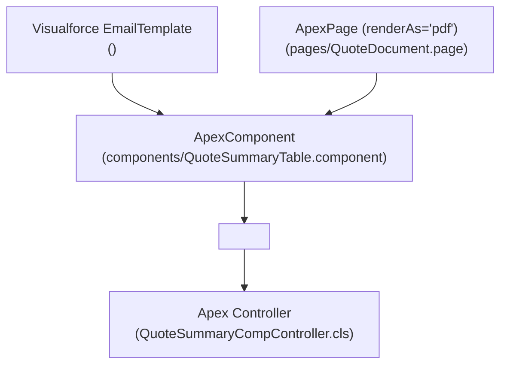

## Why the `ApexComponent` Metadata Type Matters

An **`ApexComponent`** defines a reusable custom Visualforce tag (`<c:MyComponent>`) that encapsulates markup and optional custom Apex controller logic. Even if your user interface is 100% built on Lightning Web Components, `ApexComponent` remains critical in two enterprise scenarios:

1. **Dynamic Related Lists in Visualforce Email Templates:** Standard and Lightning Email Templates cannot execute arbitrary SOQL joins or custom Apex sorting. By embedding `<c:OrderLinesTable orderId="{!relatedTo.Id}" />` inside a `Visualforce` [EmailTemplate](/docs/metadata/email-template-metadata-type/), you can render complex HTML tables and attach dynamically generated PDFs (`<messaging:attachment renderAs="pdf">`).
2. **Modular PDF Document Headers, Footers, and Tables:** Sharing standardized branding headers, legal footers, and line-item tables across dozens of [ApexPage](/docs/metadata/apex-page-metadata-type/) PDF templates.



---

## SFDX Source Format & File Structure

In SFDX projects, custom Visualforce components live inside `force-app/main/default/components/` as a file pair:

- `components/<ComponentName>.component`: The Visualforce component markup wrapped in `<apex:component>`.
- `components/<ComponentName>.component-meta.xml`: The metadata companion file.

---

## Key Metadata Fields on `ApexComponent`

| Field | Type | Required | Description |
|---|---|---|---|
| `apiVersion` | `double` | Yes | The Salesforce API version used to compile the component markup. |
| `label` | `string` | Yes | Display name for the custom component in Setup (`<label>Quote Summary Table</label>`). |
| `description` | `string` | No | Text description documenting the component's attributes and where it is embedded. |
| `packageVersions` | `PackageVersion[]` | No | Managed package version bindings if the component references packaged tags or classes. |

---

## Real-World XML & Markup Example

### 1. Metadata File (`components/QuoteLineTable.component-meta.xml`)

```xml
<?xml version="1.0" encoding="UTF-8"?>
<ApexComponent xmlns="http://soap.sforce.com/2006/04/metadata">
    <apiVersion>68.0</apiVersion>
    <description>Renders sorted Quote Line Items for both Visualforce Email Templates and PDF Quote documents.</description>
    <label>Quote Line Table</label>
</ApexComponent>
```

### 2. Component Markup (`components/QuoteLineTable.component`)

```xml
<apex:component controller="QuoteLineTableController" access="global">
    <apex:attribute name="quoteId"
                    type="Id"
                    description="The Quote record ID whose lines should be rendered"
                    assignTo="{!recordId}"
                    required="true" />
    <table border="1" cellpadding="6" cellspacing="0" width="100%">
        <thead>
            <tr>
                <th>Product</th>
                <th>Quantity</th>
                <th>Net Total</th>
            </tr>
        </thead>
        <tbody>
            <apex:repeat value="{!lineItems}" var="line">
                <tr>
                    <td>{!line.Product2.Name}</td>
                    <td>{!line.Quantity}</td>
                    <td>{!line.TotalPrice}</td>
                </tr>
            </apex:repeat>
        </tbody>
    </table>
</apex:component>
```

> [!TIP]
> **Order of Execution Gotcha (`Constructor` vs. `assignTo`):** In an `ApexComponent` controller, the Apex constructor executes **before** `<apex:attribute assignTo="{!recordId}"/>` setter methods run. Never run your SOQL query inside the constructor—instead, lazy-load the query inside the getter (`getLineItems()`) after `recordId` has been populated!

---

## Querying `ApexComponent` with SOQL & Tooling API

You can query `ApexComponent` directly in SOQL or the Tooling API to inventory custom Visualforce components and their associated Apex controllers.

### 1. List All Custom Visualforce Components and Their Controllers

```sql
SELECT Id, Name, MasterLabel, ApiVersion, ControllerType, ControllerKey,
       Description, LastModifiedBy.Name, LastModifiedDate
FROM ApexComponent
WHERE NamespacePrefix = null
ORDER BY Name ASC
```

### 2. Inspect Component Markup for Specific Attributes or Controller References

```sql
SELECT Id, Name, ControllerKey, Markup
FROM ApexComponent
WHERE Name = 'QuoteLineTable'
```

---

## Deployment & Dependency Best Practices

- **Deploy Order in Partial Manifests:** When deploying an `ApexComponent` alongside its custom Apex controller and parent `ApexPage` or `EmailTemplate`, ensure the `ApexClass` is included in the same `package.xml` transaction so compilation dependencies resolve cleanly.
- **Removing Unused Attributes:** You cannot delete an `<apex:attribute>` from an `ApexComponent` while any `ApexPage` or `EmailTemplate` in the target org still passes that attribute in markup. Update the consuming pages first or deploy both changes together.
