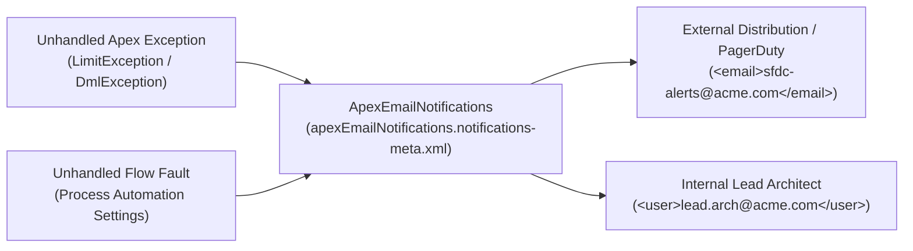

## Why the `ApexEmailNotifications` Metadata Type Is Essential for Production Observability

By default, when an unhandled Apex governor limit (`System.LimitException: Too many SOQL queries: 101`) or NullPointerException occurs in Production, Salesforce emails the `LastModifiedBy` user of the failing class or trigger. If that consultant or developer left the project two years ago, critical production failures go unnoticed.

**`ApexEmailNotifications`** (`apexEmailNotifications/apexEmailNotifications.notifications-meta.xml`) centralizes unhandled **Apex Exception** and **Flow Fault** emails (when **Process Automation Settings → Send Process or Flow Error Email to → Apex Exception Email Recipients** is enabled) to your DevOps PagerDuty, Slack email webhook, or engineering distribution list.



---

## Key Metadata Fields on `ApexEmailNotifications`

In SFDX source format, there is only **one** file per org:
`force-app/main/default/apexEmailNotifications/apexEmailNotifications.notifications-meta.xml`

| Field | Type | Required | Description |
|---|---|---|---|
| `apexEmailNotification` | `ApexEmailNotification[]` | No | List of notification recipients. Deploying an empty `<ApexEmailNotifications/>` deletes all recipients in the org. |
| `apexEmailNotification.email` | `string` | Conditional | External email address or distribution list (mutually exclusive with `user`). |
| `apexEmailNotification.user` | `string` | Conditional | Username of an active Salesforce User in the org (mutually exclusive with `email`). |

---

## Real-World XML Example (`apexEmailNotifications/apexEmailNotifications.notifications-meta.xml`)

```xml
<?xml version="1.0" encoding="UTF-8"?>
<ApexEmailNotifications xmlns="http://soap.sforce.com/2006/04/metadata">
    <apexEmailNotification>
        <email>salesforce-prod-alerts@acme.example.com</email>
    </apexEmailNotification>
    <apexEmailNotification>
        <email>pagerduty-sfdc-sev2@acme.example.com</email>
    </apexEmailNotification>
</ApexEmailNotifications>
```

---

## Querying `ApexEmailNotification` via SOQL

You can query the configured exception recipients in standard SOQL or the Tooling API:

```sql
SELECT Id, Email, UserId, User.Name, User.Username, User.IsActive, CreatedDate
FROM ApexEmailNotification
ORDER BY CreatedDate DESC
```

---

## Senior Architect Best Practices & Gotchas

> [!WARNING]
> **Full-Overwrite Behavior (`destructiveChanges.xml` Not Used):** Deploying `ApexEmailNotifications` **replaces** the entire list of recipients in the target org. Any recipient previously added in **Setup → Apex Exception Email** that is missing from your `.notifications-meta.xml` file is deleted upon deploy.

- **Prefer `<email>` Distribution Lists Over `<user>` Usernames:** Using `<email>sfdc-devops@acme.example.com</email>` instead of `<user>admin@acme.com</user>` avoids sandbox username mismatch errors during CI/CD deployments and lets you manage alert membership in Google Workspace, Microsoft 365, or PagerDuty without redeploying Salesforce metadata!

