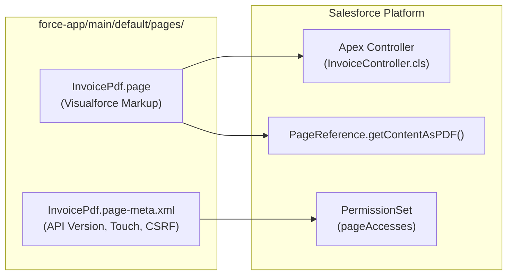

## Why the `ApexPage` Metadata Type Still Matters in Modern Orgs

While Lightning Web Components (`LightningComponentBundle`) are the default UI framework for modern Salesforce development, **`ApexPage`** (Visualforce) remains an indispensable architectural building block. In enterprise orgs, architects still rely on `ApexPage` for capabilities that LWC cannot natively perform on the server:

1. **Server-Side PDF Generation (`renderAs="pdf"`):** Generating invoices, quotes, and compliance certificates directly into `Blob` content via `PageReference.getContentAsPDF()`.
2. **List View Mass Action Buttons:** Passing selected record IDs from a standard list view into a `StandardSetController` using a custom `WebLink` button.
3. **Lightning Out & Canvas Host Containers:** Hosting external scripts or isolated origins that cannot run inside Lightning Web Security (LWS).
4. **Custom OAuth Callback & Payment Redirect Pages:** Handling server-side query parameters before redirecting back to Lightning Experience.



---

## SFDX Source Format & File Structure

Every `ApexPage` consists of two paired files in the `pages/` directory:

- `pages/<PageName>.page`: The Visualforce XML/HTML markup starting with `<apex:page>`.
- `pages/<PageName>.page-meta.xml`: The metadata companion file defining the API version, label, and security flags.

---

## Key Metadata Fields on `ApexPage`

| Field | Type | Required | Architectural Purpose |
|---|---|---|---|
| `apiVersion` | `double` | Yes | The Salesforce API version used to compile the Visualforce page and evaluate standard components. |
| `label` | `string` | Yes | The human-readable label displayed in Setup, Lightning App Builder, and Permission Sets. |
| `availableInTouch` | `boolean` | No | Enables the page for **Lightning Experience**, the **Salesforce Mobile App**, and Lightning Utility Bars. Defaults to `false`. |
| `confirmationTokenRequired` | `boolean` | No | Requires a CSRF token on `GET` requests to the page. Critical if your `<apex:page action="{!init}">` method performs DML or state changes. |
| `description` | `string` | No | Documents the architectural purpose of the page (up to 255 characters). |
| `packageVersions` | `PackageVersion[]` | No | Pins the managed package version (`namespace`, `majorNumber`, `minorNumber`) referenced by the page. |

---

## Real-World XML & Markup Example

### 1. Metadata File (`pages/InvoiceStatementPdf.page-meta.xml`)

```xml
<?xml version="1.0" encoding="UTF-8"?>
<ApexPage xmlns="http://soap.sforce.com/2006/04/metadata">
    <apiVersion>68.0</apiVersion>
    <availableInTouch>true</availableInTouch>
    <confirmationTokenRequired>true</confirmationTokenRequired>
    <description>Renders an official customer invoice statement as a downloadable PDF via Flying Saucer engine.</description>
    <label>Invoice Statement PDF</label>
</ApexPage>
```

### 2. Visualforce Markup (`pages/InvoiceStatementPdf.page`)

```xml
<apex:page standardController="Account"
           extensions="InvoiceStatementController"
           renderAs="pdf"
           applyBodyTag="false"
           showHeader="false">
    <html>
        <head>
            <style type="text/css">
                @page { size: A4 portrait; margin: 20mm; }
                body { font-family: Arial Unicode MS, sans-serif; font-size: 10pt; }
            </style>
        </head>
        <body>
            <h1>Statement for {!Account.Name}</h1>
            <c:InvoiceLineItemTable accountId="{!Account.Id}" />
        </body>
    </html>
</apex:page>
```

> [!WARNING]
> **Enabling `confirmationTokenRequired` Breaks Hardcoded URLs:** When `<confirmationTokenRequired>true</confirmationTokenRequired>` is enabled, navigating to `/apex/InvoiceStatementPdf?id=001...` using a plain HTML string URL without using `URLFOR($Page.InvoiceStatementPdf, null, [id=Account.Id])` or an `ApexPages.PageReference` in Apex will fail with an invalid session/CSRF error.

---

## Querying `ApexPage` with SOQL & Tooling API

`ApexPage` is directly queryable via standard SOQL and the Tooling API. This makes it easy to audit legacy Visualforce pages for security compliance, outdated API versions, or missing CSRF protection.

### 1. Find Visualforce Pages Missing CSRF Protection or Lightning Readiness

```sql
SELECT Id, Name, MasterLabel, ApiVersion, ControllerType, ControllerKey,
       IsAvailableInTouch, IsConfirmationTokenRequired, LastModifiedDate
FROM ApexPage
WHERE NamespacePrefix = null
  AND (IsConfirmationTokenRequired = false OR ApiVersion < 55.0)
ORDER BY ApiVersion ASC
```

### 2. Search Visualforce Page Markup for Deprecated JavaScript Libraries

```sql
SELECT Name, MasterLabel, ApiVersion, ControllerKey
FROM ApexPage
WHERE NamespacePrefix = null
ORDER BY Name ASC
```

*(Note: You can include the `Markup` field in a targeted query on specific pages to scan for inline `<script>` tags or `sforce.connection` AJAX Toolkit usage.)*

### 3. Audit Which Permission Sets Grant Access to a Visualforce Page

```sql
SELECT Parent.Name, Parent.Label, Parent.IsOwnedByProfile
FROM SetupEntityAccess
WHERE SetupEntityType = 'ApexPage'
  AND SetupEntityId IN (
      SELECT Id FROM ApexPage WHERE Name = 'InvoiceStatementPdf'
  )
```

---

## Senior Architect Best Practices & Gotchas

- **Always Grant Access via `PermissionSet` (`pageAccesses`):** Users without explicit `ApexPage` access in a [Permission Set](/docs/metadata/permission-set-metadata-type/) or [Profile](/docs/metadata/profile-metadata-type/) will receive an `Insufficient Privileges` error—even if an Apex class calls `getContentAsPDF()` in user context.
- **Avoid DML in `<apex:page action="...">`:** AppExchange Security Review flags any Visualforce page that executes DML inside its page-load `action` method unless `confirmationTokenRequired` is `true` or the logic is moved to a postback command action.
- **Keep Reusable PDF Fragments in `ApexComponent`:** Instead of duplicating CSS and table markup across multiple PDF pages, encapsulate shared sections inside an [ApexComponent](/docs/metadata/apex-component-metadata-type/).
