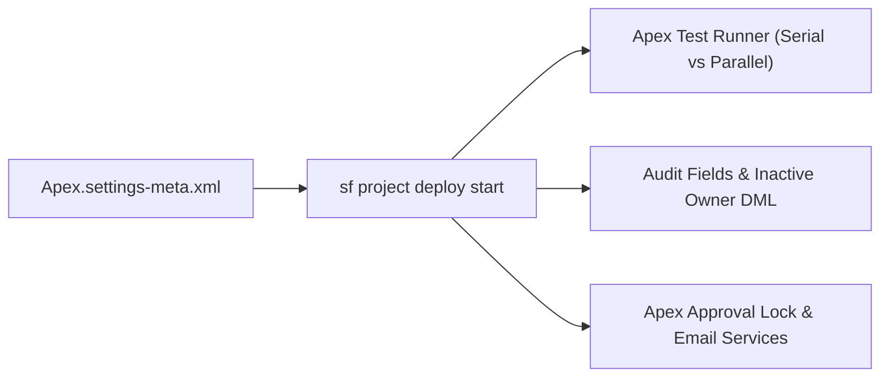

## Architectural Overview

The `ApexSettings` metadata type controls critical org-wide switches for the Apex runtime, unit test execution engine, inbound email handlers, and historical data migration capabilities. For a Senior Salesforce Architect, version-controlling `Apex.settings-meta.xml` is essential for deterministic CI/CD pipelines and data migration cutovers.

For example, when migrating legacy records into Salesforce and populating `CreatedDate`, `CreatedById`, or `LastModifiedDate`, an architect must enable `enableAuditFieldsInactiveOwner` in `ApexSettings` before granting the corresponding system permissions inside a [PermissionSet](/docs/metadata/permission-set-metadata-type/). Similarly, controlling `enableDisableParallelApexTesting` prevents or exposes `UNABLE_TO_LOCK_ROW` contention during automated test runs.



## Directory Location and File Suffix

| Property | Value |
| :--- | :--- |
| **Metadata Type Name** | `Settings` (member: `Apex`) |
| **XML Root Element** | `<ApexSettings>` |
| **SFDX Directory** | `force-app/main/default/settings/` |
| **File Name & Suffix** | `Apex.settings-meta.xml` |

## Key Metadata Fields

| Field | Type | Description & Architectural Significance |
| :--- | :--- | :--- |
| `enableAggregateCodeCoverageOnly` | `boolean` | Stores only aggregate code coverage totals rather than line-by-line coverage during test runs, speeding up large test suites at the cost of line-level detail. |
| `enableApexAccessRightsPref` | `boolean` | Enforces explicit user profile or permission set access checks for `@AuraEnabled` and REST-exposed [ApexClass](/docs/metadata/apex-class-metadata-type/) methods. |
| `enableApexApprovalLockUnlock` | `boolean` | Allows Apex code to lock and unlock records programmatically using `Approval.lock()` and `Approval.unlock()` methods. |
| `enableAuditFieldsInactiveOwner` | `boolean` | Unlocks the org preference allowing Permission Sets and Profiles to grant "Set Audit Fields upon Record Creation" and "Update Records with Inactive Owners". |
| `enableCompileOnDeploy` | `boolean` | Compiles all Apex classes in the org during every deployment to prevent runtime compilation latency for end users after major releases. |
| `enableDisableParallelApexTesting` | `boolean` | When set to `true`, disables parallel Apex test execution so unit tests run serially (preventing shared-record row lock errors in poorly isolated tests). |
| `enableDoNotEmailDebugLog` | `boolean` | Suppresses unhandled exception emails originating from managed package code when subscriber debug logging is active. |
| `enableEmailToApexSubdomain` | `boolean` | Appends a sandbox-specific subdomain to generated Email-to-Apex service addresses. |
| `enableFasterDeployment` | `boolean` | Optimizes Apex compilation and validation phases during Metadata API deployments. |
| `enableFtMav` | `boolean` | Enforces minimum API version validation rules on Apex components when required by platform updates. |
| `enableGaplessTestAutoNum` | `boolean` | Prevents unit tests from incrementing auto-number field sequences on real org records when test records are rolled back. |

> [!WARNING]
> Pay close attention to `enableDisableParallelApexTesting`. Because the underlying UI checkbox is named **Disable Parallel Apex Testing**, setting `<enableDisableParallelApexTesting>true</enableDisableParallelApexTesting>` **disables** parallel testing and forces serial execution!

## Declarative XML and Package Manifest Examples

Below is an architect-recommended `Apex.settings-meta.xml` configuration that enables `Approval.lock()`/`unlock()`, protects auto-number sequences from unit test gaps, enables audit field permissions, and keeps parallel testing active (`enableDisableParallelApexTesting` set to `false`).

```xml title="force-app/main/default/settings/Apex.settings-meta.xml"
<?xml version="1.0" encoding="UTF-8"?>
<ApexSettings xmlns="http://soap.sforce.com/2006/04/metadata">
    <enableAggregateCodeCoverageOnly>false</enableAggregateCodeCoverageOnly>
    <enableApexAccessRightsPref>true</enableApexAccessRightsPref>
    <enableApexApprovalLockUnlock>true</enableApexApprovalLockUnlock>
    <enableAuditFieldsInactiveOwner>true</enableAuditFieldsInactiveOwner>
    <enableCompileOnDeploy>true</enableCompileOnDeploy>
    <enableDisableParallelApexTesting>false</enableDisableParallelApexTesting>
    <enableGaplessTestAutoNum>true</enableGaplessTestAutoNum>
</ApexSettings>
```

```xml title="manifest/package.xml"
<?xml version="1.0" encoding="UTF-8"?>
<Package xmlns="http://soap.sforce.com/2006/04/metadata">
    <types>
        <members>Apex</members>
        <name>Settings</name>
    </types>
    <version>68.0</version>
</Package>
```

## SFDX CLI Retrieval and Scratch Org Configuration

Retrieve or deploy `ApexSettings` directly with the Salesforce CLI:

```bash
# Retrieve ApexSettings from your org
sf project retrieve start --metadata Settings:Apex --target-org my-org

# Deploy ApexSettings to target org
sf project deploy start --metadata Settings:Apex --target-org my-org
```

You can also inject `ApexSettings` directly into `config/project-scratch-def.json` so every new scratch org inherits these preferences at creation time:

```json title="config/project-scratch-def.json"
{
  "orgName": "Enterprise Architecture Scratch Org",
  "edition": "Developer",
  "settings": {
    "apexSettings": {
      "enableApexApprovalLockUnlock": true,
      "enableAuditFieldsInactiveOwner": true,
      "enableDisableParallelApexTesting": false,
      "enableGaplessTestAutoNum": true
    }
  }
}
```

## Senior Architect Best Practices and Gotchas

1. **Always Enable `enableGaplessTestAutoNum`:** Without this setting, every time a developer or CI job runs Apex unit tests that insert records with Auto-Number fields (like `CaseNumber` or `Invoice_Number__c`), the sequence counter increments permanently even though the test transaction rolls back. Enabling `enableGaplessTestAutoNum` isolates test auto-numbers from production sequences.
2. **Dependency Order with `PermissionSet`:** If a `PermissionSet` in your repository includes `<userPermissions><name>CreateAuditFields</name><enabled>true</enabled></userPermissions>`, `Apex.settings-meta.xml` with `<enableAuditFieldsInactiveOwner>true</enableAuditFieldsInactiveOwner>` must be enabled in the org; otherwise, the permission set deployment fails with `Unknown user permission: CreateAuditFields`.
3. **Compile on Deploy Trade-offs:** Setting `enableCompileOnDeploy` to `true` is recommended for production cutovers so business users do not experience a freeze the first time a trigger runs after deployment, but keep it `false` in scratch orgs and CI validation sandboxes to keep deployment times fast.
