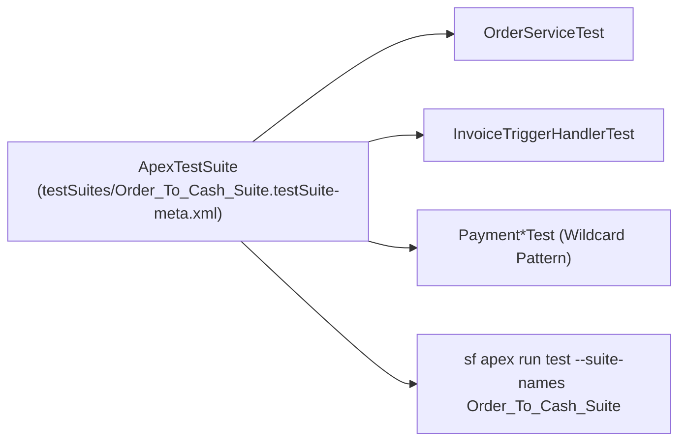

## Why the `ApexTestSuite` Metadata Type Accelerates Enterprise CI/CD

As a Salesforce org grows past hundreds of Apex classes, running `RunLocalTests` on every developer pull request creates multi-hour CI/CD bottlenecks. **`ApexTestSuite`** (`testSuites/<SuiteName>.testSuite-meta.xml`) lets architects curate domain-specific collections of Apex test classes (for example, `Order_To_Cash_Suite`, `CPQ_Pricing_Suite`, or `Nightly_Integration_Regression`) directly in version control.



---

## Key Metadata Fields on `ApexTestSuite`

| Field | Type | Required | Description |
|---|---|---|---|
| `testClassName` | `string[]` | No | List of [ApexClass](/docs/metadata/apex-class-metadata-type/) test names or wildcard patterns (`Order*Test`, `*`, `Namespace.*`) included in the suite. |

---

## Real-World XML Example (`testSuites/Order_To_Cash_Suite.testSuite-meta.xml`)

```xml
<?xml version="1.0" encoding="UTF-8"?>
<ApexTestSuite xmlns="http://soap.sforce.com/2006/04/metadata">
    <testClassName>OrderCreationServiceTest</testClassName>
    <testClassName>OrderTriggerHandlerTest</testClassName>
    <testClassName>InvoiceGenerationBatchTest</testClassName>
    <testClassName>PaymentGateway*Test</testClassName>
</ApexTestSuite>
```

---

## Running an `ApexTestSuite` with Salesforce CLI (`sf`)

```bash
# Run one or more ApexTestSuites asynchronously and wait 15 minutes for results
sf apex run test \
  --suite-names Order_To_Cash_Suite \
  --result-format human \
  --code-coverage \
  --wait 15
```

---

## Querying `ApexTestSuite` and `TestSuiteMembership` via SOQL

In the Salesforce database, suites are stored in `ApexTestSuite` and linked to `ApexClass` via the junction object `TestSuiteMembership`.

### 1. List All Apex Test Suites and Their Member Classes

```sql
SELECT Id, TestSuiteName,
       (SELECT ApexClassId, ApexClass.Name FROM TestSuiteMemberships)
FROM ApexTestSuite
ORDER BY TestSuiteName ASC
```

### 2. Find Test Classes That Are Not Included in Any `ApexTestSuite`

```sql
SELECT Id, Name, ApiVersion, LengthWithoutComments
FROM ApexClass
WHERE NamespacePrefix = null
  AND Name LIKE '%Test%'
  AND Id NOT IN (SELECT ApexClassId FROM TestSuiteMembership)
ORDER BY Name ASC
```

> [!TIP]
> **Audit Orphaned `*Test` Classes:** Running the second SOQL query above in your CI pipeline helps catch newly created `*Test` classes that developers forgot to add to their domain's `ApexTestSuite`!

