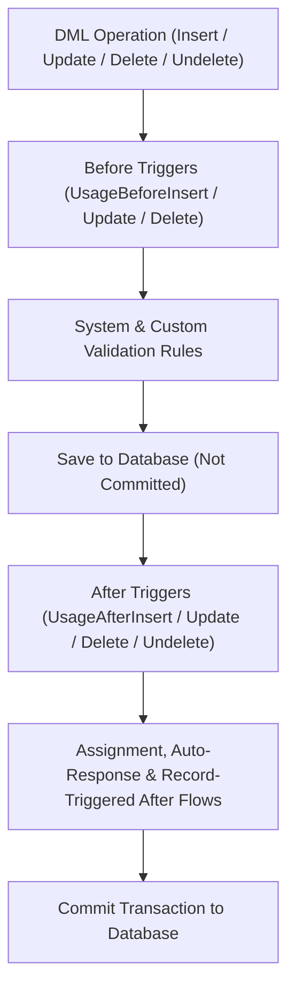

## Overview

The `ApexTrigger` metadata type represents an Apex trigger that executes before or after Data Manipulation Language (DML) operations (`insert`, `update`, `delete`, `undelete`) on a standard object, custom object (`__c`), platform event (`__e`), or Change Data Capture event (`*ChangeEvent`).

In a Salesforce DX project, each trigger is stored in `force-app/main/default/triggers/` as a pair of files: `TriggerName.trigger` (the executable Apex definition) and `TriggerName.trigger-meta.xml` (the Metadata API descriptor). Use the metadata descriptor to bind the trigger's `apiVersion` and toggle its `status` between `Active` and `Inactive` during bulk data migrations or emergency hotfixes. Always keep the trigger body minimal and delegate business logic to an [Apex Trigger Handler Pattern](/docs/apex/trigger-handler-pattern/) class.



In the Salesforce Order of Execution shown above, `ApexTrigger` components fire at two critical checkpoints: **Before Triggers** modify field values on `Trigger.new` without extra DML statements before validation rules run, and **After Triggers** read system-generated `Id` values and update related records after database save.

## Prerequisites

- **Permissions:** "Author Apex" and "Modify Metadata Through Metadata API Functions" permissions.
- **Target Object:** The target sObject, Platform Event, or Change Event must exist in the org.
- **API Version:** Verified against API version `68.0` (Winter '27).

## ApexTrigger XML Metadata Structure

The `TriggerName.trigger-meta.xml` file contains three configurable properties:

| XML Element | Type | Required | Valid Values & Architect Guidance |
| :--- | :--- | :--- | :--- |
| `apiVersion` | `double` | ✅ Yes | API version (e.g., `68.0`). Determines SOQL behavior and governor limit enforcement rules. |
| `status` | `ApexCodeUnitStatus` | ✅ Yes | `Active` (runs on DML), `Inactive` (compiled but disabled), or `Deleted` (removes trigger in managed package upgrades). |
| `packageVersions` | `PackageVersion[]` | No | Specifies the `namespace`, `majorNumber`, and `minorNumber` of referenced managed packages. |

> [!TIP]
> While you can set `<status>Inactive</status>` in `TriggerName.trigger-meta.xml` to disable a trigger during a data load, changing XML metadata in Production requires a deployment and test run. For zero-deployment control during data loads, build a hierarchy Custom Setting or Custom Metadata bypass switch inside your [Apex Trigger Handler Pattern](/docs/apex/trigger-handler-pattern/).

## Querying ApexTrigger via SOQL

The `ApexTrigger` object is available in **standard SOQL** and **Tooling API**, exposing boolean flags (`UsageBeforeInsert`, `UsageAfterUpdate`, etc.) for every DML event a trigger subscribes to.

### 1. Audit All Triggers and Their Subscribed DML Events on an Object
Run this standard SOQL query to inspect every trigger registered on `Account` or any custom object:

```soql
SELECT Id, Name, TableEnumOrId, Status, ApiVersion, IsValid,
       UsageBeforeInsert, UsageBeforeUpdate, UsageBeforeDelete,
       UsageAfterInsert, UsageAfterUpdate, UsageAfterDelete, UsageAfterUndelete,
       LengthWithoutComments
FROM ApexTrigger
WHERE TableEnumOrId = 'Account'
ORDER BY Name ASC
```

### 2. Detect Objects Violating the "One Trigger Per Object" Best Practice
Having multiple active triggers on the same object results in non-deterministic execution order. Use this query to find offending objects across your org:

```soql
SELECT TableEnumOrId, COUNT(Id) activeTriggerCount
FROM ApexTrigger
WHERE Status = 'Active'
  AND NamespacePrefix = null
GROUP BY TableEnumOrId
HAVING COUNT(Id) > 1
```

### 3. Find Invalid or Inactive Triggers in Production
Identify triggers that failed recompilation after a schema change or were left inactive after a migration:

```soql
SELECT Name, TableEnumOrId, Status, IsValid, LastModifiedBy.Name, LastModifiedDate
FROM ApexTrigger
WHERE Status = 'Inactive' OR IsValid = false
ORDER BY LastModifiedDate DESC
```

## Example

The following example shows a complete `InvoiceTrigger` metadata pair (`InvoiceTrigger.trigger` and `InvoiceTrigger.trigger-meta.xml`) paired with a bulk-safe unit test that satisfies Production deployment coverage rules.

```xml title="force-app/main/default/triggers/InvoiceTrigger.trigger-meta.xml"
<?xml version="1.0" encoding="UTF-8"?>
<ApexTrigger xmlns="http://soap.sforce.com/2006/04/metadata">
    <apiVersion>68.0</apiVersion>
    <status>Active</status>
</ApexTrigger>
```

```apex title="force-app/main/default/triggers/InvoiceTrigger.trigger"
trigger InvoiceTrigger on Account (
    before insert, before update, before delete,
    after insert, after update, after delete, after undelete
) {
    new AccountTriggerHandler().run();
}
```

```apex title="force-app/main/default/classes/InvoiceTriggerTest.cls"
@IsTest
private class InvoiceTriggerTest {

    @IsTest
    static void executesTriggerOnBulkInsert() {
        List<Account> accounts = new List<Account>();
        for (Integer i = 0; i < 200; i++) {
            accounts.add(new Account(Name = 'Billing Account ' + i));
        }

        Test.startTest();
        insert accounts;
        Test.stopTest();

        Integer countInserted = [SELECT COUNT() FROM Account WHERE Name LIKE 'Billing Account %'];
        Assert.areEqual(200, countInserted, 'All 200 accounts should be processed by the trigger');
    }
}
```

Deploy only the trigger and run its specific test class in Production:

```bash
sf project deploy start \
  --metadata ApexTrigger:InvoiceTrigger \
  --test-level RunSpecifiedTests \
  --tests InvoiceTriggerTest \
  --target-org Production
```

## Limits and Gotchas

- **Zero-Coverage Deployment Failure:** Even if your org has 95% overall Apex test coverage, deploying an active `ApexTrigger` with **0% test coverage** causes the Production deployment to fail immediately.
- **200-Record Batch Chunks:** Salesforce invokes an `ApexTrigger` with at most **200 records** per chunk (`Trigger.new` size ≤ 200). For Platform Event triggers (`__e`), the maximum batch size is **2,000 event messages** per invocation (configurable down to 1 via `PlatformEventSubscriberConfig`).
- **Shared Governor Limits:** Every trigger on an object shares the single transaction's governor limits (100 synchronous SOQL queries, 150 DML statements, 10,000毫秒 CPU time) with all other triggers, record-triggered Flows, and Apex classes in the save order.
- **No Wildcard Filtering by Object:** In `package.xml`, `<members>*</members>` under `<name>ApexTrigger</name>` retrieves every trigger in the org; you cannot write `<members>Account.*</members>`.

## Related Official Documentation

- [ApexTrigger Metadata API Reference](https://developer.salesforce.com/docs/atlas.en-us.api_meta.meta/api_meta/meta_triggers.htm): XML format, `status` options, and manifest configuration.
- [ApexTrigger Object Reference](https://developer.salesforce.com/docs/atlas.en-us.object_reference.meta/object_reference/sforce_api_objects_apextrigger.htm): Querying trigger event flags (`UsageBeforeInsert`, `TableEnumOrId`) via SOQL.
- [Triggers and Order of Execution](https://developer.salesforce.com/docs/atlas.en-us.apexcode.meta/apexcode/apex_triggers_order_of_execution.htm): Complete transactional save order reference.
