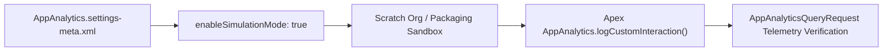

## Architectural Overview

The `AppAnalyticsSettings` metadata type manages org-level preferences for AppExchange AppAnalytics, Salesforce's telemetry service for Second-Generation Managed Packages (2GP) and First-Generation Managed Packages (1GP). For ISV Technical Architects and enterprise teams building internal multi-org packages, `AppAnalyticsSettings` enables simulation and validation of custom usage tracking (`AppAnalytics.logCustomInteraction()`) inside scratch orgs before releasing a package version.



## Directory Location and File Suffix

| Property | Value |
| :--- | :--- |
| **Metadata Type Name** | `Settings` (member: `AppAnalytics`) |
| **XML Root Element** | `<AppAnalyticsSettings>` |
| **SFDX Directory** | `force-app/main/default/settings/` |
| **File Name & Suffix** | `AppAnalytics.settings-meta.xml` |

## Key Metadata Fields

| Field | Type | Description & Architectural Significance |
| :--- | :--- | :--- |
| `enableSimulationMode` | `boolean` | Enables AppAnalytics simulation mode in a scratch org or developer org, allowing developers to test `AppAnalytics.logCustomInteraction()` calls without requiring a full License Management Org (LMO) connection. |

## Declarative XML and Package Manifest Examples

The following example enables `enableSimulationMode` for an ISV scratch org development pipeline:

```xml title="force-app/main/default/settings/AppAnalytics.settings-meta.xml"
<?xml version="1.0" encoding="UTF-8"?>
<AppAnalyticsSettings xmlns="http://soap.sforce.com/2006/04/metadata">
    <enableSimulationMode>true</enableSimulationMode>
</AppAnalyticsSettings>
```

```xml title="manifest/package.xml"
<?xml version="1.0" encoding="UTF-8"?>
<Package xmlns="http://soap.sforce.com/2006/04/metadata">
    <types>
        <members>AppAnalytics</members>
        <name>Settings</name>
    </types>
    <version>68.0</version>
</Package>
```

You can also configure `appAnalyticsSettings` directly in your `config/project-scratch-def.json`:

```json title="config/project-scratch-def.json"
{
  "orgName": "ISV Package Telemetry Scratch Org",
  "edition": "Partner Developer",
  "features": ["AppAnalytics"],
  "settings": {
    "appAnalyticsSettings": {
      "enableSimulationMode": true
    }
  }
}
```

## Querying AppAnalyticsQueryRequest via SOQL

In your License Management Org (LMO), after AppAnalytics is enabled, query `AppAnalyticsQueryRequest` to monitor log generation jobs (`CustomEntityType`, `PackageUsageSummary`, `PackageUsageLog`, or `SubscriberSnapshot`):

```soql
SELECT Id, DataType, StartTime, EndTime, PackageIds,
       OrganizationIds, RequestState, DownloadUrl, DownloadExpirationTime
FROM AppAnalyticsQueryRequest
ORDER BY CreatedDate DESC
LIMIT 20
```

## Senior Architect Best Practices and Gotchas

1. **Exclude from Managed Package Artifacts:** Never package `AppAnalytics.settings-meta.xml` inside a 2GP or 1GP managed package. Keep it in an unpacked dev/config folder or in `project-scratch-def.json` for automated testing only.
2. **PII Prohibition in Custom Interactions:** When testing custom interaction logs with `enableSimulationMode`, verify that only non-PII interaction labels and UUIDs are passed to `AppAnalytics.logCustomInteraction()`. Passing subscriber record names or email addresses violates AppExchange security review requirements.
