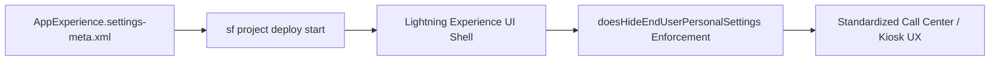

## Architectural Overview

The `AppExperienceSettings` metadata type represents org-level user interface settings that govern how users interact with the Lightning Experience App Launcher and personal navigation preferences. Enterprise architects use `AppExperience.settings-meta.xml` in regulated or kiosk-style call center orgs where end users should have a locked-down, standardized workspace without personal UI overrides.



## Directory Location and File Suffix

| Property | Value |
| :--- | :--- |
| **Metadata Type Name** | `Settings` (member: `AppExperience`) |
| **XML Root Element** | `<AppExperienceSettings>` |
| **SFDX Directory** | `force-app/main/default/settings/` |
| **File Name & Suffix** | `AppExperience.settings-meta.xml` |

## Key Metadata Fields

| Field | Type | Description & Architectural Significance |
| :--- | :--- | :--- |
| `doesHideEndUserPersonalSettings` | `boolean` | When `true`, hides personal settings customization options from end users to enforce a uniform Lightning interface across the org. |

> [!NOTE]
> Even if you lock personal tab customization at the [CustomApplication](/docs/metadata/custom-application-metadata-type/) level (`<isNavPersonalizationDisabled>true</isNavPersonalizationDisabled>`), `AppExperienceSettings` provides an org-wide governance toggle for the broader app experience.

## Declarative XML and Package Manifest Examples

The following example shows how to configure and deploy `AppExperience.settings-meta.xml` using `package.xml`:

```xml title="force-app/main/default/settings/AppExperience.settings-meta.xml"
<?xml version="1.0" encoding="UTF-8"?>
<AppExperienceSettings xmlns="http://soap.sforce.com/2006/04/metadata">
    <doesHideEndUserPersonalSettings>false</doesHideEndUserPersonalSettings>
</AppExperienceSettings>
```

```xml title="manifest/package.xml"
<?xml version="1.0" encoding="UTF-8"?>
<Package xmlns="http://soap.sforce.com/2006/04/metadata">
    <types>
        <members>AppExperience</members>
        <name>Settings</name>
    </types>
    <version>68.0</version>
</Package>
```

## SFDX CLI Retrieval and Deployment Commands

Retrieve and deploy `AppExperienceSettings` using the Salesforce CLI:

```bash
# Retrieve AppExperienceSettings from an org
sf project retrieve start --metadata Settings:AppExperience --target-org my-org

# Deploy AppExperienceSettings to production
sf project deploy start --metadata Settings:AppExperience --target-org my-prod-org
```

## Senior Architect Best Practices and Gotchas

1. **Combine with `CustomApplication` Nav Flags:** For contact center or retail store orgs where agents should never reorder or close navigation bar tabs, pair `AppExperienceSettings` with `<isNavPersonalizationDisabled>true</isNavPersonalizationDisabled>` and `<isNavAutoTempTabsDisabled>true</isNavAutoTempTabsDisabled>` on your [CustomApplication](/docs/metadata/custom-application-metadata-type/) definitions.
2. **Test with Standard User Personas:** Administrators with "Modify All Data" or "Customize Application" permissions may still see setup and personal menus in Lightning Experience. Always validate `doesHideEndUserPersonalSettings` by logging in as a standard user profile.
