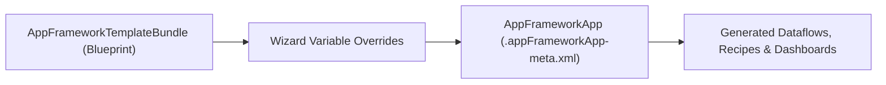

## Architectural Overview

The `AppFrameworkApp` metadata type represents a deployed application instance generated by the Salesforce App Framework from an `AppFrameworkTemplateBundle`. When an organization installs an Industry Cloud analytics template, a Data Cloud starter kit, or a custom templated app, `AppFrameworkApp` captures the chosen wizard variable values, the source template reference, and the deployment state of the generated assets.

Architecturally, separating the template (`AppFrameworkTemplateBundle`) from the instance (`AppFrameworkApp`) enables multi-region or multi-brand organizations to instantiate the same analytical blueprint multiple times with region-specific filter variables while upgrading all instances cleanly when the underlying template evolves.



## Directory Location and File Suffix

| Property | Value |
| :--- | :--- |
| **Metadata Type Name** | `AppFrameworkApp` |
| **XML Root Element** | `<AppFrameworkApp>` |
| **SFDX Directory** | `force-app/main/default/appFrameworkApps/` |
| **File Suffix** | `.appFrameworkApp-meta.xml` |

## Key Metadata Fields

| Field | Type | Required | Description & Architectural Significance |
| :--- | :--- | :--- | :--- |
| `masterLabel` | `string` | Yes | The user-facing name of the instantiated application. |
| `templateSourceId` | `string` | Yes | The developer name (or namespace-qualified name) of the `AppFrameworkTemplateBundle` used to construct this app. |
| `templateVersion` | `string` | No | Tracks the version number of the template from which the app was generated or last upgraded. |
| `description` | `string` | No | Describes the business unit, region, or configuration purpose of this application instance. |
| `status` | `string` | No | Reflects the current construction status of the templated app (such as `Completed`, `InProgress`, or `Failed`). |
| `templateValues` | `string` | No | Serialized JSON or key-value map of the configuration variables supplied when instantiating the template. |

## Declarative XML and Package Manifest Examples

Below is an example of an `AppFrameworkApp` metadata definition instantiating a Revenue Intelligence template for the EMEA region:

```xml title="force-app/main/default/appFrameworkApps/EMEA_Revenue_Intelligence_App.appFrameworkApp-meta.xml"
<?xml version="1.0" encoding="UTF-8"?>
<AppFrameworkApp xmlns="http://soap.sforce.com/2006/04/metadata">
    <masterLabel>EMEA Revenue Intelligence App</masterLabel>
    <description>Instantiated Revenue Intelligence app scoped to EMEA fiscal calendar and EUR currency.</description>
    <templateSourceId>Enterprise_Revenue_Template</templateSourceId>
    <templateVersion>2.0</templateVersion>
</AppFrameworkApp>
```

```xml title="manifest/package.xml"
<?xml version="1.0" encoding="UTF-8"?>
<Package xmlns="http://soap.sforce.com/2006/04/metadata">
    <types>
        <members>EMEA_Revenue_Intelligence_App</members>
        <name>AppFrameworkApp</name>
    </types>
    <version>68.0</version>
</Package>
```

## SFDX CLI Retrieval and Deployment Commands

Retrieve and deploy `AppFrameworkApp` instances using the Salesforce CLI:

```bash
# Retrieve an AppFrameworkApp definition from an org
sf project retrieve start \
  --metadata AppFrameworkApp:EMEA_Revenue_Intelligence_App \
  --target-org analytics-uat

# Deploy the template bundle and app instance together
sf project deploy start \
  --metadata AppFrameworkTemplateBundle:Enterprise_Revenue_Template AppFrameworkApp:EMEA_Revenue_Intelligence_App \
  --target-org analytics-prod
```

## Senior Architect Best Practices and Gotchas

1. **Validate Field-Level Security for Integration Users:** When an `AppFrameworkApp` is instantiated or upgraded, the platform's Analytics Cloud Integration User reads the Salesforce objects and fields specified in `templateValues`. If the Integration User's profile or permission set lacks Read access to even one referenced custom field, app construction fails with `Failed` status.
2. **Deploy Template Before App Instance:** Always ensure the `AppFrameworkTemplateBundle` (or the managed package providing it) is installed in the target org before deploying `AppFrameworkApp`.
3. **Avoid Manual Edits to Generated Assets:** If you customize a dashboard generated by an `AppFrameworkApp` directly in the UI rather than updating the template variables, subsequent template upgrades may overwrite your manual changes.
