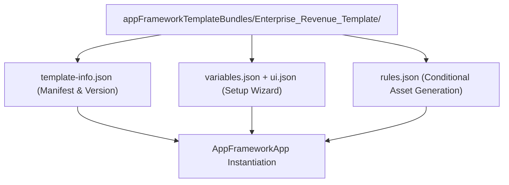

## Architectural Overview

The `AppFrameworkTemplateBundle` metadata type defines a multi-file application template bundle in the Salesforce App Framework. Much like [ExperienceBundle](/docs/metadata/experience-bundle-metadata-type/) or `WaveTemplateBundle`, an `AppFrameworkTemplateBundle` stores human-readable JSON files—such as `template-info.json`, `variables.json`, `ui.json`, and `rules.json`—inside a dedicated subfolder under `appFrameworkTemplateBundles/`.

For ISV partners and multi-org enterprise architects, `AppFrameworkTemplateBundle` solves the "schema variance" problem. Instead of hardcoding org-specific custom fields inside dashboards and recipes, the template bundle prompts the administrator through a guided setup wizard (`ui.json` + `variables.json`) and dynamically rewrites the generated assets using `rules.json` during `AppFrameworkApp` instantiation.



## Directory Location and Bundle Structure

| Property | Value |
| :--- | :--- |
| **Metadata Type Name** | `AppFrameworkTemplateBundle` |
| **XML Root Element** | `<AppFrameworkTemplateBundle>` |
| **SFDX Directory** | `force-app/main/default/appFrameworkTemplateBundles/<BundleName>/` |
| **Descriptor Suffix** | `<BundleName>.appFrameworkTemplateBundle-meta.xml` |

A typical bundle directory structure looks like this:

```text
force-app/main/default/appFrameworkTemplateBundles/Enterprise_Revenue_Template/
├── Enterprise_Revenue_Template.appFrameworkTemplateBundle-meta.xml
├── template-info.json
├── variables.json
├── ui.json
└── rules.json
```

## Key Metadata and Bundle Files

| File / Field | Type | Description & Architectural Significance |
| :--- | :--- | :--- |
| `masterLabel` | `string` | Display name of the template shown in the App Studio / Template Gallery. |
| `description` | `string` | Summary of the template's business capabilities and prerequisites. |
| `templateType` | `string` | Specifies the target application domain (`app`, `dashboard`, or `data`). |
| `template-info.json` | `JSON` | Defines template version (`releaseInfo`), icons, asset inventory, and references to `variables.json`, `ui.json`, and `rules.json`. |
| `variables.json` | `JSON` | Declares typed input variables (`SobjectFieldType`, `StringType`, `NumberType`, `BooleanType`) and default expressions. |
| `ui.json` | `JSON` | Organizes variables into wizard pages with conditional visibility expressions. |
| `rules.json` | `JSON` | Defines transformation macros (`set`, `replace`, `delete`, `add`) that mutate target recipes and dashboards based on user answers. |

## Declarative XML and Package Manifest Examples

Below is the root metadata XML file for `Enterprise_Revenue_Template` and the corresponding `package.xml` manifest:

```xml title="force-app/main/default/appFrameworkTemplateBundles/Enterprise_Revenue_Template/Enterprise_Revenue_Template.appFrameworkTemplateBundle-meta.xml"
<?xml version="1.0" encoding="UTF-8"?>
<AppFrameworkTemplateBundle xmlns="http://soap.sforce.com/2006/04/metadata">
    <masterLabel>Enterprise Revenue Intelligence Template</masterLabel>
    <description>Configurable multi-currency revenue and pipeline velocity template bundle.</description>
</AppFrameworkTemplateBundle>
```

```xml title="manifest/package.xml"
<?xml version="1.0" encoding="UTF-8"?>
<Package xmlns="http://soap.sforce.com/2006/04/metadata">
    <types>
        <members>Enterprise_Revenue_Template</members>
        <name>AppFrameworkTemplateBundle</name>
    </types>
    <version>68.0</version>
</Package>
```

## SFDX CLI Retrieval and Deployment Commands

Retrieve and deploy the entire `AppFrameworkTemplateBundle` directory using the Salesforce CLI:

```bash
# Retrieve the template bundle into your local SFDX project
sf project retrieve start \
  --metadata AppFrameworkTemplateBundle:Enterprise_Revenue_Template \
  --target-org template-dev-org

# Deploy changes after editing rules.json or variables.json
sf project deploy start \
  --source-dir force-app/main/default/appFrameworkTemplateBundles/Enterprise_Revenue_Template \
  --target-org template-uat-org
```

## Senior Architect Best Practices and Gotchas

1. **Bump `templateVersion` in `template-info.json`:** Whenever you modify `variables.json` or `rules.json` and want existing `AppFrameworkApp` instances to see an "Upgrade Available" prompt, increment the `templateVersion` string in `template-info.json`.
2. **Validate JSON Syntax in Pre-Commit Hooks:** A single trailing comma in `rules.json` or `variables.json` will cause the Metadata API deployment to fail with a generic bundle parsing error. Enforce `jq` or Prettier JSON validation in your Git pre-commit checks.
3. **Provide Safe Fallback Defaults in `variables.json`:** For headless CI/CD app creation where no human clicks through `ui.json`, ensure every required variable in `variables.json` has a valid `defaultValue` so automated `AppFrameworkApp` deployments succeed without manual input.
