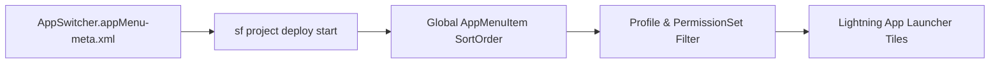

## Architectural Overview

The `AppMenu` metadata type defines the global sequence and default visibility of applications inside the Lightning Experience App Launcher (`AppSwitcher`), the Salesforce Mobile App (`Salesforce1`), and Experience Cloud navigation menus (`NetworkTabs`).

For a Senior Salesforce Architect, `AppMenu` ensures that newly onboarded users immediately see core business apps (such as a custom Commercial Banking Console or Field Service Portal) at the top-left of the App Launcher rather than buried beneath dozens of legacy standard apps like `Chatter`, `Content`, or `Community`.



## Directory Location and File Suffix

| Property | Value |
| :--- | :--- |
| **Metadata Type Name** | `AppMenu` |
| **XML Root Element** | `<AppMenu>` |
| **SFDX Directory** | `force-app/main/default/appMenus/` |
| **File Suffix** | `.appMenu-meta.xml` |
| **Standard File Names** | `AppSwitcher.appMenu-meta.xml`, `Salesforce1.appMenu-meta.xml`, `NetworkTabs.appMenu-meta.xml` |

## Key Metadata Fields

The `<AppMenu>` root element contains an ordered list of `<appMenuItems>` (`AppMenuItem`) elements. The position of each `<appMenuItems>` block in the XML file determines its global sort order:

| Field | Type | Required | Description & Architectural Significance |
| :--- | :--- | :--- | :--- |
| `appMenuItems` | `AppMenuItem[]` | No | Ordered array of menu items representing applications, connected apps, or tabs. |
| `appMenuItems.name` | `string` | Yes | The API name (`DeveloperName`) of the referenced [CustomApplication](/docs/metadata/custom-application-metadata-type/), [ConnectedApp](/docs/metadata/connected-app-metadata-type/), or standard tab. |
| `appMenuItems.type` | `AppMenuItemType` | Yes | Categorizes the referenced item. Valid values include `CustomApplication`, `ConnectedApp`, `ServiceProvider`, `StandardAppMenuItem`, and `TabSet`. |

> [!WARNING]
> `AppMenu` is a **monolithic** metadata file. Deploying `AppSwitcher.appMenu-meta.xml` requires every `<name>` referenced in the file to exist in the target org. If a sandbox has an extra Connected App or a missing AppExchange package compared to production, deployment will fail with `In field: name - no CustomApplication named X found`.

## Declarative XML and Package Manifest Examples

Below is a clean `AppSwitcher.appMenu-meta.xml` placing a custom `Commercial_Sales_Console` first in the App Launcher:

```xml title="force-app/main/default/appMenus/AppSwitcher.appMenu-meta.xml"
<?xml version="1.0" encoding="UTF-8"?>
<AppMenu xmlns="http://soap.sforce.com/2006/04/metadata">
    <appMenuItems>
        <name>Commercial_Sales_Console</name>
        <type>CustomApplication</type>
    </appMenuItems>
    <appMenuItems>
        <name>standard__LightningSales</name>
        <type>CustomApplication</type>
    </appMenuItems>
    <appMenuItems>
        <name>standard__LightningService</name>
        <type>CustomApplication</type>
    </appMenuItems>
    <appMenuItems>
        <name>Chatter_Desktop</name>
        <type>ConnectedApp</type>
    </appMenuItems>
    <appMenuItems>
        <name>Salesforce_to_Salesforce</name>
        <type>StandardAppMenuItem</type>
    </appMenuItems>
</AppMenu>
```

```xml title="manifest/package.xml"
<?xml version="1.0" encoding="UTF-8"?>
<Package xmlns="http://soap.sforce.com/2006/04/metadata">
    <types>
        <members>AppSwitcher</members>
        <members>Salesforce1</members>
        <name>AppMenu</name>
    </types>
    <version>68.0</version>
</Package>
```

## Querying AppMenuItem via SOQL

Because `AppMenu` maps directly to the standard `AppMenuItem` sObject, you can audit the current App Launcher order and visibility using standard SOQL:

```soql
SELECT Id, Name, Label, Type, SortOrder, IsVisible, IsAccessible, ApplicationId
FROM AppMenuItem
ORDER BY SortOrder ASC
```

## Senior Architect Best Practices and Gotchas

1. **Do Not Track `AppSwitcher.appMenu-meta.xml` in Scratch Org Pipelines with Optional Packages:** Because Connected Apps (`CPQ`, `Docusign`, `Slack`) vary across environments, many enterprise teams exclude `AppSwitcher.appMenu-meta.xml` from `.forceignore` during scratch org builds and only deploy it to staging/production release branches.
2. **Enforce Access via Permission Sets, Not AppMenu:** Setting an item's visibility in the App Menu UI only hides its tile from the App Launcher drawer; users with the direct URL can still access the app unless `applicationVisibilities` in their [Profile](/docs/metadata/profile-metadata-type/) or [PermissionSet](/docs/metadata/permission-set-metadata-type/) revokes access.
3. **`Salesforce1` Menu Controls Mobile Navigation:** In `Salesforce1.appMenu-meta.xml`, the top 4 items become the persistent bottom navigation bar in the Salesforce Mobile App for users browsing mobile-only navigation. Place your highest-frequency mobile items (`Events`, `Tasks`, `Dashboards`) at the top of `Salesforce1.appMenu-meta.xml`.
