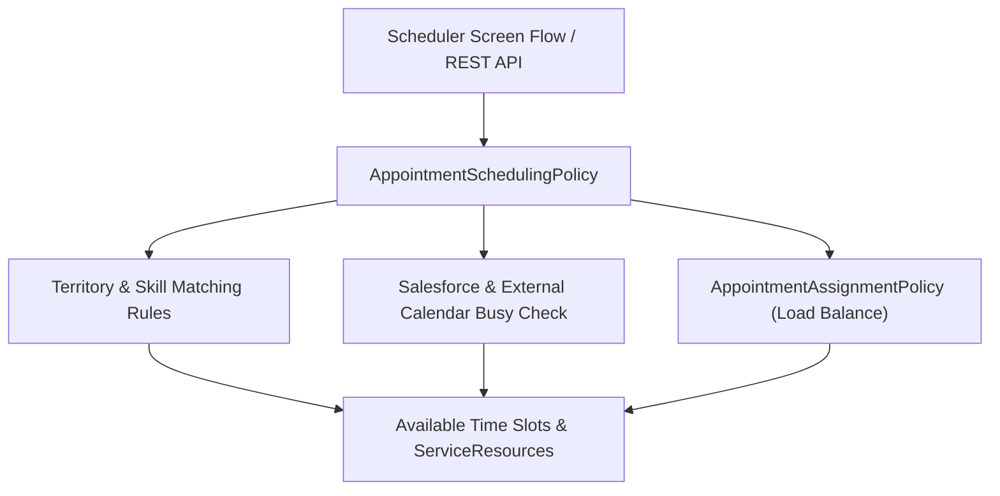

## Architectural Overview

The `AppointmentSchedulingPolicy` metadata type is the central rule engine for **Salesforce Scheduler**. Whenever a customer or contact center agent invokes a Salesforce Scheduler [Flow](/docs/metadata/flow-metadata-type/) or the `/connect/scheduling/available-territory-slots` REST API, the referenced `AppointmentSchedulingPolicy` dictates how candidate time slots and resources are filtered.

Architecturally, `AppointmentSchedulingPolicy` controls whether the engine checks standard Salesforce Calendar `Event` records, external Exchange/Google calendars, exact skill level thresholds, primary versus secondary service territories, and resource load-balancing policies.



## Directory Location and File Suffix

| Property | Value |
| :--- | :--- |
| **Metadata Type Name** | `AppointmentSchedulingPolicy` |
| **XML Root Element** | `<AppointmentSchedulingPolicy>` |
| **SFDX Directory** | `force-app/main/default/appointmentSchedulingPolicies/` |
| **File Suffix** | `.appointmentSchedulingPolicy-meta.xml` |

## Key Metadata Fields

| Field | Type | Required | Description & Architectural Significance |
| :--- | :--- | :--- | :--- |
| `masterLabel` | `string` | Yes | The display label of the scheduling policy in Setup. |
| `appointmentAssignmentPolicy` | `string` | No | Developer name of the `AppointmentAssignmentPolicy` used to balance resource utilization. |
| `appointmentStartTimeInterval` | `string` | Yes | Interval in minutes between offered slot start times (`5`, `10`, `15`, `20`, `30`, `45`, `60`, etc.). |
| `extCalEventHandler` | `string` | No | Name of an [ApexClass](/docs/metadata/apex-class-metadata-type/) implementing `LxScheduler.ServiceResourceScheduleHandler` to check external calendar availability. |
| `isIncludeEmptyResource` | `boolean` | No | Determines whether resources without explicit operating hours inherit territory operating hours. |
| `isOrgCalendarUsed` | `boolean` | Yes | Checks the service resource's Salesforce Calendar (`Event` object) for conflicting busy events. |
| `isPrimaryMemberUsed` | `boolean` | Yes | Allows scheduling with primary `ServiceTerritoryMember` resources. |
| `isRelocationUsed` | `boolean` | Yes | Considers relocated (`Relocation` type) `ServiceTerritoryMember` records for temporary branch coverage. |
| `isSecondaryMemberUsed` | `boolean` | Yes | Allows scheduling with secondary `ServiceTerritoryMember` resources. |
| `isSkillHierarchyUsed` | `boolean` | Yes | Enforces skill level comparison when matching `SkillRequirement` records against `ServiceResourceSkill`. |
| `isSkillUsed` | `boolean` | Yes | Enforces skill matching between the `WorkType` and the `ServiceResource`. |
| `isTerritoryMembershipUsed` | `boolean` | Yes | Restricts candidate resources to active members of the selected `ServiceTerritory`. |

## Declarative XML and Package Manifest Examples

The following example configures a retail banking scheduling policy with 30-minute start intervals, Salesforce calendar conflict checking, skill enforcement, and load balancing:

```xml title="force-app/main/default/appointmentSchedulingPolicies/Retail_Branch_Scheduling_Policy.appointmentSchedulingPolicy-meta.xml"
<?xml version="1.0" encoding="UTF-8"?>
<AppointmentSchedulingPolicy xmlns="http://soap.sforce.com/2006/04/metadata">
    <appointmentAssignmentPolicy>Advisor_Duration_Load_Balance</appointmentAssignmentPolicy>
    <appointmentStartTimeInterval>30</appointmentStartTimeInterval>
    <isOrgCalendarUsed>true</isOrgCalendarUsed>
    <isPrimaryMemberUsed>true</isPrimaryMemberUsed>
    <isRelocationUsed>true</isRelocationUsed>
    <isSecondaryMemberUsed>false</isSecondaryMemberUsed>
    <isSkillHierarchyUsed>true</isSkillHierarchyUsed>
    <isSkillUsed>true</isSkillUsed>
    <isTerritoryMembershipUsed>true</isTerritoryMembershipUsed>
    <masterLabel>Retail Branch Scheduling Policy</masterLabel>
</AppointmentSchedulingPolicy>
```

```xml title="manifest/package.xml"
<?xml version="1.0" encoding="UTF-8"?>
<Package xmlns="http://soap.sforce.com/2006/04/metadata">
    <types>
        <members>Advisor_Duration_Load_Balance</members>
        <name>AppointmentAssignmentPolicy</name>
    </types>
    <types>
        <members>Retail_Branch_Scheduling_Policy</members>
        <name>AppointmentSchedulingPolicy</name>
    </types>
    <version>68.0</version>
</Package>
```

## Querying AppointmentSchedulingPolicy via SOQL

Audit all scheduling policies in your org using standard SOQL:

```soql
SELECT Id, DeveloperName, MasterLabel, AppointmentStartTimeInterval,
       IsOrgCalendarUsed, IsSkillUsed, IsSkillHierarchyUsed,
       IsTerritoryMembershipUsed, ExtCalEventHandlerId
FROM AppointmentSchedulingPolicy
ORDER BY DeveloperName
```

## Senior Architect Best Practices and Gotchas

1. **External Calendar Handler Timeouts:** When binding an Apex class to `extCalEventHandler`, remember that synchronous callouts to Microsoft Graph or Google Calendar execute during live slot generation. Implement aggressive caching or batch availability queries so slot loading stays under 3 seconds.
2. **Keep `appointmentStartTimeInterval` Coarse for High-Volume Portals:** Setting `appointmentStartTimeInterval` to `5` or `10` minutes across hundreds of service resources multiplies the CPU cost of slot calculation. Use `30` or `60` minutes for public Experience Cloud guest scheduling flows.
3. **Include Dependent Apex and Assignment Policies:** If your `AppointmentSchedulingPolicy` references both an `appointmentAssignmentPolicy` and an `extCalEventHandler` Apex class, deploy all three components in the same package manifest.
