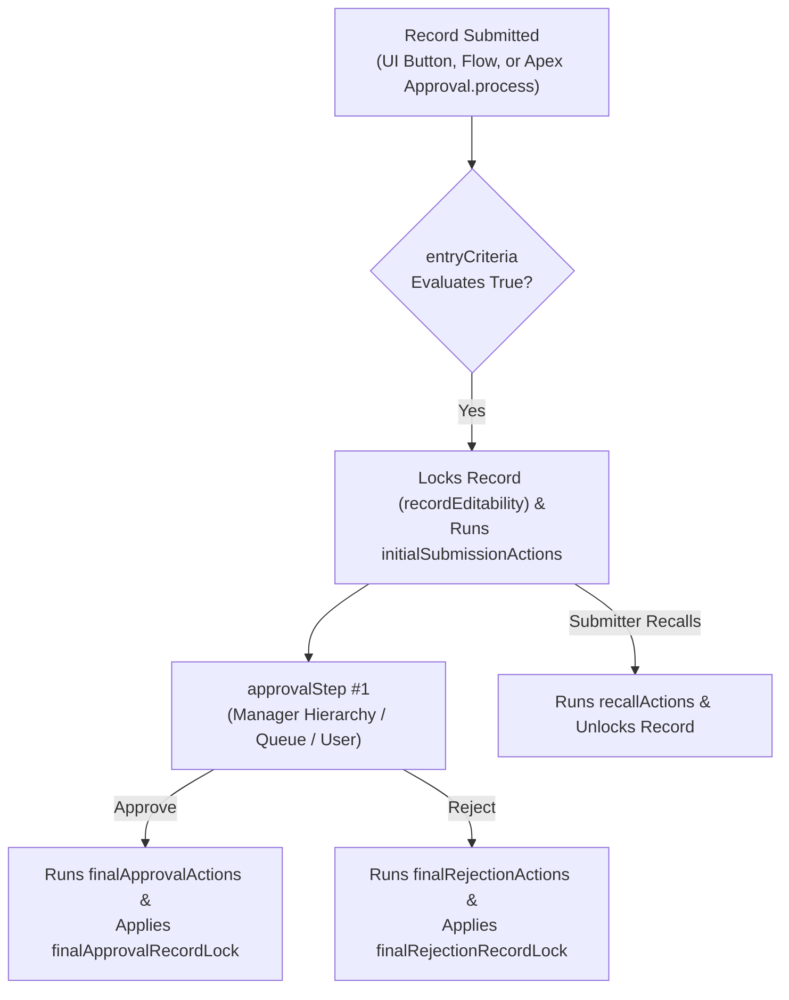

The `ApprovalProcess` metadata type automates multi-step sign-off workflows for Salesforce records—governing who can submit a record (`allowedSubmitters`), which criteria qualify a record (`entryCriteria`), how records are locked during review (`recordEditability`, `finalApprovalRecordLock`), and which approvers or [Queue](/docs/metadata/queue-metadata-type/) members review each of up to **30** sequential or unanimous `<approvalStep>` stages.

In Salesforce DX projects, approval processes are stored in `force-app/main/default/approvalProcesses/` using the `<ObjectName>.<ProcessName>.approvalProcess-meta.xml` naming format.



## Key Metadata Fields

| Field | Type | Required | Description |
|---|---|---|---|
| `label` | `string` | Yes | UI display name of the approval process |
| `active` | `boolean` | Yes | Whether the approval process is active (`true`) or inactive (`false`) |
| `recordEditability` | `RecordEditabilityType` | Yes | Who can edit locked pending records: `AdminOnly` or `AdminOrCurrentApprover` |
| `allowRecall` | `boolean` | No | Allows the original submitter to recall a pending submission |
| `entryCriteria` | `ApprovalEntryCriteria` | No | `criteriaItems` (+ `booleanFilter`) or `formula` qualifying records for this process |
| `allowedSubmitters` | `ApprovalSubmitter[]` | No | Who can submit records (`owner`, `creator`, `role`, `group`, `user`) |
| `nextAutomatedApprover` | `NextAutomatedApprover` | No | User hierarchy field (such as `Manager`) used for automatic routing |
| `approvalPageFields` | `ApprovalPageField` | No | Fields displayed to the approver on the approval decision screen |
| `approvalStep` | `ApprovalStep[]` | No | Up to 30 ordered approval steps (`name`, `stepNumber`, `entryCriteria`, `assignedApprover`, `rejectBehavior`) |
| `initialSubmissionActions` / `finalApprovalActions` / `finalRejectionActions` / `recallActions` | `ApprovalAction` | No | Field updates, email alerts, or outbound messages executed at each lifecycle transition |
| `finalApprovalRecordLock` / `finalRejectionRecordLock` | `boolean` | No | Whether the record remains locked (`true`) or unlocks (`false`) after completion |

## Production-Grade XML Example

Below is an `ApprovalProcess` on `Opportunity` (`Opportunity.Enterprise_Discount_Approval_v1.approvalProcess-meta.xml`) that routes discounts over 20% to the submitter's `Manager` and escalates discounts over 40% to a Deal Desk Queue in Step 2:

```xml
<?xml version="1.0" encoding="UTF-8"?>
<ApprovalProcess xmlns="http://soap.sforce.com/2006/04/metadata">
    <active>true</active>
    <allowRecall>true</allowRecall>
    <allowedSubmitters>
        <type>owner</type>
    </allowedSubmitters>
    <approvalPageFields>
        <field>Name</field>
        <field>Owner</field>
        <field>Amount</field>
        <field>Discount_Percent__c</field>
    </approvalPageFields>
    <approvalStep>
        <allowDelegate>true</allowDelegate>
        <assignedApprover>
            <approver>
                <type>userHierarchyField</type>
            </approver>
        </assignedApprover>
        <label>Step 1 - Sales Manager Review</label>
        <name>Step_1_Sales_Manager_Review</name>
    </approvalStep>
    <approvalStep>
        <allowDelegate>false</allowDelegate>
        <assignedApprover>
            <approver>
                <name>Deal_Desk_Approvers_Queue</name>
                <type>queue</type>
            </approver>
            <whenMultipleApprovers>FirstResponse</whenMultipleApprovers>
        </assignedApprover>
        <entryCriteria>
            <criteriaItems>
                <field>Opportunity.Discount_Percent__c</field>
                <operation>greaterThan</operation>
                <value>40</value>
            </criteriaItems>
        </entryCriteria>
        <label>Step 2 - Deal Desk Executive Sign-off</label>
        <name>Step_2_Deal_Desk_Executive_Sign_off</name>
        <rejectBehavior>
            <type>RejectRequest</type>
        </rejectBehavior>
    </approvalStep>
    <description>Two-tier discount approval process for Opportunities exceeding 20% discount.</description>
    <enableMobileDeviceAccess>false</enableMobileDeviceAccess>
    <entryCriteria>
        <criteriaItems>
            <field>Opportunity.Discount_Percent__c</field>
            <operation>greaterThan</operation>
            <value>20</value>
        </criteriaItems>
    </entryCriteria>
    <finalApprovalRecordLock>true</finalApprovalRecordLock>
    <finalRejectionRecordLock>false</finalRejectionRecordLock>
    <label>Enterprise Discount Approval v1</label>
    <nextAutomatedApprover>
        <useApproverFieldOfRecordOwner>true</useApproverFieldOfRecordOwner>
        <userHierarchyField>Manager</userHierarchyField>
    </nextAutomatedApprover>
    <processOrder>1</processOrder>
    <recordEditability>AdminOnly</recordEditability>
    <showApprovalHistory>true</showApprovalHistory>
</ApprovalProcess>
```

> [!WARNING]
> **Activated Approval Steps Cannot Be Added or Reordered in Place**: Once an `ApprovalProcess` has been activated in Production, Salesforce permanently locks the number and order of its `<approvalStep>` elements—even if you set `<active>false</active>` first. Always append a version suffix (`_v1`, `_v2`) to your `ApprovalProcess` developer name when introducing new steps in CI/CD.

## Querying Approval Processes and Pending Approvals with SOQL

```sql
-- 1. Find all currently pending approval requests for a specific record or user
SELECT Id, ActorId, Actor.Name, OriginalActorId, ProcessInstanceId,
       ProcessInstance.TargetObjectId, ProcessInstance.Status, CreatedDate
FROM ProcessInstanceWorkitem
WHERE ProcessInstance.TargetObjectId = '006xx000001a2b3AAA'

-- 2. Audit full approval step history (Submitted, Approved, Rejected, Recalled)
SELECT Id, TargetObjectId, Status, ProcessDefinition.Name, ProcessDefinition.DeveloperName,
       (SELECT Id, StepStatus, Actor.Name, Comments, CreatedDate FROM StepsAndWorkitems ORDER BY CreatedDate DESC)
FROM ProcessInstance
WHERE TargetObjectId = '006xx000001a2b3AAA'
ORDER BY CreatedDate DESC
```

