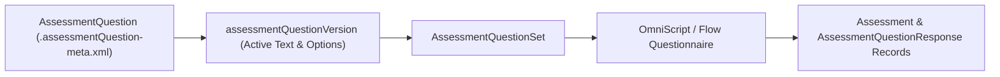

## Architectural Overview

The `AssessmentQuestion` metadata type defines a reusable, version-controlled intake or compliance question within the **Salesforce Discovery Framework** (used across Financial Services Cloud, Health Cloud, Public Sector Solutions, and Net Zero Cloud).

In regulated industries—such as mortgage underwriting, clinical patient intake, or KYC (Know Your Customer) onboarding—auditors require proof of the exact question text and picklist options presented to a customer at the time of application. `AssessmentQuestion` achieves this by pairing a parent question definition (containing `dataType` and `questionCategory`) with a child `<assessmentQuestionVersion>` block that tracks the active wording, response values, and status.



## Directory Location and File Suffix

| Property | Value |
| :--- | :--- |
| **Metadata Type Name** | `AssessmentQuestion` |
| **XML Root Element** | `<AssessmentQuestion>` |
| **SFDX Directory** | `force-app/main/default/assessmentQuestions/` |
| **File Suffix** | `.assessmentQuestion-meta.xml` |

## Key Metadata Fields

| Field | Type | Required | Description & Architectural Significance |
| :--- | :--- | :--- | :--- |
| `name` | `string` | Yes | Display name of the assessment question record. |
| `developerName` | `string` | Yes | Unique developer identifier used across APIs, `AssessmentQuestionSet`, and OmniStudio mappings. |
| `dataType` | `string` | Yes | Specifies the input control type (`Text`, `TextArea`, `Radio`, `Multiselect`, `Select`, `Number`, `Currency`, `Date`, `Checkbox`, `Email`, `Telephone`, `Formula`). |
| `questionCategory` | `string` | No | Categorizes the question by domain (for example, `Financial`, `Demographic`, `Clinical`, or `Compliance`). |
| `relatedQuestion` | `string` | No | Developer name of a parent `AssessmentQuestion` when modeling dependent or sub-questions. |
| `formulaResponseDataType` | `string` | No | Output data type when `dataType` is `Formula`. |
| `assessmentQuestionVersion` | `AssessmentQuestionVersion` | Yes | Nested version container defining `questionText`, `responseValues`, `helpText`, `isActive`, `status`, and `versionNumber`. |

## Declarative XML and Package Manifest Examples

Below is a production `AssessmentQuestion` for capturing a client's liquid net worth tier during KYC onboarding:

```xml title="force-app/main/default/assessmentQuestions/KYC_Liquid_Net_Worth_Tier.assessmentQuestion-meta.xml"
<?xml version="1.0" encoding="UTF-8"?>
<AssessmentQuestion xmlns="http://soap.sforce.com/2006/04/metadata">
    <assessmentQuestionVersion>
        <description>Captures applicant liquid net worth bracket for suitability verification.</description>
        <helpText>Include cash, marketable securities, and money market funds excluding primary residence.</helpText>
        <isActive>true</isActive>
        <name>KYC Liquid Net Worth Tier v1</name>
        <optionSourceResponseValue>false</optionSourceResponseValue>
        <questionText>What is the applicant&apos;s estimated liquid net worth?</questionText>
        <responseValues>Under 100K
100K to 500K
500K to 2M
Over 2M</responseValues>
        <status>Active</status>
        <versionNumber>1</versionNumber>
    </assessmentQuestionVersion>
    <dataType>Radio</dataType>
    <developerName>KYC_Liquid_Net_Worth_Tier</developerName>
    <name>KYC Liquid Net Worth Tier</name>
    <questionCategory>Financial</questionCategory>
</AssessmentQuestion>
```

```xml title="manifest/package.xml"
<?xml version="1.0" encoding="UTF-8"?>
<Package xmlns="http://soap.sforce.com/2006/04/metadata">
    <types>
        <members>KYC_Liquid_Net_Worth_Tier</members>
        <name>AssessmentQuestion</name>
    </types>
    <version>68.0</version>
</Package>
```

## Querying AssessmentQuestion via SOQL

Query active questions and their live versions in your org using standard SOQL:

```soql
SELECT Id, Name, DeveloperName, DataType, QuestionCategory,
       (SELECT Id, VersionNumber, Status, IsActive, QuestionText, ResponseValues
        FROM AssessmentQuestionVersions
        WHERE IsActive = true)
FROM AssessmentQuestion
ORDER BY QuestionCategory, DeveloperName
```

## Senior Architect Best Practices and Gotchas

1. **Newline-Separated `responseValues`:** In `<responseValues>`, each selectable option for `Radio`, `Select`, or `Multiselect` questions is separated by a newline character (`\n`) inside the XML tag. Avoid introducing leading or trailing spaces on individual lines, or OmniStudio value comparisons will fail.
2. **Enable Discovery Framework First:** Deploying `AssessmentQuestion` metadata fails if the target org does not have the **Discovery Framework** org preference enabled (`DiscoveryFrameworkPref` in `IndustriesSettings` or scratch org features).
3. **Immutable Active Versions in Production:** Once an `AssessmentQuestionVersion` has been activated (`<status>Active</status>`) in production and linked to customer `AssessmentQuestionResponse` records, create a new version (`versionNumber` 2) rather than mutating the response values of version 1.
