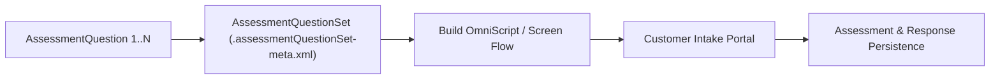

## Architectural Overview

The `AssessmentQuestionSet` metadata type defines a curated collection of `AssessmentQuestion` definitions within the **Salesforce Discovery Framework**. While `AssessmentQuestion` stores individual atomic questions, `AssessmentQuestionSet` assembles those questions into a reusable questionnaire (such as an "Institutional Investor Suitability Set" or "Annual Health Risk Assessment").

From an architectural perspective, `AssessmentQuestionSet` acts as the bridge between declarative compliance repositories and runtime UI engines (OmniScripts and Screen Flows), ensuring that multiple channels render the exact same set of regulated questions.



## Directory Location and File Suffix

| Property | Value |
| :--- | :--- |
| **Metadata Type Name** | `AssessmentQuestionSet` |
| **XML Root Element** | `<AssessmentQuestionSet>` |
| **SFDX Directory** | `force-app/main/default/assessmentQuestionSets/` |
| **File Suffix** | `.assessmentQuestionSet-meta.xml` |

## Key Metadata Fields

| Field | Type | Required | Description & Architectural Significance |
| :--- | :--- | :--- | :--- |
| `name` | `string` | Yes | The human-readable label of the assessment question set. |
| `developerName` | `string` | Yes | Unique developer API name for the question set across the org. |
| `assessmentQuestions` | `string[]` | No | Array of `<assessmentQuestions>` elements, each containing the `developerName` of a member `AssessmentQuestion`. |

## Declarative XML and Package Manifest Examples

Below is an `AssessmentQuestionSet` grouping three KYC compliance questions, paired with a `package.xml` that deploys both the questions and the set:

```xml title="force-app/main/default/assessmentQuestionSets/Institutional_KYC_Question_Set.assessmentQuestionSet-meta.xml"
<?xml version="1.0" encoding="UTF-8"?>
<AssessmentQuestionSet xmlns="http://soap.sforce.com/2006/04/metadata">
    <assessmentQuestions>KYC_Liquid_Net_Worth_Tier</assessmentQuestions>
    <assessmentQuestions>KYC_Source_Of_Funds</assessmentQuestions>
    <assessmentQuestions>KYC_Politically_Exposed_Person</assessmentQuestions>
    <developerName>Institutional_KYC_Question_Set</developerName>
    <name>Institutional KYC Question Set</name>
</AssessmentQuestionSet>
```

```xml title="manifest/package.xml"
<?xml version="1.0" encoding="UTF-8"?>
<Package xmlns="http://soap.sforce.com/2006/04/metadata">
    <types>
        <members>KYC_Liquid_Net_Worth_Tier</members>
        <members>KYC_Source_Of_Funds</members>
        <members>KYC_Politically_Exposed_Person</members>
        <name>AssessmentQuestion</name>
    </types>
    <types>
        <members>Institutional_KYC_Question_Set</members>
        <name>AssessmentQuestionSet</name>
    </types>
    <version>68.0</version>
</Package>
```

## Querying AssessmentQuestionSet and Assignments via SOQL

You can inspect question sets and their assigned questions in any org using standard SOQL:

```soql
SELECT Id, Name, DeveloperName,
       (SELECT Id, AssessmentQuestion.DeveloperName, AssessmentQuestion.DataType
        FROM AssessmentQuestionAssignments)
FROM AssessmentQuestionSet
ORDER BY DeveloperName
```

## Senior Architect Best Practices and Gotchas

1. **Include All Child Questions in Deployment:** If an `AssessmentQuestionSet` lists a `<assessmentQuestions>` developer name that does not exist in the target org or deployment zip, the deployment fails with a missing dependency error.
2. **Include Dependent Parent Questions:** When an `AssessmentQuestion` has a `relatedQuestion` parent dependency, both the parent and child `AssessmentQuestion` must be included in the `AssessmentQuestionSet` so OmniScript generation can wire the conditional visibility logic properly.
3. **Domain-Scoped Question Sets:** Rather than creating one monolithic `AssessmentQuestionSet` with 150 questions, partition question sets into modular 15-to-25 question blocks (e.g., `Applicant_Identity_Set`, `Financial_Profile_Set`, `Regulatory_Disclosures_Set`) that can be reused across multiple OmniScripts.
