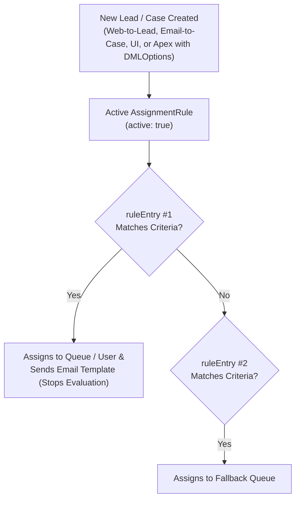

The `AssignmentRules` metadata type represents automated routing rules for **Lead** and **Case** records. Introduced in API version 27.0, `AssignmentRules` evaluates an ordered list of `<ruleEntry>` blocks from top to bottom and assigns the record's `OwnerId` (and optional Case Team or notification email template) to the first matching [Queue](/docs/metadata/queue-metadata-type/) or `User`.

In Salesforce DX projects, assignment rules are stored per object in `force-app/main/default/assignmentRules/Case.assignmentRules-meta.xml` and `Lead.assignmentRules-meta.xml`.



## Key Fields on `AssignmentRule` and `RuleEntry`

| Field | Location | Required | Description |
|---|---|---|---|
| `fullName` | `assignmentRule` | Yes | Name of the assignment rule |
| `active` | `assignmentRule` | No | Only **one** rule per object (`Lead` or `Case`) can have `<active>true</active>` at a time |
| `ruleEntry` | `assignmentRule` | No | Ordered array of routing entries evaluated sequentially |
| `assignedTo` | `ruleEntry` | No | Developer name of the target `Queue` or username of the target `User` |
| `assignedToType` | `ruleEntry` | No | `Queue` (recommended for CI/CD) or `User` |
| `criteriaItems` | `ruleEntry` | Conditional | Field filter conditions (`field`, `operation`, `value`)—mutually exclusive with `formula` |
| `booleanFilter` | `ruleEntry` | No | Filter logic combining `criteriaItems` (such as `1 AND (2 OR 3)`) |
| `formula` | `ruleEntry` | Conditional | Formula expression evaluating to `true`/`false`—mutually exclusive with `criteriaItems` |
| `template` | `ruleEntry` | No | Folder/name of the Classic Email Template sent to the new owner |
| `team` | `ruleEntry` | No | Predefined Case Team name(s) added to the Case |
| `overrideExistingTeams` | `ruleEntry` | No | Replaces (`true`) or appends (`false`) existing Case Teams |

## Production-Grade XML Example (`Case.assignmentRules-meta.xml`)

Below is a CI/CD-friendly `Case` assignment rule (`force-app/main/default/assignmentRules/Case.assignmentRules-meta.xml`) that routes critical cases to an engineering queue and falls back to a general triage queue:

```xml
<?xml version="1.0" encoding="UTF-8"?>
<AssignmentRules xmlns="http://soap.sforce.com/2006/04/metadata">
    <assignmentRule>
        <fullName>Global_Support_Case_Routing</fullName>
        <active>true</active>
        <ruleEntry>
            <assignedTo>Tier_3_Engineering_Queue</assignedTo>
            <assignedToType>Queue</assignedToType>
            <booleanFilter>1 AND 2</booleanFilter>
            <criteriaItems>
                <field>Case.Priority</field>
                <operation>equals</operation>
                <value>Critical,High</value>
            </criteriaItems>
            <criteriaItems>
                <field>Case.Origin</field>
                <operation>equals</operation>
                <value>Web,API</value>
            </criteriaItems>
            <overrideExistingTeams>false</overrideExistingTeams>
        </ruleEntry>
        <ruleEntry>
            <assignedTo>Tier_1_General_Support_Queue</assignedTo>
            <assignedToType>Queue</assignedToType>
            <formula>TRUE</formula>
            <overrideExistingTeams>false</overrideExistingTeams>
        </ruleEntry>
    </assignmentRule>
</AssignmentRules>
```

## Triggering `AssignmentRules` in Apex via `Database.DMLOptions`

A classic Salesforce interview question and production bug: **inserting a `Lead` or `Case` in Apex does not trigger active Assignment Rules by default**. You must attach `Database.DMLOptions`:

```java
public with sharing class InboundCaseIntakeService {
    public static Id createRoutedCase(String subject, String priority) {
        AssignmentRule activeRule = [
            SELECT Id
            FROM AssignmentRule
            WHERE SobjectType = 'Case' AND Active = true
            WITH SYSTEM_MODE
            LIMIT 1
        ];

        Database.DMLOptions dmlOpts = new Database.DMLOptions();
        dmlOpts.assignmentRuleHeader.assignmentRuleId = activeRule.Id;
        // Alternatively: dmlOpts.assignmentRuleHeader.useDefaultRule = true;

        Case newCase = new Case(
            Subject = subject,
            Priority = priority,
            Origin = 'API'
        );
        newCase.setOptions(dmlOpts);
        insert as user newCase;
        return newCase.Id;
    }
}
```

## Querying `AssignmentRule` with SOQL

```sql
-- List all Lead and Case AssignmentRules and verify which rule is currently active
SELECT Id, Name, SobjectType, Active, LastModifiedDate
FROM AssignmentRule
ORDER BY SobjectType, Active DESC, Name ASC
```

