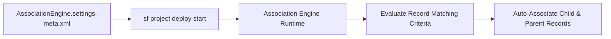

## Architectural Overview

The `AssociationEngineSettings` metadata type controls org-wide configuration for the **Salesforce Association Engine**, a declarative service used across Industry Clouds (including Financial Services Cloud, Automotive Cloud, and Health Cloud) to automatically associate incoming records (such as tasks, voice calls, emails, or leads) with parent accounts, households, or opportunities based on matching rules and preconditions.

By managing `AssociationEngine.settings-meta.xml` in source control, architects ensure that automated record-linking engines behave identically across development sandboxes, UAT, and production.



## Directory Location and File Suffix

| Property | Value |
| :--- | :--- |
| **Metadata Type Name** | `Settings` (member: `AssociationEngine`) |
| **XML Root Element** | `<AssociationEngineSettings>` |
| **SFDX Directory** | `force-app/main/default/settings/` |
| **File Name & Suffix** | `AssociationEngine.settings-meta.xml` |

## Key Metadata Fields

| Field | Type | Description & Architectural Significance |
| :--- | :--- | :--- |
| `enableAssociationEngine` | `boolean` | Master org toggle that enables or disables automated Association Engine rule evaluation across supported objects. |

## Declarative XML and Package Manifest Examples

Below is the declarative `AssociationEngine.settings-meta.xml` file and its `package.xml` manifest:

```xml title="force-app/main/default/settings/AssociationEngine.settings-meta.xml"
<?xml version="1.0" encoding="UTF-8"?>
<AssociationEngineSettings xmlns="http://soap.sforce.com/2006/04/metadata">
    <enableAssociationEngine>true</enableAssociationEngine>
</AssociationEngineSettings>
```

```xml title="manifest/package.xml"
<?xml version="1.0" encoding="UTF-8"?>
<Package xmlns="http://soap.sforce.com/2006/04/metadata">
    <types>
        <members>AssociationEngine</members>
        <name>Settings</name>
    </types>
    <version>68.0</version>
</Package>
```

## SFDX CLI Retrieval and Deployment Commands

Use the Salesforce CLI (`sf`) to retrieve and deploy `AssociationEngineSettings`:

```bash
# Retrieve AssociationEngineSettings from the target org
sf project retrieve start --metadata Settings:AssociationEngine --target-org my-org

# Deploy AssociationEngineSettings to target org
sf project deploy start --metadata Settings:AssociationEngine --target-org my-prod-org
```

## Senior Architect Best Practices and Gotchas

1. **Bypass During Bulk Historical Migrations:** When migrating millions of historical interaction or task records via Bulk API 2.0, temporarily set `enableAssociationEngine` to `false` (or pre-populate the target foreign keys in your ETL staging tables) to avoid asynchronous association queue backlogs.
2. **Avoid Overlapping Apex Triggers:** Before writing custom `after insert` triggers to link `Task`, `Event`, or `EngagementInteraction` records to Household Accounts, verify whether your Industry Cloud license already executes an Association Engine rule so you do not create duplicate relationship records or row lock contention.
