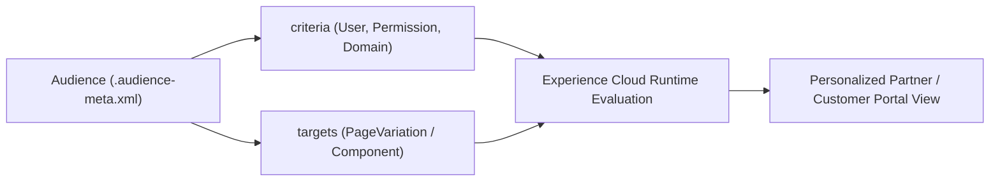

## Architectural Overview

The `Audience` metadata type defines personalization segments and targeting assignments for **Experience Cloud** sites. With `Audience`, architects can dynamically swap out entire page variations, individual Lightning Web Components, branding sets, or navigation menus inside an [ExperienceBundle](/docs/metadata/experience-bundle-metadata-type/) based on who the logged-in (or guest) user is.

Architecturally, `Audience` separates two responsibilities inside one metadata file:
1. **`criteria` (`AudienceCriteria`):** The targeting rules (User field values, Custom/Standard Permissions, Profile, Domain, or Geo-Location).
2. **`targets` (`PersonalizationTargetInfos`):** The exact Experience Cloud page variations, component instances, or CMS content items assigned to this segment.



## Directory Location and File Suffix

| Property | Value |
| :--- | :--- |
| **Metadata Type Name** | `Audience` |
| **XML Root Element** | `<Audience>` |
| **SFDX Directory** | `force-app/main/default/audiences/` |
| **File Suffix** | `.audience-meta.xml` |

## Key Metadata Fields

| Field | Type | Required | Description & Architectural Significance |
| :--- | :--- | :--- | :--- |
| `audienceName` | `string` | Yes | The human-readable name of the audience shown in Experience Builder. |
| `container` | `string` | Yes | The name of the Experience Cloud site (`Network` name) that owns this audience. |
| `description` | `string` | No | Documents the business persona and targeting logic for the audience. |
| `formulaFilterType` | `FormulaFilterType` | Yes | How multiple criteria are evaluated: `AllCriteriaMatch`, `AnyCriterionMatches`, or `CustomLogic`. |
| `formula` | `string` | No | Boolean filter logic (for example, `1 AND (2 OR 3)`) required when `formulaFilterType` is `CustomLogic`. |
| `criteria` | `AudienceCriteria` | No | Contains `<criterion>` items specifying `criteriaNumber`, `type` (`FieldBased`, `Permission`, `Profile`, `Domain`, `GeoLocation`), `operator`, and `criterionValue`. |
| `targets` | `PersonalizationTargetInfos` | No | Contains `<target>` mappings (`groupName`, `targetType`, `targetValue`, `publishStatus`, `priority`) linking the audience to Experience Cloud variations. |

> [!TIP]
> **Architect Golden Rule:** Avoid using `Profile` criteria in `Audience` definitions whenever possible. Instead, evaluate a `CustomPermission` (`<type>Permission</type>`) or a formula field on `User` (`<type>FieldBased</type>`). Custom Permissions are decoupled from Profiles and deploy cleanly across scratch orgs, sandboxes, and production.

## Declarative XML and Package Manifest Examples

Below is a production `Audience` targeting Gold Partner users who hold the `Gold_Partner_Portal_Access` custom permission and belong to an active partner account:

```xml title="force-app/main/default/audiences/Gold_Tier_Partners.audience-meta.xml"
<?xml version="1.0" encoding="UTF-8"?>
<Audience xmlns="http://soap.sforce.com/2006/04/metadata">
    <audienceName>Gold Tier Partners</audienceName>
    <container>Partner Central</container>
    <criteria>
        <criterion>
            <criteriaNumber>1</criteriaNumber>
            <criterionValue>
                <isEnabled>true</isEnabled>
                <permissionName>Gold_Partner_Portal_Access</permissionName>
                <permissionType>Custom</permissionType>
            </criterionValue>
            <operator>Equal</operator>
            <type>Permission</type>
        </criterion>
        <criterion>
            <criteriaNumber>2</criteriaNumber>
            <criterionValue>
                <entityField>Contact.Account.Partner_Tier__c</entityField>
                <entityType>User</entityType>
                <fieldValue>Gold</fieldValue>
            </criterionValue>
            <operator>Equal</operator>
            <type>FieldBased</type>
        </criterion>
    </criteria>
    <description>Targets Gold-tier partner portal users for executive deal registration views.</description>
    <formulaFilterType>AllCriteriaMatch</formulaFilterType>
    <isDefaultAudience>false</isDefaultAudience>
</Audience>
```

```xml title="manifest/package.xml"
<?xml version="1.0" encoding="UTF-8"?>
<Package xmlns="http://soap.sforce.com/2006/04/metadata">
    <types>
        <members>Gold_Tier_Partners</members>
        <name>Audience</name>
    </types>
    <version>68.0</version>
</Package>
```

## SFDX CLI Retrieval and Deployment Commands

Retrieve and deploy `Audience` metadata alongside your Experience Cloud site:

```bash
# Retrieve all Audience definitions from the org
sf project retrieve start --metadata "Audience:*" --target-org exp-cloud-uat

# Deploy Audience together with ExperienceBundle
sf project deploy start \
  --metadata Audience:Gold_Tier_Partners "ExperienceBundle:Partner_Central1" \
  --target-org exp-cloud-prod
```

## Senior Architect Best Practices and Gotchas

1. **`targets` UUID Synchronization with `ExperienceBundle`:** The `<targetValue>` and `<groupName>` fields inside an `Audience`'s `<targets>` block reference internal component and view UUIDs inside your `ExperienceBundle` JSON files. Always commit and deploy `Audience` and `ExperienceBundle` changes in the same Git commit and deployment transaction.
2. **Audience Limits per Site:** An Experience Cloud site supports up to 1,500 custom audiences, and a single `Audience` can contain up to 100 criteria rows (with a maximum depth of 4 lookup relationships on `FieldBased` criteria such as `User.Contact.Account.Parent.Tier__c`).
3. **Security vs. Personalization:** `Audience` component visibility is a **client-side / UX personalization layer**, not an object security boundary. Always enforce record and field security via Sharing Sets, Sharing Rules, and [PermissionSet](/docs/metadata/permission-set-metadata-type/) FLS.
