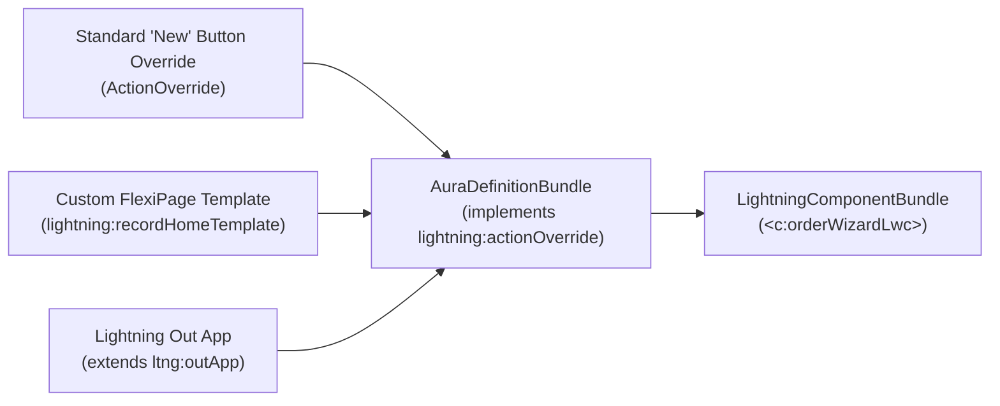

## Why `AuraDefinitionBundle` Still Matters in LWC-First Architectures

Although Salesforce recommends [LightningComponentBundle](/docs/metadata/lightning-component-bundle-metadata-type/) (LWC) for all new UI development, **`AuraDefinitionBundle`** is far from dead. Several core Salesforce platform extension points still require a thin Aura container or bundle:

1. **Standard Action Overrides (`lightning:actionOverride`):** Overriding the standard **New**, **Edit**, or **View** button on an object requires an Aura component implementing `lightning:actionOverride` that wraps your LWC (`<c:myCustomNewForm>`).
2. **Lightning Out Applications (`ltng:outApp`):** Embedding an LWC inside a Visualforce page or an external web application requires an Aura `.app` bundle extending `ltng:outApp`.
3. **Custom FlexiPage Templates (`lightning:appHomeTemplate`, `lightning:recordHomeTemplate`):** Creating custom page layout regions for Lightning App Builder still uses an Aura `.cmp` + `.design` + `.svg` bundle.
4. **Design Tokens (`defaultTokens.tokens`):** Defining org-wide CSS design tokens shared across LWC and Aura.



---

## SFDX Source Format & Bundle Structure

In SFDX source format, each Aura bundle resides in `force-app/main/default/aura/<BundleName>/`. Unlike LWC (which uses camelCase folder names), Aura bundles typically use PascalCase (`OrderNewOverride/`):

```text
force-app/main/default/aura/OrderNewOverride/
├── OrderNewOverride.cmp
├── OrderNewOverride.cmp-meta.xml
├── OrderNewOverrideController.js
├── OrderNewOverrideHelper.js
├── OrderNewOverride.css
└── OrderNewOverride.design
```

### Supported Aura Bundle Flavors

| Root File Extension | Bundle Type | Purpose |
|---|---|---|
| `.cmp` + `.cmp-meta.xml` | Component | UI component, action override wrapper, or custom FlexiPage template. |
| `.app` + `.app-meta.xml` | Application | Standalone Aura app or Lightning Out host (`extends="ltng:outApp"`). |
| `.evt` + `.evt-meta.xml` | Event | Component or Application Aura event (`type="COMPONENT"` or `type="APPLICATION"`). |
| `.intf` + `.intf-meta.xml` | Interface | Marker or attribute contract interface (`<aura:interface>`). |
| `.tokens` + `.tokens-meta.xml` | Tokens | Design tokens bundle (`<aura:tokens>`). |

---

## Real-World Example: Thin Aura Wrapper for Standard `New` Button Override

### 1. Metadata Sidecar (`aura/OrderNewOverride/OrderNewOverride.cmp-meta.xml`)

```xml
<?xml version="1.0" encoding="UTF-8"?>
<AuraDefinitionBundle xmlns="http://soap.sforce.com/2006/04/metadata">
    <apiVersion>68.0</apiVersion>
    <description>Thin Aura wrapper delegating the Order standard New action override to the orderCreationWizard LWC.</description>
</AuraDefinitionBundle>
```

### 2. Component Markup (`aura/OrderNewOverride/OrderNewOverride.cmp`)

```xml
<aura:component implements="lightning:actionOverride,lightning:hasPageReference" access="global">
    <c:orderCreationWizard
        recordTypeId="{!v.pageReference.state.recordTypeId}"
        onclose="{!c.handleClose}" />
</aura:component>
```

> [!TIP]
> **Keep Zero Business Logic in Aura Wrappers:** When using `AuraDefinitionBundle` as an adapter for `lightning:actionOverride` or Workspace API tabs (`lightning:workspaceAPI`), pass the `pageReference` state directly to your child LWC and emit standard CustomEvents (`onclose`) back up to the Aura controller only to close or navigate the tab.

---

## Querying `AuraDefinitionBundle` & `AuraDefinition` via Tooling API

You can audit all Aura bundles and even search inside their `.cmp` and `.js` source files using two objects: `AuraDefinitionBundle` (the parent folder) and `AuraDefinition` (the individual files).

### 1. List All Custom Aura Bundles in the Org

```sql
SELECT Id, DeveloperName, MasterLabel, ApiVersion, Description, LastModifiedDate
FROM AuraDefinitionBundle
WHERE NamespacePrefix = null
ORDER BY DeveloperName ASC
```

### 2. Inspect Individual Aura Files (`COMPONENT`, `CONTROLLER`, `HELPER`) via Tooling API

```sql
SELECT Id, AuraDefinitionBundle.DeveloperName, DefType, Format, Source
FROM AuraDefinition
WHERE AuraDefinitionBundle.NamespacePrefix = null
  AND DefType IN ('COMPONENT', 'APPLICATION', 'CONTROLLER', 'HELPER')
```

---

## Senior Architect Gotchas

- **Case-Sensitivity Collisions with LWC:** An `AuraDefinitionBundle` and a `LightningComponentBundle` **cannot share the same name** in the same namespace—even if their casing differs (for example, `aura/OrderCard` and `lwc/orderCard` both claim the `c:orderCard` tag and will fail deployment with a duplicate component name error).
- **API Version Alignment:** Always keep `<apiVersion>` at `40.0` or higher (ideally `68.0`) so Lightning Locker / Lightning Web Security rules apply consistently between your Aura wrapper and child LWC.
