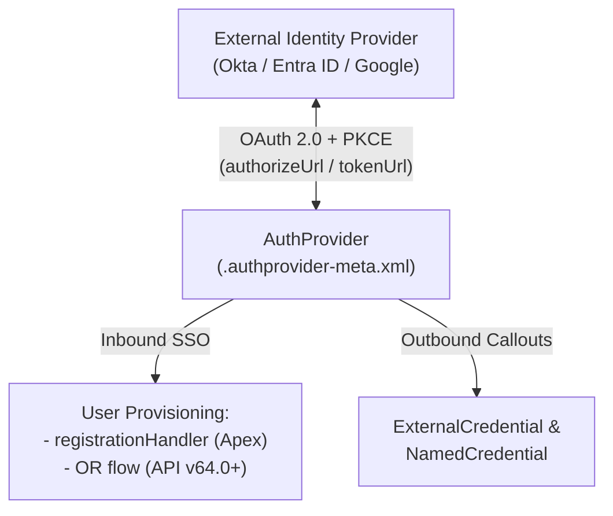

The `AuthProvider` metadata type represents an **Authentication Provider** (`Auth. Provider` in Setup) supporting OAuth 2.0 and OpenID Connect integrations. Introduced in API version 27.0 (with PKCE support added in v59.0 and Flow Registration Handlers added in v64.0), `AuthProvider` serves two vital platform roles:
1. **Inbound Single Sign-On (SSO)**: Allows employees, partners, and Experience Cloud customers to sign into Salesforce using Okta, Azure AD (`Microsoft`), Google, Apple, or any `OpenIdConnect` provider, provisioning or matching `User` records via an [ApexClass](/docs/metadata/apex-class-metadata-type/) (`Auth.RegistrationHandler`) or Identity [Flow](/docs/metadata/flow-metadata-type/).
2. **Outbound OAuth Token Broker**: Acts as the OAuth 2.0 browser-flow handshake provider referenced by [ExternalCredential](/docs/metadata/external-credential-metadata-type/) and [NamedCredential](/docs/metadata/named-credential-metadata-type/).

In Salesforce DX projects, authentication providers are stored in `force-app/main/default/authproviders/` with the `.authprovider-meta.xml` suffix.



## Key Metadata Fields

| Field | Type | Required | Description |
|---|---|---|---|
| `friendlyName` | `string` | Yes | Display label in Setup -> Auth. Providers |
| `providerType` | `AuthProviderType` | Yes | `OpenIdConnect`, `Salesforce`, `Microsoft`, `Google`, `Apple`, `GitHub`, `Bitbucket`, `MuleSoft`, `Slack`, or `Custom` |
| `authorizeUrl` | `string` | Conditional | OAuth 2.0 authorization endpoint URL |
| `tokenUrl` | `string` | Conditional | OAuth 2.0 token endpoint URL |
| `userInfoUrl` | `string` | No | OpenID Connect `/userinfo` endpoint URL |
| `consumerKey` | `string` | No | OAuth Client ID registered with the identity provider |
| `consumerSecret` | `string` | No | OAuth Client Secret (exported as a placeholder on retrieve) |
| `defaultScopes` | `string` | No | Space-separated OAuth scopes (for example, `openid email profile refresh_token`) |
| `isPkceEnabled` | `boolean` | No | Enables OAuth 2.0 Proof Key for Code Exchange (`true` recommended, v59.0+) |
| `registrationHandler` | `string` | Conditional | Apex class implementing `Auth.RegistrationHandler` (mutually exclusive with `flow`) |
| `flow` | `string` | Conditional | Identity User Registration Flow API name (v64.0+, mutually exclusive with `registrationHandler`) |
| `executionUser` | `string` | Conditional | Username of the system admin user with `Manage Users` under whose context the handler runs |
| `plugin` | `string` | Conditional | Custom Apex class extending `Auth.AuthProviderPluginClass` when `providerType` is `Custom` |
| `customMetadataTypeRecord` | `string` | Conditional | `CustomMetadata` record storing configuration for a `Custom` `AuthProviderPluginClass` |

## Production-Grade XML Example (OpenID Connect with PKCE)

Below is an `AuthProvider` (`Okta_Customer_CIAM.authprovider-meta.xml`) configured for Experience Cloud SSO with PKCE enabled:

```xml
<?xml version="1.0" encoding="UTF-8"?>
<AuthProvider xmlns="http://soap.sforce.com/2006/04/metadata">
    <authorizeUrl>https://id.example.com/oauth2/default/v1/authorize</authorizeUrl>
    <consumerKey>0oa8x9y0z1ExampleClientId</consumerKey>
    <defaultScopes>openid profile email</defaultScopes>
    <executionUser>ciam-system-admin@example.com</executionUser>
    <friendlyName>Okta Customer CIAM</friendlyName>
    <idTokenIssuer>https://id.example.com/oauth2/default</idTokenIssuer>
    <includeOrgIdInIdentifier>false</includeOrgIdInIdentifier>
    <isPkceEnabled>true</isPkceEnabled>
    <providerType>OpenIdConnect</providerType>
    <registrationHandler>OktaCustomerRegistrationHandler</registrationHandler>
    <requireMfa>false</requireMfa>
    <sendAccessTokenInHeader>true</sendAccessTokenInHeader>
    <sendClientCredentialsInHeader>false</sendClientCredentialsInHeader>
    <sendSecretInApis>true</sendSecretInApis>
    <tokenUrl>https://id.example.com/oauth2/default/v1/token</tokenUrl>
    <userInfoUrl>https://id.example.com/oauth2/default/v1/userinfo</userInfoUrl>
</AuthProvider>
```

> [!WARNING]
> **Post-Deploy `consumerSecret` & Callback URL Checklist**:
> 1. Because Salesforce masks `<consumerSecret>` during metadata retrieval, always set or verify the Client Secret in **Setup -> Auth. Providers** after the initial deployment to a new environment.
> 2. Copy the generated **Callback URL** (`https://<MyDomain>.my.salesforce.com/services/authcallback/<UrlSuffix>`) and register it in your external Identity Provider's Redirect URI allowlist.

## Querying `AuthProvider` with SOQL

```sql
-- Audit all configured Auth. Providers, their PKCE status, and Registration Handlers
SELECT Id, DeveloperName, FriendlyName, ProviderType, AuthorizeUrl, TokenUrl,
       DefaultScopes, IsPkceEnabled, RegistrationHandlerId, ExecutionUserId
FROM AuthProvider
ORDER BY FriendlyName ASC
```
