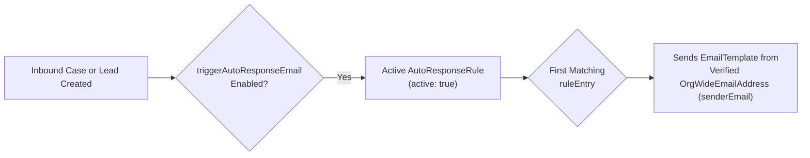

The `AutoResponseRules` metadata type configures automatic acknowledgment emails sent to customers or prospects when a **Case** or **Lead** is created (via Web-to-Lead, Web-to-Case, Email-to-Case, Customer Portal, or API with `EmailHeader.triggerAutoResponseEmail`). Introduced in API version 27.0, an active `AutoResponseRule` evaluates `<ruleEntry>` blocks in top-to-bottom sequence and sends the [EmailTemplate](/docs/metadata/email-template-metadata-type/) defined on the first matching entry.

In Salesforce DX projects, auto-response rules are stored in `force-app/main/default/autoResponseRules/Case.autoResponseRules-meta.xml` and `Lead.autoResponseRules-meta.xml`.



## Key Fields on `AutoResponseRule` and `RuleEntry`

| Field | Location | Required | Description |
|---|---|---|---|
| `fullName` | `autoResponseRule` | Yes | Name of the auto-response rule |
| `active` | `autoResponseRule` | No | Whether this rule is active (`true` for at most 1 rule per object) |
| `ruleEntry` | `autoResponseRule` | No | Ordered array of condition-to-template rules |
| `criteriaItems` | `ruleEntry` | Conditional | Field filter criteria (`field`, `operation`, `value`)—mutually exclusive with `formula` |
| `booleanFilter` | `ruleEntry` | No | Boolean logic combining `criteriaItems` |
| `formula` | `ruleEntry` | Conditional | Formula expression evaluating to `true`—mutually exclusive with `criteriaItems` |
| `senderName` | `ruleEntry` | Yes | Display name in the outbound email's `From` header |
| `senderEmail` | `ruleEntry` | Yes | Must match a verified **Organization-Wide Email Address** in the target org |
| `replyToEmail` | `ruleEntry` | No | Optional `Reply-To` address (for example, your Email-to-Case routing address) |
| `template` | `ruleEntry` | Yes | Developer path (`Folder/TemplateName`) of the Email Template to send |
| `notifyCcRecipients` | `ruleEntry` | No | Includes CC recipients from an incoming Email-to-Case message on the auto-response (v32.0+) |

## Production-Grade XML Example (`Case.autoResponseRules-meta.xml`)

```xml
<?xml version="1.0" encoding="UTF-8"?>
<AutoResponseRules xmlns="http://soap.sforce.com/2006/04/metadata">
    <autoResponseRule>
        <fullName>Customer_Support_Auto_Response</fullName>
        <active>true</active>
        <ruleEntry>
            <criteriaItems>
                <field>Case.Priority</field>
                <operation>equals</operation>
                <value>Critical,High</value>
            </criteriaItems>
            <notifyCcRecipients>true</notifyCcRecipients>
            <replyToEmail>support@example.com</replyToEmail>
            <senderEmail>noreply-support@example.com</senderEmail>
            <senderName>Enterprise Priority Support</senderName>
            <template>Support_Templates/Priority_Case_Acknowledgment</template>
        </ruleEntry>
        <ruleEntry>
            <formula>TRUE</formula>
            <notifyCcRecipients>false</notifyCcRecipients>
            <replyToEmail>support@example.com</replyToEmail>
            <senderEmail>noreply-support@example.com</senderEmail>
            <senderName>Customer Support Team</senderName>
            <template>Support_Templates/Standard_Case_Acknowledgment</template>
        </ruleEntry>
    </autoResponseRule>
</AutoResponseRules>
```

> [!WARNING]
> **Verify `OrgWideEmailAddress` Before Deploying `AutoResponseRules`**: If `<senderEmail>` references an email address that is not registered and verified in `OrgWideEmailAddress` in the destination sandbox or production org, the deployment will fail. Query `SELECT Id, Address, DisplayName, IsVerified FROM OrgWideEmailAddress` in the target org before deploying.

## Triggering Auto-Response Emails in Apex

```java
Database.DMLOptions dmlOpts = new Database.DMLOptions();
dmlOpts.emailHeader.triggerAutoResponseEmail = true;

Lead webLead = new Lead(
    FirstName = 'Aarav',
    LastName = 'Mehta',
    Company = 'CloudScale India',
    Email = 'aarav@cloudscale.example.com'
);
webLead.setOptions(dmlOpts);
insert as user webLead;
```

