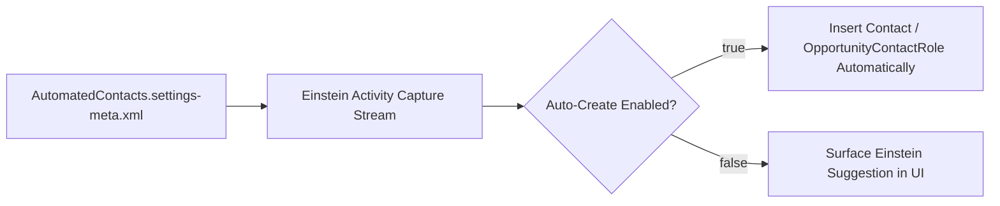

## Architectural Overview

The `AutomatedContactsSettings` metadata type manages org-wide preferences for **Einstein Automated Contacts**. By analyzing synced emails and calendar events (via Einstein Activity Capture), Salesforce can either suggest or automatically create new `Contact` records and `OpportunityContactRole` associations.

From a data governance perspective, Senior Salesforce Architects carefully control `AutomatedContacts.settings-meta.xml`. While automatic creation reduces manual data entry for sales reps, orgs with strict duplicate rules, required custom fields on `Contact`, or MDM (Master Data Management) synchronization often prefer **suggestion mode** (enabling the feature while setting the `Automatically` flags to `false`).



## Directory Location and File Suffix

| Property | Value |
| :--- | :--- |
| **Metadata Type Name** | `Settings` (member: `AutomatedContacts`) |
| **XML Root Element** | `<AutomatedContactsSettings>` |
| **SFDX Directory** | `force-app/main/default/settings/` |
| **File Name & Suffix** | `AutomatedContacts.settings-meta.xml` |

## Key Metadata Fields

| Field | Type | Description & Architectural Significance |
| :--- | :--- | :--- |
| `enableAddContactAutomatically` | `boolean` | When `true`, Einstein automatically creates new `Contact` records from email and event participants instead of waiting for user approval. |
| `enableAddContactRoleAutomatically` | `boolean` | When `true`, Einstein automatically inserts `OpportunityContactRole` records when activity participants match an active opportunity's account. |
| `enableAddContactRoleWithSuggestion` | `boolean` | Enables Einstein to suggest new `OpportunityContactRole` records in the Lightning UI for sales rep review. |
| `enableAddContactWithSuggestion` | `boolean` | Enables Einstein to suggest new `Contact` records in the Lightning UI rather than inserting them silently. |

## Declarative XML and Package Manifest Examples

Below is a governance-friendly `AutomatedContacts.settings-meta.xml` configuration that enables Einstein suggestions for reps while preventing silent background creation of contacts:

```xml title="force-app/main/default/settings/AutomatedContacts.settings-meta.xml"
<?xml version="1.0" encoding="UTF-8"?>
<AutomatedContactsSettings xmlns="http://soap.sforce.com/2006/04/metadata">
    <enableAddContactAutomatically>false</enableAddContactAutomatically>
    <enableAddContactRoleAutomatically>true</enableAddContactRoleAutomatically>
    <enableAddContactRoleWithSuggestion>true</enableAddContactRoleWithSuggestion>
    <enableAddContactWithSuggestion>true</enableAddContactWithSuggestion>
</AutomatedContactsSettings>
```

```xml title="manifest/package.xml"
<?xml version="1.0" encoding="UTF-8"?>
<Package xmlns="http://soap.sforce.com/2006/04/metadata">
    <types>
        <members>AutomatedContacts</members>
        <name>Settings</name>
    </types>
    <version>68.0</version>
</Package>
```

## SFDX CLI Retrieval and Deployment Commands

Retrieve and deploy `AutomatedContactsSettings` using the Salesforce CLI:

```bash
# Retrieve AutomatedContactsSettings from your org
sf project retrieve start --metadata Settings:AutomatedContacts --target-org my-org

# Deploy AutomatedContactsSettings to production
sf project deploy start --metadata Settings:AutomatedContacts --target-org my-prod-org
```

## Senior Architect Best Practices and Gotchas

1. **Validation Rule Compatibility:** If you set `<enableAddContactAutomatically>true</enableAddContactAutomatically>`, Einstein inserts `Contact` records using only `FirstName`, `LastName`, `Email`, `Phone`, `Title`, and `AccountId`. Any custom validation rule or universally required [CustomField](/docs/metadata/custom-field-metadata-type/) on `Contact` without a default value will block automatic creation unless exempted for the Automated Process user.
2. **Opportunity Attribution Accuracy:** Enabling `enableAddContactRoleAutomatically` significantly improves Multi-Touch Campaign Attribution and Einstein Opportunity Scoring because opportunities no longer have empty `OpportunityContactRole` related lists.
