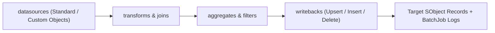

## Architectural Overview

The `BatchCalcJobDefinition` metadata type represents a **Data Processing Engine (DPE)** pipeline definition. DPE offloads heavy data extraction, multi-object joins, complex formula transformations, hierarchy rollups, and bulk writebacks from the core Apex transactional database onto Salesforce's high-scale analytical compute infrastructure (CRM Analytics / Hyper / Data Cloud runtime).

For Senior Salesforce Architects, `BatchCalcJobDefinition` replaces brittle chained `Database.Batchable` Apex classes in scenarios such as Rebate Management payout calculations, Loyalty Management tier rollups, Financial Services household asset summaries, and Net Zero Cloud carbon accounting.



## Directory Location and File Suffix

| Property | Value |
| :--- | :--- |
| **Metadata Type Name** | `BatchCalcJobDefinition` |
| **XML Root Element** | `<BatchCalcJobDefinition>` |
| **SFDX Directory** | `force-app/main/default/batchCalcJobDefinitions/` |
| **File Suffix** | `.batchCalcJobDefinition-meta.xml` |

## Key Metadata Fields

| Field | Type | Required | Description & Architectural Significance |
| :--- | :--- | :--- | :--- |
| `label` | `string` | Yes | The user-facing name of the Data Processing Engine definition in Setup. |
| `processType` | `BatchCalcProcessType` | Yes | Categorizes the domain of the DPE job (for example, `DataProcessingEngine`, `Rebates`, `Loyalty`, `FinancialServices`, `Forecasting`, or `AccountingSubledger`). |
| `executionPlatformType` | `string` | No | Specifies the compute runtime (`CRMA` for CRM Analytics runtime or `DataCloud` / `Hyper` where supported). |
| `status` | `BatchCalcJobStatus` | Yes | Lifecycle state of the job definition (`Active`, `Inactive`, or `Draft`). |
| `datasources` | `BatchCalcJobDatasource[]` | No | Defines source Salesforce objects (`StandardObject`), fields, and aliases extracted into the pipeline. |
| `filters` | `BatchCalcJobFilter[]` | No | Filter nodes that restrict rows based on boolean criteria or runtime input parameters. |
| `joins` | `BatchCalcJobJoin[]` | No | Combines two nodes using `Inner`, `LeftOuter`, `RightOuter`, or `FullOuter` join semantics. |
| `aggregates` | `BatchCalcJobAggregate[]` | No | Groups rows by dimension fields and computes `Sum`, `Count`, `Min`, `Max`, or `Avg` metrics. |
| `transforms` | `BatchCalcJobTransform[]` | No | Calculates derived formula columns, type conversions, or text manipulations. |
| `parameters` | `BatchCalcJobParameter[]` | No | Declares dynamic runtime input variables passed from [Flow](/docs/metadata/flow-metadata-type/) when invoking the job. |
| `writebacks` | `BatchCalcJobWritebackObject[]` | No | Maps output node columns back to target Salesforce objects using `Insert`, `Update`, `Upsert`, or `Delete` operations. |

## Declarative XML and Package Manifest Examples

Below is a `BatchCalcJobDefinition` that aggregates closed-won `Opportunity` amounts per `Account` and writes the total back to a custom field `YTD_Closed_Won_Revenue__c`:

```xml title="force-app/main/default/batchCalcJobDefinitions/Account_YTD_Revenue_Rollup.batchCalcJobDefinition-meta.xml"
<?xml version="1.0" encoding="UTF-8"?>
<BatchCalcJobDefinition xmlns="http://soap.sforce.com/2006/04/metadata">
    <aggregates>
        <fields>
            <aggregateFunction>Sum</aggregateFunction>
            <alias>TotalWonAmount</alias>
            <sourceFieldName>Amount</sourceFieldName>
        </fields>
        <groupBy>AccountId</groupBy>
        <label>Sum Won Amount by Account</label>
        <name>Sum_Won_Amount_By_Account</name>
        <sourceName>Filter_Closed_Won</sourceName>
    </aggregates>
    <datasources>
        <fields>
            <alias>AccountId</alias>
            <dataType>Text</dataType>
            <name>AccountId</name>
        </fields>
        <fields>
            <alias>Amount</alias>
            <dataType>Numeric</dataType>
            <name>Amount</name>
        </fields>
        <fields>
            <alias>IsWon</alias>
            <dataType>Boolean</dataType>
            <name>IsWon</name>
        </fields>
        <label>Opportunity Source</label>
        <name>Opportunity_Source</name>
        <sourceName>Opportunity</sourceName>
        <type>StandardObject</type>
    </datasources>
    <description>Aggregates Won Opportunity amounts and updates Account YTD revenue.</description>
    <filters>
        <criteria>
            <inputVariable>IsWon</inputVariable>
            <operator>Equals</operator>
            <sequence>1</sequence>
            <value>true</value>
        </criteria>
        <isDynamicFilter>false</isDynamicFilter>
        <label>Filter Closed Won</label>
        <name>Filter_Closed_Won</name>
        <sourceName>Opportunity_Source</sourceName>
    </filters>
    <isTemplate>false</isTemplate>
    <label>Account YTD Revenue Rollup</label>
    <processType>DataProcessingEngine</processType>
    <status>Inactive</status>
    <writebacks>
        <fields>
            <runtimeParameter>false</runtimeParameter>
            <sourceFieldName>AccountId</sourceFieldName>
            <targetFieldName>Id</targetFieldName>
        </fields>
        <fields>
            <runtimeParameter>false</runtimeParameter>
            <sourceFieldName>TotalWonAmount</sourceFieldName>
            <targetFieldName>YTD_Closed_Won_Revenue__c</targetFieldName>
        </fields>
        <isChangedRow>false</isChangedRow>
        <label>Writeback Account Revenue</label>
        <name>Writeback_Account_Revenue</name>
        <operationType>Update</operationType>
        <sourceName>Sum_Won_Amount_By_Account</sourceName>
        <storageType>sObject</storageType>
        <targetObjectName>Account</targetObjectName>
        <writebackSequence>1</writebackSequence>
        <writebackUser>005000000000000AAA</writebackUser>
    </writebacks>
</BatchCalcJobDefinition>
```

```xml title="manifest/package.xml"
<?xml version="1.0" encoding="UTF-8"?>
<Package xmlns="http://soap.sforce.com/2006/04/metadata">
    <types>
        <members>Account_YTD_Revenue_Rollup</members>
        <name>BatchCalcJobDefinition</name>
    </types>
    <version>68.0</version>
</Package>
```

## Querying DPE Execution History via SOQL

Monitor `BatchCalcJobDefinition` runs and inspect failed writeback records using the standard `BatchJob` and `BatchJobPartFailedRecord` objects:

```soql
SELECT Id, Name, BatchJobDefinitionName, Status, StartTime, EndTime,
       ErrorDescription, RetryCount
FROM BatchJob
WHERE Type = 'Calc'
ORDER BY CreatedDate DESC
LIMIT 25
```

## Senior Architect Best Practices and Gotchas

1. **Sanitize `<writebackUser>` Across Orgs:** When you retrieve an active `BatchCalcJobDefinition`, Salesforce often exports the 18-character `User.Id` in `<writebackUser>`. Because User IDs differ between sandboxes and production, deploy with `<status>Inactive</status>` and omit or replace `<writebackUser>` during CI/CD, or activate the DPE definition post-deployment.
2. **Analytics Cloud Integration User FLS:** Every object and field listed in `<datasources>` must have Read FLS granted to the **Analytics Cloud Integration User** profile/permission set, and every target field in `<writebacks>` must have Edit FLS granted to the designated writeback user.
3. **Use `<isChangedRow>true</isChangedRow>` to Minimize DML:** Enabling `isChangedRow` on writeback nodes instructs DPE to only update target records whose calculated metric actually changed, drastically reducing Apex trigger execution and row lock contention.
