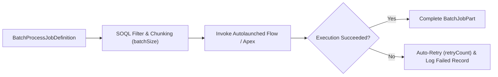

## Architectural Overview

The `BatchProcessJobDefinition` metadata type represents a **Batch Management** job definition in Salesforce. While standard Schedule-Triggered Flows have strict daily record interview limits (`250,000` records per 24 hours or license-multiplied limits), `BatchProcessJobDefinition` allows architects to declaratively query large sObject datasets, slice them into configurable `batchSize` chunks, and execute an Autolaunched [Flow](/docs/metadata/flow-metadata-type/) for each record—complete with built-in retry counts, retry intervals, and row-level failure logging in `BatchJobPartFailedRecord`.



## Directory Location and File Suffix

| Property | Value |
| :--- | :--- |
| **Metadata Type Name** | `BatchProcessJobDefinition` |
| **XML Root Element** | `<BatchProcessJobDefinition>` |
| **SFDX Directory** | `force-app/main/default/batchProcessJobDefinitions/` |
| **File Suffix** | `.batchProcessJobDefinition-meta.xml` |

## Key Metadata Fields

| Field | Type | Required | Description & Architectural Significance |
| :--- | :--- | :--- | :--- |
| `masterLabel` | `string` | Yes | The human-readable name of the Batch Management job in Setup. |
| `batchSize` | `int` | Yes | Number of records processed per batch execution chunk (for example, `50`, `100`, or `200`). |
| `flowName` | `string` | No | The API name of the active Autolaunched Flow invoked for each record in the batch. |
| `flowInputVariable` | `string` | No | The input variable name in the target Flow (typically `recordId`) that receives each queried record's ID. |
| `processGroup` | `string` | Yes | Logical group or namespace categorizing the batch job for operational monitoring. |
| `retryCount` | `int` | Yes | Number of times Salesforce automatically retries a failed batch chunk before marking it failed (for example, `3`). |
| `retryInterval` | `int` | Yes | Wait time in milliseconds or minutes between automatic retry attempts (for example, `1000`). |
| `sourceObjectName` | `string` | Yes | API name of the Salesforce object queried by the batch job (such as `Account`, `Invoice__c`, or `InsurancePolicy`). |
| `status` | `string` | Yes | Activation state of the batch process job (`Active` or `Inactive`). |
| `type` | `string` | No | Execution target type (`Flow` or `Apex`). |
| `filterCriteria` | `BatchProcessJobFilterCriteria[]` | No | Declarative filter conditions applied to `sourceObjectName` when selecting records to process. |

## Declarative XML and Package Manifest Examples

Below is a `BatchProcessJobDefinition` that selects overdue invoices in chunks of 50 and passes each record ID into an Autolaunched Flow named `Process_Overdue_Invoice_Dunning`, retrying transient locks up to 3 times:

```xml title="force-app/main/default/batchProcessJobDefinitions/Overdue_Invoice_Dunning_Batch.batchProcessJobDefinition-meta.xml"
<?xml version="1.0" encoding="UTF-8"?>
<BatchProcessJobDefinition xmlns="http://soap.sforce.com/2006/04/metadata">
    <batchSize>50</batchSize>
    <description>Chunks overdue invoices and executes the dunning notification flow with automatic retries.</description>
    <filterCondition>1 AND 2</filterCondition>
    <filterCriteria>
        <fieldName>Status__c</fieldName>
        <inputVariable>OverdueStatus</inputVariable>
        <operator>Equals</operator>
        <sequence>1</sequence>
        <value>Overdue</value>
    </filterCriteria>
    <filterCriteria>
        <fieldName>Balance_Due__c</fieldName>
        <inputVariable>MinBalance</inputVariable>
        <operator>GreaterThan</operator>
        <sequence>2</sequence>
        <value>0</value>
    </filterCriteria>
    <flowInputVariable>recordId</flowInputVariable>
    <flowName>Process_Overdue_Invoice_Dunning</flowName>
    <masterLabel>Overdue Invoice Dunning Batch</masterLabel>
    <processGroup>BillingOperations</processGroup>
    <retryCount>3</retryCount>
    <retryInterval>1000</retryInterval>
    <sourceObjectName>Invoice__c</sourceObjectName>
    <status>Active</status>
    <type>Flow</type>
</BatchProcessJobDefinition>
```

```xml title="manifest/package.xml"
<?xml version="1.0" encoding="UTF-8"?>
<Package xmlns="http://soap.sforce.com/2006/04/metadata">
    <types>
        <members>Process_Overdue_Invoice_Dunning</members>
        <name>Flow</name>
    </types>
    <types>
        <members>Overdue_Invoice_Dunning_Batch</members>
        <name>BatchProcessJobDefinition</name>
    </types>
    <version>68.0</version>
</Package>
```

## Querying BatchProcessJobDefinition and Run Logs via SOQL

Query the definition or inspect live batch job executions via SOQL:

```soql
SELECT Id, DeveloperName, MasterLabel, SourceObjectName,
       FlowDefinition, BatchSize, RetryCount, Status
FROM BatchProcessJobDefinition
ORDER BY DeveloperName
```

```soql
SELECT Id, BatchJob.Name, Status, TotalRecordsCount,
       ProcessedRecordsCount, FailedRecordsCount, StartTime, EndTime
FROM BatchJobPart
ORDER BY CreatedDate DESC
LIMIT 20
```

## Senior Architect Best Practices and Gotchas

1. **Tune `batchSize` Based on Flow SOQL/DML Footprint:** Even though Salesforce bulkifies Autolaunched Flow interviews across a batch chunk, complex subflows or invocable Apex callouts inside the target Flow can hit CPU time limits (10,000 ms) at `batchSize` 200. Benchmark at `50` or `100` in a Full Sandbox before production cutover.
2. **Index All `filterCriteria` Fields:** Because `BatchProcessJobDefinition` runs a high-volume initial query on `sourceObjectName`, ensure every field used in `filterCriteria` is indexed (or has a custom index requested via Salesforce Support) to avoid initial query timeouts on tables exceeding 1 million rows.
3. **Deploy the Target Flow Active:** Deploying a `BatchProcessJobDefinition` with `<status>Active</status>` requires the referenced `flowName` to already be deployed and active in the target org.
