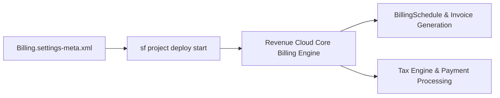

## Architectural Overview

The `BillingSettings` metadata type represents org-wide configuration toggles for **Salesforce Revenue Cloud Billing** (Core Billing). As enterprises transition from managed-package CPQ & Billing to core Revenue Cloud objects (`BillingSchedule`, `BillingScheduleGroup`, `Invoice`, `InvoiceLine`, `CreditMemo`, and `Payment`), `Billing.settings-meta.xml` governs whether core billing services, tax calculation integrations, and automated invoice posting engines are active in the org.



## Directory Location and File Suffix

| Property | Value |
| :--- | :--- |
| **Metadata Type Name** | `Settings` (member: `Billing`) |
| **XML Root Element** | `<BillingSettings>` |
| **SFDX Directory** | `force-app/main/default/settings/` |
| **File Name & Suffix** | `Billing.settings-meta.xml` |

## Key Metadata Fields

| Field | Type | Description & Architectural Significance |
| :--- | :--- | :--- |
| `enableBilling` | `boolean` | Master toggle that activates Revenue Cloud Core Billing objects, APIs, and batch invoice schedulers across the organization. |

> [!NOTE]
> Once `enableBilling` is activated in an org, standard Revenue Cloud Billing objects (`BillingPolicy`, `BillingTreatment`, `TaxEngine`, `Invoice`, and `CreditMemo`) become accessible to users assigned the corresponding Revenue Cloud permission sets.

## Declarative XML and Package Manifest Examples

Below is the declarative `Billing.settings-meta.xml` configuration file and its `package.xml` manifest:

```xml title="force-app/main/default/settings/Billing.settings-meta.xml"
<?xml version="1.0" encoding="UTF-8"?>
<BillingSettings xmlns="http://soap.sforce.com/2006/04/metadata">
    <enableBilling>true</enableBilling>
</BillingSettings>
```

```xml title="manifest/package.xml"
<?xml version="1.0" encoding="UTF-8"?>
<Package xmlns="http://soap.sforce.com/2006/04/metadata">
    <types>
        <members>Billing</members>
        <name>Settings</name>
    </types>
    <version>68.0</version>
</Package>
```

## SFDX CLI Retrieval and Scratch Org Setup

Retrieve and deploy `BillingSettings` using the Salesforce CLI:

```bash
# Retrieve BillingSettings from your Revenue Cloud org
sf project retrieve start --metadata Settings:Billing --target-org revcloud-org

# Deploy BillingSettings to a target sandbox or production org
sf project deploy start --metadata Settings:Billing --target-org revcloud-prod
```

In scratch org definitions (`config/project-scratch-def.json`), include `BillingSettings` alongside the Revenue Cloud feature flags:

```json title="config/project-scratch-def.json"
{
  "orgName": "Revenue Cloud Billing Scratch Org",
  "edition": "Developer",
  "features": ["EnableSetPasswordInApi"],
  "settings": {
    "billingSettings": {
      "enableBilling": true
    }
  }
}
```

## Senior Architect Best Practices and Gotchas

1. **Sequence Before Custom Fields on Billing Objects:** In CI/CD pipelines, always deploy `Settings:Billing` (`Billing.settings-meta.xml`) **before** deploying custom fields, validation rules, or flows that reference standard Revenue Cloud Billing objects (`Invoice`, `InvoiceLine`, `BillingSchedule`). Otherwise, the custom fields will fail with `Invalid object name: Invoice`.
2. **Cannot Be Disabled Once Invoices Exist:** After `enableBilling` is turned on and billing schedules or invoices are generated in a sandbox or production org, attempting to deploy `<enableBilling>false</enableBilling>` will fail validation.
