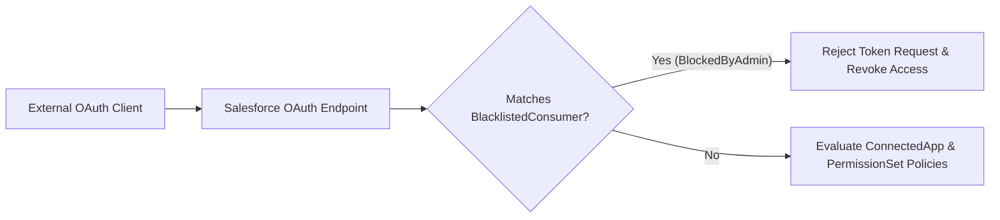

## Architectural Overview

In enterprise identity and access management (IAM) architectures, controlling which external OAuth clients can authenticate against a Salesforce org is critical to preventing data exfiltration and shadow IT. The `BlacklistedConsumer` metadata type represents an OAuth consumer (typically an external or unverified connected app) that an administrator or security architect has explicitly blocked from accessing the org.

When a `BlacklistedConsumer` record is deployed to an environment, the platform immediately blocks the associated `consumerKey` from initiating OAuth 2.0 flows and invalidates active sessions tied to that consumer. Storing `BlacklistedConsumer` definitions in version control allows security teams to enforce consistent OAuth blocklists across production, staging, and UAT sandboxes via automated CI/CD pipelines.



## SFDX Directory & File Suffix

| Property | Value |
| :--- | :--- |
| **Metadata Type Name** | `BlacklistedConsumer` |
| **Classic Directory** | `blacklistedConsumers/` |
| **Classic File Suffix** | `.blacklistedConsumer` |
| **SFDX Source Directory** | `force-app/main/default/blacklistedConsumers/` |
| **SFDX File Suffix** | `.blacklistedConsumer-meta.xml` |

## Key Metadata Fields

The `BlacklistedConsumer` metadata type extends `Metadata` and exposes the following declarative XML elements:

| Field Name | Field Type | Required | Architectural Description |
| :--- | :--- | :--- | :--- |
| `blockedByAdmin` | `boolean` | Yes | Indicates whether the OAuth consumer was explicitly blocked by a Salesforce administrator (`true`) or automatically flagged (`false`). |
| `consumerKey` | `string` | Yes | The unique OAuth `client_id` (Consumer Key) of the connected app or external OAuth client being blocked. |
| `consumerName` | `string` | Yes | The human-readable display name of the blocked OAuth application or consumer. |
| `masterLabel` | `string` | Yes | The master label for the blocked consumer record displayed in the Setup UI. |

> [!NOTE]
> While `BlacklistedConsumer` acts as an explicit deny-list, enterprise architects should combine it with API Access Control ("Limit API access to only installed connected apps") so unlisted third-party OAuth clients are denied by default.

## Declarative XML & `package.xml` Examples

### SFDX Source File Example

The following example blocks an unauthorized browser extension OAuth client from authenticating against the org:

```xml title="force-app/main/default/blacklistedConsumers/Unauthorized_Scraper_App.blacklistedConsumer-meta.xml"
<?xml version="1.0" encoding="UTF-8"?>
<BlacklistedConsumer xmlns="http://soap.sforce.com/2006/04/metadata">
    <blockedByAdmin>true</blockedByAdmin>
    <consumerKey>3MVG9SemV5D80oBel7x9K_untrusted_client_key_001</consumerKey>
    <consumerName>Unauthorized Data Scraper Extension</consumerName>
    <masterLabel>Unauthorized Data Scraper Extension</masterLabel>
</BlacklistedConsumer>
```

### Package Manifest (`package.xml`)

```xml title="manifest/package.xml"
<?xml version="1.0" encoding="UTF-8"?>
<Package xmlns="http://soap.sforce.com/2006/04/metadata">
    <types>
        <members>Unauthorized_Scraper_App</members>
        <name>BlacklistedConsumer</name>
    </types>
    <version>68.0</version>
</Package>
```

## SFDX CLI & Auditing Commands

Because `BlacklistedConsumer` is a declarative security metadata type, you retrieve and deploy it using the Salesforce CLI (`sf`), and pair it with `OauthToken` SOQL queries to audit active consumer usage before blocking:

```bash
# Retrieve all BlacklistedConsumer definitions via manifest
sf project retrieve start --manifest manifest/package.xml

# Deploy a specific BlacklistedConsumer security rule to production
sf project deploy start --metadata BlacklistedConsumer:Unauthorized_Scraper_App
```

To audit currently active OAuth tokens in the org before creating a `BlacklistedConsumer` entry, run the following SOQL query:

```soql
SELECT Id, AppName, ConsumerKey, UserId, UseCount, LastUsedDate
FROM OauthToken
ORDER BY LastUsedDate DESC
LIMIT 100
```

## Senior Architect Best Practices & Gotchas

- **Consumer Key Environment Variance:** If you block an internal [ConnectedApp](/docs/metadata/connected-app-metadata-type/) created in a specific sandbox, remember that newly created connected apps generate a unique `consumerKey` per org unless packaged. Verify the exact `consumerKey` before deploying across environments.
- **Defense in Depth with Permission Sets:** Relying solely on `BlacklistedConsumer` creates a reactive posture. Configure your org's Connected Apps OAuth Usage policy to set apps to "Admin approved users are pre-authorized" and grant access via [PermissionSet](/docs/metadata/permission-set-metadata-type/) assignments.
- **Immediate Session Termination:** Deploying `BlacklistedConsumer` with `blockedByAdmin` set to `true` immediately breaks integration pipelines using that `consumerKey`. Always audit `OauthToken` and `LoginHistory` first to verify no mission-critical middleware shares the consumer key.

> [!WARNING]
> Blocking a shared integration consumer key in production will immediately cause HTTP `400 Bad Request` (`invalid_client_id` or `restricted_client`) errors for all integration users authenticating with that client ID.
