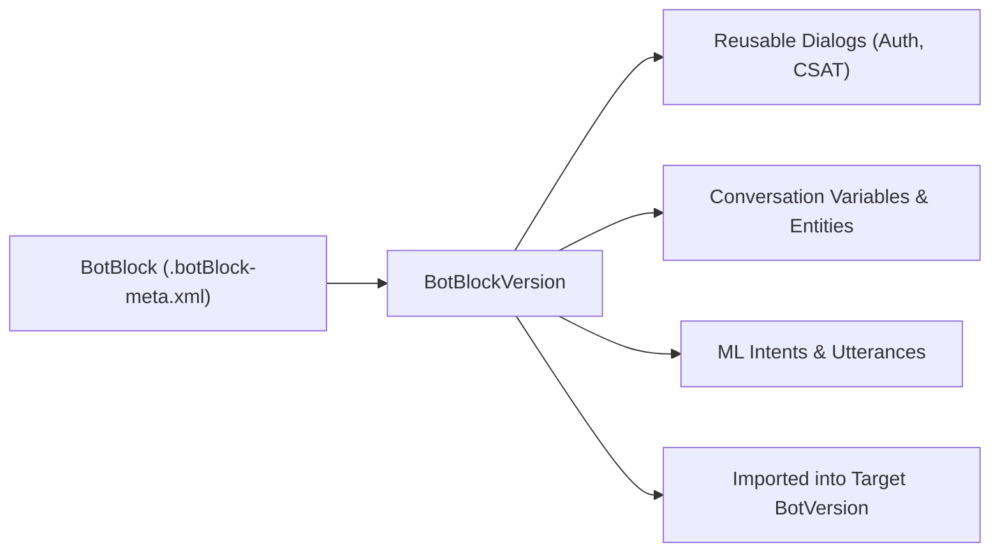

## Architectural Overview

When scaling Einstein Bots across multiple business units, languages, or regional Service Cloud channels, duplicating common conversational patterns—such as customer identity verification, OTP validation, agent handoff routing, or post-chat CSAT surveys—creates technical debt. The `BotBlock` metadata type solves this by encapsulating a self-contained group of dialogs, variables, entities, and machine learning intents that can be imported into any Einstein Bot.

Architecturally, `BotBlock` serves as a composable conversational blueprint. Independent development teams or ISVs can author, version, and distribute a `BotBlock` via unlocked or managed packages, enabling rapid assembly of enterprise bots with standardized compliance and authentication guardrails.



## SFDX Directory & File Suffix

| Property | Value |
| :--- | :--- |
| **Metadata Type Name** | `BotBlock` |
| **Classic Directory** | `botBlocks/` |
| **Classic File Suffix** | `.botBlock` |
| **SFDX Source Directory** | `force-app/main/default/botBlocks/` |
| **SFDX File Suffix** | `.botBlock-meta.xml` |

## Key Metadata Fields

The `BotBlock` metadata type and its nested `BotBlockVersion` contain the following key elements:

| Field Name | Field Type | Required | Architectural Description |
| :--- | :--- | :--- | :--- |
| `botBlockVersions` | `BotBlockVersion[]` | No | Versioned definitions containing the dialogs, variables, and intent model for the block. |
| `description` | `string` | No | Explains the functional scope and prerequisites of the reusable bot block. |
| `label` | `string` | Yes | The human-readable name of the Bot Block displayed in the Einstein Bot Builder UI. |
| `richContentEnabled` | `boolean` | No | Indicates whether the block requires an Enhanced Bot with rich content capabilities. |
| `botBlockVersions.botDialogs` | `BotDialog[]` | No | The collection of reusable dialog steps, messages, and invocations packaged in the version. |
| `botBlockVersions.conversationVariables` | `ConversationVariable[]` | No | Local variables scoped to the block's dialogs. |
| `botBlockVersions.mlDomain` | `LocalMlDomain` | No | Reusable intent definitions and slot classes bundled with the block. |
| `botBlockVersions.status` | `BotBlockVersionStatus` | Yes | Lifecycle status of the block version (for example, `Active` or `Inactive`). |

> [!NOTE]
> A `BotBlock` with `richContentEnabled` set to `true` can only be imported into Enhanced Einstein Bots; Standard Bots will filter it out during block selection.

## Declarative XML & `package.xml` Examples

### SFDX Source File Example

The following `BotBlock` packages a reusable post-conversation CSAT survey module:

```xml title="force-app/main/default/botBlocks/CSAT_Survey_Block.botBlock-meta.xml"
<?xml version="1.0" encoding="UTF-8"?>
<BotBlock xmlns="http://soap.sforce.com/2006/04/metadata">
    <botBlockVersions>
        <botDialogs>
            <botSteps>
                <botMessages>
                    <message>Before you go, how would you rate your support experience today (1 to 5)?</message>
                    <messageIdentifier>csat_prompt_msg_01</messageIdentifier>
                </botMessages>
                <stepIdentifier>csat_step_01</stepIdentifier>
                <type>Message</type>
            </botSteps>
            <botSteps>
                <stepIdentifier>csat_step_end</stepIdentifier>
                <type>Wait</type>
            </botSteps>
            <developerName>Collect_CSAT_Score</developerName>
            <isPlaceholderDialog>false</isPlaceholderDialog>
            <label>Collect CSAT Score</label>
            <showInFooterMenu>false</showInFooterMenu>
        </botDialogs>
        <conversationVariables>
            <dataType>Number</dataType>
            <developerName>CSAT_Rating</developerName>
            <label>CSAT Rating</label>
        </conversationVariables>
        <description>Standard 5-point CSAT collection dialog for Service Cloud bots.</description>
        <fullName>v1</fullName>
        <status>Active</status>
    </botBlockVersions>
    <description>Reusable CSAT survey block for Enhanced Einstein Bots.</description>
    <label>CSAT Survey Block</label>
    <richContentEnabled>true</richContentEnabled>
</BotBlock>
```

### Package Manifest (`package.xml`)

```xml title="manifest/package.xml"
<?xml version="1.0" encoding="UTF-8"?>
<Package xmlns="http://soap.sforce.com/2006/04/metadata">
    <types>
        <members>CSAT_Survey_Block</members>
        <name>BotBlock</name>
    </types>
    <version>68.0</version>
</Package>
```

## SFDX CLI Retrieval & Deployment Commands

Use the Salesforce CLI to retrieve and deploy `BotBlock` components across environments:

```bash
# Retrieve all BotBlock metadata components in the org
sf project retrieve start --metadata BotBlock

# Deploy a specific BotBlock and its underlying Flow dependencies
sf project deploy start --metadata BotBlock:CSAT_Survey_Block Flow:Record_CSAT_Response
```

## Senior Architect Best Practices & Gotchas

- **Copy-on-Import Semantics:** Importing a `BotBlock` into a bot performs a deep copy of the block's `botDialogs` and `conversationVariables` into the target `BotVersion` XML. It is **not** a live runtime reference. If you fix a bug in a `BotBlock`, you must update the consuming bots as well.
- **Placeholder Dialogs for Handoffs:** Use `<isPlaceholderDialog>true</isPlaceholderDialog>` inside a `BotBlock` when the block needs to transition back to a host bot's specific dialog (such as `Main_Menu` or `Transfer_To_Agent`). The host bot admin then maps the placeholder after importing the block.
- **Package External Dependencies Together:** If a `BotBlock` invokes an autolaunched [Flow](/docs/metadata/flow-metadata-type/) or `@InvocableMethod` in an [ApexClass](/docs/metadata/apex-class-metadata-type/), bundle those classes and flows in the same unlocked package or manifest so the block never fails deployment due to missing references.

> [!TIP]
> Prefix all `conversationVariables` and `botDialogs` inside a `BotBlock` with a short module namespace (such as `Auth_` or `CSAT_`) to prevent naming collisions when imported into complex target bots.
