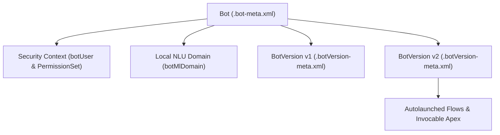

## Architectural Overview

The `Bot` metadata type represents the top-level definition of an Einstein Bot (Standard or Enhanced) in Salesforce Service Cloud and Digital Engagement. Architecturally, `Bot` acts as the parent envelope that binds the bot's security context (`botUser`), natural language understanding (`BotMlDomain`), Omni-Channel routing integration, and versioned conversational state machines (`BotVersion`).

In modern SFDX source format, `Bot` is decomposed into a dedicated directory under `bots/<BotName>/`, separating the top-level `BotName.bot-meta.xml` definition from individual `BotVersion` XML files. This separation allows conversational designers and developers to iterate on new bot versions without mutating the root bot identity or active routing configurations.



## SFDX Directory & File Suffix

| Property | Value |
| :--- | :--- |
| **Metadata Type Name** | `Bot` |
| **Classic Directory** | `bots/` |
| **Classic File Suffix** | `.bot` |
| **SFDX Source Directory** | `force-app/main/default/bots/<BotName>/` |
| **SFDX File Suffix** | `.bot-meta.xml` |

## Key Metadata Fields

The `Bot` metadata type contains the following key configuration elements:

| Field Name | Field Type | Required | Architectural Description |
| :--- | :--- | :--- | :--- |
| `botMlDomain` | `BotMlDomain` | No | Defines the local Einstein Intent Set (`mlIntents` and `mlSlotClasses`) used to train the bot's NLU model. |
| `botSource` | `BotSource` | No | Specifies whether the bot was created directly (`None`) or from an external template. |
| `botUser` | `string` | No | The username of the User record under whose security context the bot executes when `CustomBotUser` is selected. |
| `botVersions` | `BotVersion[]` | No | One or more conversational bot versions; decomposed into `.botVersion-meta.xml` files in SFDX format. |
| `contextVariables` | `BotContextVariable[]` | No | Context variables mapped from Messaging Session or Chat Transcript records into the bot session. |
| `conversationChannelProviders` | `BotChannelProvider[]` | No | Links the bot to Messaging for In-App and Web or other digital engagement channels. |
| `description` | `string` | No | Text description documenting the bot's purpose and target customer segment. |
| `label` | `string` | No | The display name of the Einstein Bot in the Setup UI. |
| `logPrivateConversationData` | `boolean` | No | Controls whether sensitive end-user utterances and session transcripts are logged to conversation tables. |
| `richContentEnabled` | `boolean` | No | Enables rich messaging components, quick replies, and carousels for Enhanced Bots. |
| `sessionTimeout` | `int` | No | Idle session timeout in minutes before the bot closes the conversation session. |
| `type` | `BotType` | No | Distinguishes between a standard customer-facing `Bot` (`Bot`) and an internal system bot (`InternalCopilot`). |

> [!TIP]
> Grant all [Flow](/docs/metadata/flow-metadata-type/), [ApexClass](/docs/metadata/apex-class-metadata-type/), and object permissions to the bot using the `sfdc.chatbot.service.permset` [PermissionSet](/docs/metadata/permission-set-metadata-type/) rather than assigning an overly permissive profile to `botUser`.

## Declarative XML & `package.xml` Examples

### SFDX Source File Example

```xml title="force-app/main/default/bots/Order_Support_Bot/Order_Support_Bot.bot-meta.xml"
<?xml version="1.0" encoding="UTF-8"?>
<Bot xmlns="http://soap.sforce.com/2006/04/metadata">
    <botMlDomain>
        <label>Order Support Domain</label>
        <name>Order_Support_Domain</name>
    </botMlDomain>
    <botUser>einstein.bot.integration@acme.enterprise</botUser>
    <contextVariables>
        <contextVariableMappings>
            <SObjectType>MessagingSession</SObjectType>
            <fieldName>MessagingSession.MessagingEndUserId</fieldName>
            <messageType>EmbeddedMessaging</messageType>
        </contextVariableMappings>
        <dataType>Id</dataType>
        <developerName>EndUserId</developerName>
        <label>End User Id</label>
    </contextVariables>
    <description>Enhanced Einstein Bot for order tracking and return authorizations.</description>
    <label>Order Support Bot</label>
    <logPrivateConversationData>true</logPrivateConversationData>
    <richContentEnabled>true</richContentEnabled>
    <sessionTimeout>30</sessionTimeout>
    <type>Bot</type>
</Bot>
```

### Package Manifest (`package.xml`)

```xml title="manifest/package.xml"
<?xml version="1.0" encoding="UTF-8"?>
<Package xmlns="http://soap.sforce.com/2006/04/metadata">
    <types>
        <members>Order_Support_Bot</members>
        <name>Bot</name>
    </types>
    <version>68.0</version>
</Package>
```

## Querying via SOQL & SFDX CLI

You can inspect deployed `Bot` records using standard SOQL against `BotDefinition`:

```soql
SELECT Id, DeveloperName, MasterLabel, Description, BotUserId, Type
FROM BotDefinition
ORDER BY DeveloperName ASC
```

Retrieve or deploy both the `Bot` and its decomposed `BotVersion` files with Salesforce CLI:

```bash
# Retrieve the Bot and all its BotVersion files
sf project retrieve start --metadata Bot:Order_Support_Bot

# Deploy the Bot container and versions
sf project deploy start --source-dir force-app/main/default/bots/Order_Support_Bot
```

## Senior Architect Best Practices & Gotchas

- **Environment-Specific `botUser` References:** If your bot uses a custom bot user instead of the Basic Chatbot User, `<botUser>` contains a hardcoded username (e.g., `bot@company.com.uat`). Use SFDX string replacement in `sfdx-project.json` so deployments across sandboxes and production do not fail on missing usernames.
- **Active Bot Lock:** You cannot overwrite an currently active `BotVersion` in the target org via Metadata API deployment. Deactivate the bot first or deploy changes as a new `BotVersion`.
- **Dependency Ordering:** A `Bot` and its `BotVersion` often reference Omni-Channel queues, Flows, and Apex classes. Ensure all referenced [Flow](/docs/metadata/flow-metadata-type/) and [ApexClass](/docs/metadata/apex-class-metadata-type/) metadata is included in the same deployment transaction or already exists in the target org.

> [!WARNING]
> Setting `logPrivateConversationData` to `true` stores customer utterances in plaintext in conversation logs. If your bot collects PII or PCI data without masking rules, keep this flag set to `false` to maintain compliance.
