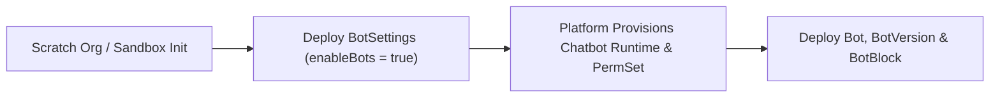

## Architectural Overview

The `BotSettings` metadata type manages the org-wide feature toggle for Salesforce Einstein Bots. In automated CI/CD pipelines and scratch org provisioning workflows, `BotSettings` is a critical foundational dependency: attempting to deploy `Bot`, `BotVersion`, `BotBlock`, or `BotTemplate` metadata into an org where `enableBots` is `false` results in immediate compilation failure (`Required feature is not enabled: Einstein Bots`).

By committing `Bot.settings-meta.xml` into your SFDX repository and pairing it with the `Chatbot` scratch org feature, DevOps engineers ensure that ephemeral testing environments and newly refreshed sandboxes automatically provision the Einstein Bot runtime and the standard `sfdc.chatbot.service.permset` permission set before any conversational metadata is deployed.



## SFDX Directory & File Suffix

| Property | Value |
| :--- | :--- |
| **Metadata Type Name** | `BotSettings` |
| **Classic Directory** | `settings/` |
| **Classic File Suffix** | `.settings` (`Bot.settings`) |
| **SFDX Source Directory** | `force-app/main/default/settings/` |
| **SFDX File Suffix** | `.settings-meta.xml` (`Bot.settings-meta.xml`) |

## Key Metadata Fields

The `BotSettings` metadata type extends `Metadata` and exposes the following org-level configuration field:

| Field Name | Field Type | Required | Architectural Description |
| :--- | :--- | :--- | :--- |
| `enableBots` | `boolean` | No | Enables (`true`) or disables (`false`) Einstein Bots in the Salesforce org. Defaults to `false`. |

> [!TIP]
> When configuring `config/project-scratch-def.json` for SFDX scratch orgs, include `"Chatbot"` in the `"features"` array alongside `"botSettings": { "enableBots": true }` under `"settings"`.

## Declarative XML & `package.xml` Examples

### SFDX Source File Example

```xml title="force-app/main/default/settings/Bot.settings-meta.xml"
<?xml version="1.0" encoding="UTF-8"?>
<BotSettings xmlns="http://soap.sforce.com/2006/04/metadata">
    <enableBots>true</enableBots>
</BotSettings>
```

### Package Manifest (`package.xml`)

Note that in `package.xml`, all `*Settings` metadata types use the `Settings` type name and strip the `Settings` suffix from `<members>`:

```xml title="manifest/package.xml"
<?xml version="1.0" encoding="UTF-8"?>
<Package xmlns="http://soap.sforce.com/2006/04/metadata">
    <types>
        <members>Bot</members>
        <name>Settings</name>
    </types>
    <version>68.0</version>
</Package>
```

### Scratch Org Definition (`project-scratch-def.json`)

```json title="config/project-scratch-def.json"
{
  "orgName": "Enterprise Service Cloud Scratch Org",
  "edition": "Enterprise",
  "features": ["ServiceCloud", "Chatbot", "LiveAgent"],
  "settings": {
    "botSettings": {
      "enableBots": true
    },
    "omniChannelSettings": {
      "enableOmniChannel": true
    }
  }
}
```

## SFDX CLI Retrieval & Deployment Commands

Retrieve or deploy `BotSettings` using the `Settings:Bot` identifier in Salesforce CLI:

```bash
# Retrieve BotSettings from an existing org
sf project retrieve start --metadata Settings:Bot

# Deploy BotSettings before deploying Bot metadata
sf project deploy start --metadata Settings:Bot
```

## Senior Architect Best Practices & Gotchas

- **Manifest Naming Convention:** A common CI/CD mistake is specifying `<name>BotSettings</name>` in `package.xml`. In Metadata API, settings always use `<name>Settings</name>` and `<members>Bot</members>`.
- **Omni-Channel Prerequisite for Enhanced Bots:** Enhanced Einstein Bots rely on Omni-Channel routing (`ServiceChannel` and `QueueRoutingConfig`). Always deploy `OmniChannelSettings` (`enableOmniChannel: true`) alongside `BotSettings` in your foundation deployment stage.
- **First-Time Activation Provisioning Delay:** When `enableBots` is flipped from `false` to `true` for the first time in an org, Salesforce provisions background chatbot infrastructure and standard permission sets. If a single deployment bundle includes both `Settings:Bot` and complex `Bot` definitions that reference `sfdc.chatbot.service.permset`, deploy `Settings:Bot` in a pre-deployment step to avoid race conditions.

> [!NOTE]
> Accepting the Einstein Bots terms of service in Setup is handled automatically when deploying `<enableBots>true</enableBots>` via the Metadata API.
