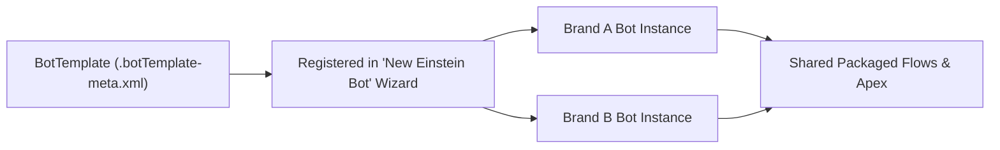

## Architectural Overview

While the `Bot` metadata type represents a concrete, runnable Einstein Bot instance in an org, `BotTemplate` represents a reusable **blueprint** registered in the Einstein Bot creation wizard. When an administrator clicks **New Bot** in Setup, Salesforce lists both standard system templates and any custom `BotTemplate` components deployed or installed in the org.

For multi-org enterprises and AppExchange ISV partners, `BotTemplate` is the primary distribution mechanism for conversational AI accelerators. Instead of shipping a static `Bot` that subscribers cannot easily clone or customize without namespace conflicts, you ship a `BotTemplate` alongside supporting [Flow](/docs/metadata/flow-metadata-type/) definitions and [ApexClass](/docs/metadata/apex-class-metadata-type/) actions. Subscribers can then instantiate multiple regional or brand-specific bots from that template.



## SFDX Directory & File Suffix

| Property | Value |
| :--- | :--- |
| **Metadata Type Name** | `BotTemplate` |
| **Classic Directory** | `botTemplates/` |
| **Classic File Suffix** | `.botTemplate` |
| **SFDX Source Directory** | `force-app/main/default/botTemplates/` |
| **SFDX File Suffix** | `.botTemplate-meta.xml` |

## Key Metadata Fields

The `BotTemplate` metadata type includes the following top-level configuration elements:

| Field Name | Field Type | Required | Architectural Description |
| :--- | :--- | :--- | :--- |
| `botDialogs` | `BotDialog[]` | No | The starter set of dialogs (`Welcome`, `Main_Menu`, `Confused`, `Error_Handling`, and custom dialogs) created when a bot is instantiated from this template. |
| `conversationGoals` | `ConversationGoal[]` | No | Preconfigured conversation goals tracked when dialogs execute. |
| `conversationVariables` | `ConversationVariable[]` | No | Default conversation variables provisioned in new bots created from the template. |
| `description` | `string` | No | Detailed description shown to administrators when selecting a template in the New Bot wizard. |
| `label` | `string` | Yes | Display name of the template in the Einstein Bot creation UI. |
| `mlDomain` | `LocalMlDomain` | No | Starter NLU intents, utterances, and custom slot entities copied into the new bot. |
| `richContentEnabled` | `boolean` | No | Specifies whether the template creates an Enhanced Bot (`true`) or a Standard Bot (`false`). |

> [!TIP]
> When authoring a `BotTemplate` for Second-Generation Managed Packages (2GP), avoid hardcoding org-specific queue names or user IDs inside `botDialogs` transfer steps so subscriber instantiation succeeds out of the box.

## Declarative XML & `package.xml` Examples

### SFDX Source File Example

```xml title="force-app/main/default/botTemplates/Retail_Concierge_Template.botTemplate-meta.xml"
<?xml version="1.0" encoding="UTF-8"?>
<BotTemplate xmlns="http://soap.sforce.com/2006/04/metadata">
    <botDialogs>
        <botSteps>
            <botMessages>
                <message>Welcome! How can our Retail Concierge assist you today?</message>
                <messageIdentifier>welcome_msg_001</messageIdentifier>
            </botMessages>
            <stepIdentifier>welcome_step_001</stepIdentifier>
            <type>Message</type>
        </botSteps>
        <botSteps>
            <botNavigation>
                <botNavigationLinks>
                    <targetBotDialog>Main_Menu</targetBotDialog>
                </botNavigationLinks>
                <type>Redirect</type>
            </botNavigation>
            <stepIdentifier>welcome_redirect_001</stepIdentifier>
            <type>Navigation</type>
        </botSteps>
        <developerName>Welcome</developerName>
        <isPlaceholderDialog>false</isPlaceholderDialog>
        <label>Welcome</label>
        <showInFooterMenu>false</showInFooterMenu>
    </botDialogs>
    <botDialogs>
        <botSteps>
            <stepIdentifier>main_menu_wait_001</stepIdentifier>
            <type>Wait</type>
        </botSteps>
        <developerName>Main_Menu</developerName>
        <isPlaceholderDialog>false</isPlaceholderDialog>
        <label>Main Menu</label>
        <showInFooterMenu>true</showInFooterMenu>
    </botDialogs>
    <conversationVariables>
        <dataType>Text</dataType>
        <developerName>Customer_Order_Number</developerName>
        <label>Customer Order Number</label>
    </conversationVariables>
    <description>Starter template for retail order status, returns, and store locator bots.</description>
    <label>Retail Concierge Bot Template</label>
    <richContentEnabled>true</richContentEnabled>
</BotTemplate>
```

### Package Manifest (`package.xml`)

```xml title="manifest/package.xml"
<?xml version="1.0" encoding="UTF-8"?>
<Package xmlns="http://soap.sforce.com/2006/04/metadata">
    <types>
        <members>Retail_Concierge_Template</members>
        <name>BotTemplate</name>
    </types>
    <version>68.0</version>
</Package>
```

## SFDX CLI Retrieval & Deployment Commands

```bash
# Retrieve a specific BotTemplate from a packaging or dev org
sf project retrieve start --metadata BotTemplate:Retail_Concierge_Template

# Deploy the BotTemplate to a target org
sf project deploy start --metadata BotTemplate:Retail_Concierge_Template
```

## Senior Architect Best Practices & Gotchas

- **Template Instantiation Is One-Way:** Just like `BotBlock`, creating a `Bot` from a `BotTemplate` clones the template structure into a new `Bot` and `BotVersion`. Subsequent updates to the `BotTemplate` do not retroactively modify already-created bots.
- **Required System Dialogs:** Every valid `BotTemplate` should include standard system entry points (`Welcome`, `Main_Menu`, `Confused`, and `Error_Handling`) or cleanly link its navigation graph so the Bot Builder UI renders without broken link warnings.
- **Prerequisite `BotSettings`:** Target orgs must have Einstein Bots enabled (`BotSettings` with `enableBots: true`) before installing or deploying a `BotTemplate`.

> [!NOTE]
> You can export an existing working `BotVersion` into a `BotTemplate` by copying its `botDialogs`, `conversationVariables`, and `mlDomain` elements into a `.botTemplate-meta.xml` wrapper and removing instance-specific fields like `entryDialog` and `status`.
