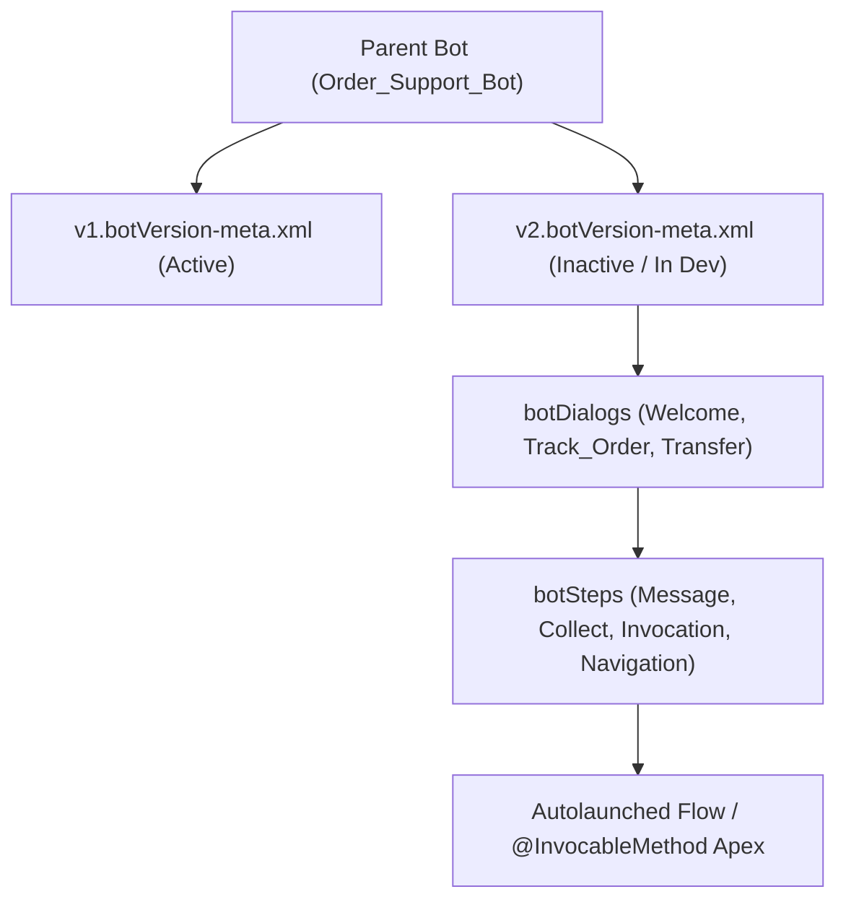

## Architectural Overview

The `BotVersion` metadata type is the core conversational engine of an Einstein Bot. While the parent `Bot` metadata file holds org-level wiring (such as the running user and channel bindings), `BotVersion` stores the entire state machine of a specific bot release: every dialog (`BotDialog`), step (`BotStep`), branching rule, variable (`ConversationVariable`), NLP intent threshold, and backend callout to [Flow](/docs/metadata/flow-metadata-type/) or [ApexClass](/docs/metadata/apex-class-metadata-type/).

In Salesforce DX source format, `BotVersion` is decomposed out of the monolithic `.bot` file into individual `<VersionName>.botVersion-meta.xml` files inside `force-app/main/default/bots/<BotName>/`. This enables teams to keep production running on `v1.botVersion-meta.xml` while developing and testing `v2.botVersion-meta.xml` in source control.



## SFDX Directory & File Suffix

| Property | Value |
| :--- | :--- |
| **Metadata Type Name** | `BotVersion` |
| **Classic Representation** | Embedded `<botVersions>` inside `bots/<BotName>.bot` |
| **SFDX Source Directory** | `force-app/main/default/bots/<BotName>/` |
| **SFDX File Suffix** | `.botVersion-meta.xml` |

## Key Metadata Fields

The `BotVersion` metadata type exposes the following primary XML elements:

| Field Name | Field Type | Required | Architectural Description |
| :--- | :--- | :--- | :--- |
| `botDialogs` | `BotDialog[]` | No | The collection of conversational dialogs (`Welcome`, `Main_Menu`, `Confused`, and business dialogs) comprising the state machine. |
| `conversationSystemDialogs` | `ConversationSystemDialog[]` | No | Maps system events such as `Error_Handling` and `Transfer_Failed` to specific target dialogs. |
| `conversationVariables` | `ConversationVariable[]` | No | Session-scoped variables (`Text`, `Number`, `Boolean`, `Object`, `Id`, `Date`, `DateTime`) used across dialogs. |
| `entryDialog` | `string` | Yes | The `developerName` of the initial `BotDialog` executed when a session starts (typically `Welcome`). |
| `intentDisambiguationEnabled` | `boolean` | No | Prompts the user to clarify when multiple NLU intents score within a close confidence margin. |
| `intentThreshold` | `double` | No | Minimum NLU confidence score (between `0.0` and `1.0`, default `0.8`) required to match a user utterance to an intent. |
| `mainMenuDialog` | `string` | No | The `developerName` of the main menu dialog accessible to users throughout the conversation. |
| `nlpProviders` | `BotNlpProvider[]` | No | Configures language-specific NLP providers and Einstein Intent Sets for multi-language bots. |
| `responseDelayMilliseconds` | `int` | No | Artificial typing delay in milliseconds before displaying bot messages to simulate natural pacing. |
| `status` | `BotVersionStatus` | No | Read-only in many deployment contexts (`Active` or `Inactive`); active status is managed via activation actions. |
| `toneType` | `BotToneType` | No | Sets the conversational tone (`Casual`, `Formal`, or `Neutral`) for generative/Einstein responses. |

> [!WARNING]
> Every `<botSteps>` and `<botMessages>` node inside a `BotVersion` contains a UUID-style `<stepIdentifier>` and `<messageIdentifier>`. When manually editing or merging `.botVersion-meta.xml` files in Git, never duplicate these identifiers or the deployment will fail.

## Declarative XML & `package.xml` Examples

### SFDX Source File Example

```xml title="force-app/main/default/bots/Order_Support_Bot/v1.botVersion-meta.xml"
<?xml version="1.0" encoding="UTF-8"?>
<BotVersion xmlns="http://soap.sforce.com/2006/04/metadata">
    <fullName>v1</fullName>
    <botDialogs>
        <botSteps>
            <botMessages>
                <message>Hi! I can help you check your order status.</message>
                <messageIdentifier>msg_welcome_01</messageIdentifier>
            </botMessages>
            <stepIdentifier>step_welcome_01</stepIdentifier>
            <type>Message</type>
        </botSteps>
        <botSteps>
            <botNavigation>
                <botNavigationLinks>
                    <targetBotDialog>Main_Menu</targetBotDialog>
                </botNavigationLinks>
                <type>Redirect</type>
            </botNavigation>
            <stepIdentifier>step_welcome_nav_01</stepIdentifier>
            <type>Navigation</type>
        </botSteps>
        <developerName>Welcome</developerName>
        <isPlaceholderDialog>false</isPlaceholderDialog>
        <label>Welcome</label>
        <showInFooterMenu>false</showInFooterMenu>
    </botDialogs>
    <botDialogs>
        <botSteps>
            <stepIdentifier>step_main_wait_01</stepIdentifier>
            <type>Wait</type>
        </botSteps>
        <developerName>Main_Menu</developerName>
        <isPlaceholderDialog>false</isPlaceholderDialog>
        <label>Main Menu</label>
        <showInFooterMenu>true</showInFooterMenu>
    </botDialogs>
    <conversationVariables>
        <dataType>Text</dataType>
        <developerName>OrderNumber</developerName>
        <label>Order Number</label>
    </conversationVariables>
    <entryDialog>Welcome</entryDialog>
    <intentDisambiguationEnabled>false</intentDisambiguationEnabled>
    <intentThreshold>0.8</intentThreshold>
    <mainMenuDialog>Main_Menu</mainMenuDialog>
    <responseDelayMilliseconds>1000</responseDelayMilliseconds>
    <toneType>Neutral</toneType>
</BotVersion>
```

### Package Manifest (`package.xml`)

```xml title="manifest/package.xml"
<?xml version="1.0" encoding="UTF-8"?>
<Package xmlns="http://soap.sforce.com/2006/04/metadata">
    <types>
        <members>Order_Support_Bot</members>
        <name>Bot</name>
    </types>
    <types>
        <members>Order_Support_Bot.v1</members>
        <name>BotVersion</name>
    </types>
    <version>68.0</version>
</Package>
```

## Querying via SOQL & SFDX CLI

Audit deployed `BotVersion` records and check which version is currently active in the target org using SOQL:

```soql
SELECT Id, DeveloperName, BotDefinition.DeveloperName, VersionNumber, Status, ToneType
FROM BotVersion
ORDER BY BotDefinition.DeveloperName, VersionNumber DESC
```

Deploy or retrieve a specific `BotVersion`:

```bash
# Retrieve a single BotVersion along with its parent Bot
sf project retrieve start --metadata Bot:Order_Support_Bot BotVersion:Order_Support_Bot.v1

# Deploy updated BotVersion XML
sf project deploy start --source-dir force-app/main/default/bots/Order_Support_Bot/v1.botVersion-meta.xml
```

## Senior Architect Best Practices & Gotchas

- **Immutable Active Versions:** If `Order_Support_Bot.v1` has `Status = 'Active'` in production, deploying edits to `v1.botVersion-meta.xml` fails with `Cannot modify an active bot version`. Adopt an immutable version strategy in CI/CD by creating `v2.botVersion-meta.xml` for major releases.
- **Invocable Contract Stability:** Changing the input or output parameter signature of an `@InvocableMethod` in an [ApexClass](/docs/metadata/apex-class-metadata-type/) or variable names in an autolaunched [Flow](/docs/metadata/flow-metadata-type/) referenced by a `<botInvocation>` breaks `BotVersion` validation. Always deploy updated Flow/Apex contracts and the updated `BotVersion` in the same atomic deployment.
- **Keep Business Logic Out of Dialog Rules:** Avoid building deeply nested conditional rules inside `BotVersion` XML. Delegate complex routing and data lookups to an autolaunched Flow or Apex service and return a single status variable to the bot.
