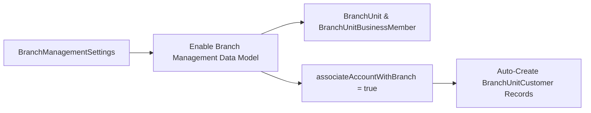

## Architectural Overview

In retail banking, wealth management, and insurance architectures built on Salesforce Financial Services Cloud (FSC), tracking how physical or virtual branches (`BranchUnit`), bankers (`BranchUnitBusinessMember`), and customers (`BranchUnitCustomer`) interact is essential for attribution and regional compliance. The `BranchManagementSettings` metadata type controls the org-wide behavior of the Branch Management data model and its automated record association engine.

Architecturally, deploying `BranchManagementSettings` enables the platform's branch attribution rules (`AssociationCriteria`), ensuring that when a banker working in a specific branch creates or updates an Account or onboarding record, Salesforce automatically stamps the corresponding `BranchUnitCustomer` junction without requiring custom Apex triggers.



## SFDX Directory & File Suffix

| Property | Value |
| :--- | :--- |
| **Metadata Type Name** | `BranchManagementSettings` |
| **Classic Directory** | `settings/` |
| **Classic File Suffix** | `.settings` (`BranchManagement.settings`) |
| **SFDX Source Directory** | `force-app/main/default/settings/` |
| **SFDX File Suffix** | `.settings-meta.xml` (`BranchManagement.settings-meta.xml`) |

## Key Metadata Fields

The `BranchManagementSettings` metadata type exposes the following org-wide configuration flags:

| Field Name | Field Type | Required | Architectural Description |
| :--- | :--- | :--- | :--- |
| `associateAccountWithBranch` | `boolean` | No | Automatically associates newly created or updated Account records with the current user's active `BranchUnit` via `BranchUnitCustomer` records (`true` or `false`). |

> [!NOTE]
> Standard objects supporting Branch Management (`BranchUnit`, `BranchUnitBusinessMember`, `BranchUnitCustomer`, and `BranchUnitRelatedRecord`) become accessible in SOQL and Setup once the Branch Management feature license and permission sets are enabled in the org.

## Declarative XML & `package.xml` Examples

### SFDX Source File Example

```xml title="force-app/main/default/settings/BranchManagement.settings-meta.xml"
<?xml version="1.0" encoding="UTF-8"?>
<BranchManagementSettings xmlns="http://soap.sforce.com/2006/04/metadata">
    <associateAccountWithBranch>true</associateAccountWithBranch>
</BranchManagementSettings>
```

### Package Manifest (`package.xml`)

```xml title="manifest/package.xml"
<?xml version="1.0" encoding="UTF-8"?>
<Package xmlns="http://soap.sforce.com/2006/04/metadata">
    <types>
        <members>BranchManagement</members>
        <name>Settings</name>
    </types>
    <version>68.0</version>
</Package>
```

## SFDX CLI & SOQL Auditing Commands

Use the Salesforce CLI to retrieve and deploy `BranchManagementSettings`:

```bash
# Retrieve BranchManagementSettings from an FSC org
sf project retrieve start --metadata Settings:BranchManagement

# Deploy BranchManagementSettings to a target environment
sf project deploy start --metadata Settings:BranchManagement
```

Once Branch Management is enabled, you can query active branches and their operating hours using SOQL:

```soql
SELECT Id, Name, BranchCode, IsActive, OperatingHoursId, ParentBranchUnitId
FROM BranchUnit
WHERE IsActive = true
ORDER BY Name ASC
```

## Senior Architect Best Practices & Gotchas

- **Scratch Org Feature Requirement:** In CI/CD pipelines using scratch orgs, you must include `"FinancialServicesCommunity"` or `"BranchManagement"` in the `"features"` list of `project-scratch-def.json` before deploying `BranchManagement.settings-meta.xml`.
- **High-Volume Data Load Impact:** When `associateAccountWithBranch` is set to `true`, bulk data loads executed by a user assigned to a `BranchUnit` will automatically generate `BranchUnitCustomer` records. Always run bulk ETL data migrations under a dedicated integration user that is **not** assigned as a `BranchUnitBusinessMember` to avoid unintended branch associations and row lock contention.
- **Sharing Model Alignment:** `BranchUnit` has its own Organization-Wide Default sharing model (`CustomObject:BranchUnit`). Review [CustomObject](/docs/metadata/custom-object-metadata-type/) sharing settings alongside `BranchManagementSettings` so regional branch managers only view performance metrics for their hierarchy.
