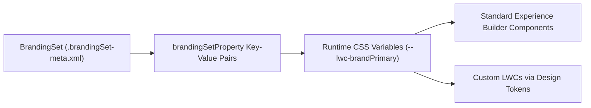

## Architectural Overview

The `BrandingSet` metadata type defines the visual design system tokens—color palettes, typography, header backgrounds, and logo asset references—for Lightning Experience themes and Experience Cloud (Aura) sites. Rather than hardcoding CSS overrides across custom Lightning Web Components, Salesforce surfaces a `BrandingSet`'s `brandingSetProperty` values as standard `--lwc-*` and `--dxp-*` CSS custom properties at runtime.

In multi-brand enterprise portals, architects can define multiple `BrandingSet` configurations for the same Experience Cloud site and bind each branding set to a specific Audience criteria (such as Partner Tier, Country, or Account Record Type). This enables a single Experience Cloud codebase to dynamically re-skin itself at login without duplicating site pages.



## SFDX Directory & File Suffix

| Property | Value |
| :--- | :--- |
| **Metadata Type Name** | `BrandingSet` |
| **Classic Directory** | `brandingSets/` |
| **Classic File Suffix** | `.brandingSet` |
| **SFDX Source Directory** | `force-app/main/default/brandingSets/` |
| **SFDX File Suffix** | `.brandingSet-meta.xml` |

## Key Metadata Fields

The `BrandingSet` metadata type contains the following XML elements:

| Field Name | Field Type | Required | Architectural Description |
| :--- | :--- | :--- | :--- |
| `brandingSetProperty` | `BrandingSetProperty[]` | No | A list of key-value property pairs (`propertyName` and `propertyValue`) defining colors, fonts, and asset URLs. |
| `description` | `string` | No | Documents the brand identity or target audience for this branding set. |
| `masterLabel` | `string` | Yes | The human-readable label displayed in Experience Builder under Theme -> Manage Branding Sets. |
| `type` | `string` | No | Specifies the template context (for example, `jepson:jepson` or `SC:service` for Customer Service themes). |
| `brandingSetProperty.propertyName` | `string` | Yes | The theme token identifier (such as `ActionColor`, `LinkColor`, `TextColor`, `PrimaryFont`, or `CompanyLogo`). |
| `brandingSetProperty.propertyValue` | `string` | No | The CSS color value (`rgb(...)`, `#hex`), font name, or ContentAsset reference assigned to the token. |

> [!TIP]
> In custom Lightning Web Components built for Experience Cloud, reference `var(--lwc-brandAction)` and `var(--lwc-colorTextDefault)` in your `.css` files so your custom components automatically inherit changes made in `BrandingSet`.

## Declarative XML & `package.xml` Examples

### SFDX Source File Example

```xml title="force-app/main/default/brandingSets/Partner_Portal_Gold_Tier.brandingSet-meta.xml"
<?xml version="1.0" encoding="UTF-8"?>
<BrandingSet xmlns="http://soap.sforce.com/2006/04/metadata">
    <brandingSetProperty>
        <propertyName>ActionColor</propertyName>
        <propertyValue>rgb(15, 76, 129)</propertyValue>
    </brandingSetProperty>
    <brandingSetProperty>
        <propertyName>BorderColor</propertyName>
        <propertyValue>rgb(212, 212, 212)</propertyValue>
    </brandingSetProperty>
    <brandingSetProperty>
        <propertyName>DetailTextColor</propertyName>
        <propertyValue>rgb(90, 90, 90)</propertyValue>
    </brandingSetProperty>
    <brandingSetProperty>
        <propertyName>ErrorFontColor</propertyName>
        <propertyValue>rgb(194, 57, 52)</propertyValue>
    </brandingSetProperty>
    <brandingSetProperty>
        <propertyName>HeaderFonts</propertyName>
        <propertyValue>Salesforce Sans</propertyValue>
    </brandingSetProperty>
    <brandingSetProperty>
        <propertyName>LinkColor</propertyName>
        <propertyValue>rgb(15, 76, 129)</propertyValue>
    </brandingSetProperty>
    <brandingSetProperty>
        <propertyName>OverlayTextColor</propertyName>
        <propertyValue>#FFFFFF</propertyValue>
    </brandingSetProperty>
    <brandingSetProperty>
        <propertyName>PageBackgroundColor</propertyName>
        <propertyValue>#F8F9FA</propertyValue>
    </brandingSetProperty>
    <brandingSetProperty>
        <propertyName>PrimaryFont</propertyName>
        <propertyValue>Salesforce Sans</propertyValue>
    </brandingSetProperty>
    <brandingSetProperty>
        <propertyName>TextColor</propertyName>
        <propertyValue>rgb(24, 24, 24)</propertyValue>
    </brandingSetProperty>
    <brandingSetProperty>
        <propertyName>TextTransformStyle</propertyName>
        <propertyValue>none</propertyValue>
    </brandingSetProperty>
    <description>Executive navy and slate branding set for Gold Tier Partner Portal users.</description>
    <masterLabel>Partner Portal Gold Tier</masterLabel>
    <type>jepson:jepson</type>
</BrandingSet>
```

### Package Manifest (`package.xml`)

```xml title="manifest/package.xml"
<?xml version="1.0" encoding="UTF-8"?>
<Package xmlns="http://soap.sforce.com/2006/04/metadata">
    <types>
        <members>Partner_Portal_Gold_Tier</members>
        <name>BrandingSet</name>
    </types>
    <version>68.0</version>
</Package>
```

## SFDX CLI Retrieval & Deployment Commands

```bash
# Retrieve all BrandingSet definitions from the org
sf project retrieve start --metadata BrandingSet

# Deploy a specific BrandingSet
sf project deploy start --metadata BrandingSet:Partner_Portal_Gold_Tier
```

## Senior Architect Best Practices & Gotchas

- **ContentAsset Dependencies for Logos:** When a `BrandingSetProperty` such as `CompanyLogo` or `HeaderBackgroundImage` references an image (`/file-asset/acme_logo?v=1`), ensure the corresponding `ContentAsset` metadata file is included in your deployment package or the deployment will fail.
- **Interaction with `ExperienceBundle`:** If you manage your Experience Cloud site using [ExperienceBundle](/docs/metadata/experience-bundle-metadata-type/), the site's active branding sets are also referenced in `experiences/<SiteName>/themes/<ThemeName>.json`. Always retrieve and commit both `BrandingSet` and `ExperienceBundle` together when modifying theme colors in Experience Builder.
- **WCAG Contrast Validation:** When updating `ActionColor`, `OverlayTextColor`, and `PageBackgroundColor` directly in XML, verify that combinations meet WCAG 2.1 AA contrast ratios (4.5:1 for normal text), as Metadata API does not block low-contrast color combinations.
