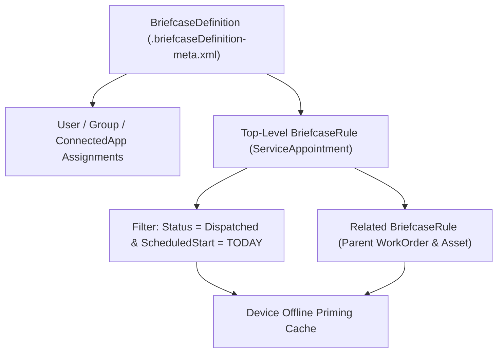

## Architectural Overview

Mobile workforces using the Salesforce Field Service mobile app or Mobile App Plus (Offline LWC) frequently operate in environments with zero cellular connectivity—such as basements, utility substations, rural sites, or hospitals. The `BriefcaseDefinition` metadata type powers **Briefcase Builder**, Salesforce's declarative offline data priming engine.

Architecturally, a `BriefcaseDefinition` defines a directed graph of object rules (`BriefcaseRule`), field filters (`BriefcaseRuleFilter`), and relationship traversals (`relatedRules`) coupled with user/group assignments. When a mobile user syncs their device while online, the Briefcase engine evaluates the active `BriefcaseDefinition` rules and caches the matching records locally on the device's encrypted offline store so offline Lightning Web Components and Field Service flows can read and mutate records seamlessly.



## SFDX Directory & File Suffix

| Property | Value |
| :--- | :--- |
| **Metadata Type Name** | `BriefcaseDefinition` |
| **Classic Directory** | `briefcaseDefinitions/` |
| **Classic File Suffix** | `.briefcaseDefinition` |
| **SFDX Source Directory** | `force-app/main/default/briefcaseDefinitions/` |
| **SFDX File Suffix** | `.briefcaseDefinition-meta.xml` |

## Key Metadata Fields

The `BriefcaseDefinition` metadata type and its nested `BriefcaseRule` elements include the following configuration fields:

| Field Name | Field Type | Required | Architectural Description |
| :--- | :--- | :--- | :--- |
| `briefcaseRules` | `BriefcaseRule[]` | No | The collection of object priming rules, filter criteria, and hierarchical related rules. |
| `description` | `string` | No | Explains which mobile persona and offline workflow this briefcase supports. |
| `isActive` | `boolean` | Yes | Activates (`true`) or deactivates (`false`) offline priming for this briefcase definition. |
| `masterLabel` | `string` | Yes | Display name of the briefcase in Setup -> Briefcase Builder. |
| `briefcaseRules.targetEntity` | `string` | Yes | API name of the standard or custom object to prime (for example, `WorkOrder`, `Asset`, or `Inspection__c`). |
| `briefcaseRules.filterLogic` | `string` | No | Boolean filter logic (such as `1 AND (2 OR 3)`) combining multiple `briefcaseRuleFilters`. |
| `briefcaseRules.briefcaseRuleFilters` | `BriefcaseRuleFilter[]` | No | Field-level filter criteria (`targetEntityField`, `filterOperator`, `filterValue`). |
| `briefcaseRules.recordLimit` | `int` | No | Caps the maximum number of records returned by the rule (combined with `orderBy` and `isAscendingOrder`). |
| `briefcaseRules.relatedRules` | `BriefcaseRule[]` | No | Child or parent object traversal rules linked via `relationshipField` and `relationshipType` (`ParentToChild` or `ChildToParent`). |

> [!TIP]
> Always set an explicit `recordLimit` and `orderBy` on every `BriefcaseRule` to prevent mobile sync timeouts and excessive battery or storage consumption on technician devices.

## Declarative XML & `package.xml` Examples

### SFDX Source File Example

```xml title="force-app/main/default/briefcaseDefinitions/Field_Tech_Daily_Dispatch.briefcaseDefinition-meta.xml"
<?xml version="1.0" encoding="UTF-8"?>
<BriefcaseDefinition xmlns="http://soap.sforce.com/2006/04/metadata">
    <briefcaseRules>
        <briefcaseRuleFilters>
            <filterOperator>Equals</filterOperator>
            <filterSeqNumber>1</filterSeqNumber>
            <filterValue>High</filterValue>
            <targetEntityField>Priority</targetEntityField>
        </briefcaseRuleFilters>
        <briefcaseRuleFilters>
            <filterOperator>Equals</filterOperator>
            <filterSeqNumber>2</filterSeqNumber>
            <filterValue>New</filterValue>
            <targetEntityField>Status</targetEntityField>
        </briefcaseRuleFilters>
        <filterLogic>1 AND 2</filterLogic>
        <isAscendingOrder>false</isAscendingOrder>
        <orderBy>CreatedDate</orderBy>
        <recordLimit>500</recordLimit>
        <relatedRules>
            <relationshipField>AccountId</relationshipField>
            <relationshipType>ChildToParent</relationshipType>
            <targetEntity>Account</targetEntity>
        </relatedRules>
        <targetEntity>WorkOrder</targetEntity>
    </briefcaseRules>
    <description>Primes high-priority open WorkOrders and parent Accounts for offline Field Service technicians.</description>
    <isActive>true</isActive>
    <masterLabel>Field Tech Daily Dispatch</masterLabel>
</BriefcaseDefinition>
```

### Package Manifest (`package.xml`)

```xml title="manifest/package.xml"
<?xml version="1.0" encoding="UTF-8"?>
<Package xmlns="http://soap.sforce.com/2006/04/metadata">
    <types>
        <members>Field_Tech_Daily_Dispatch</members>
        <name>BriefcaseDefinition</name>
    </types>
    <version>68.0</version>
</Package>
```

## Querying via Tooling API & SFDX CLI

You can inspect active `BriefcaseDefinition` records and their rules via the Tooling API:

```soql
SELECT Id, DeveloperName, MasterLabel, IsActive, Description, LastModifiedDate
FROM BriefcaseDefinition
ORDER BY DeveloperName ASC
```

Retrieve and deploy `BriefcaseDefinition` components using Salesforce CLI:

```bash
# Retrieve BriefcaseDefinition metadata
sf project retrieve start --metadata BriefcaseDefinition:Field_Tech_Daily_Dispatch

# Deploy BriefcaseDefinition metadata to target org
sf project deploy start --metadata BriefcaseDefinition:Field_Tech_Daily_Dispatch
```

## Senior Architect Best Practices & Gotchas

- **Selectivity & Indexed Filter Fields:** Briefcase priming queries execute whenever mobile users connect and sync. Ensure every `targetEntityField` used in `briefcaseRuleFilters` on high-volume objects (>100,000 rows) is indexed (standard index or custom index on [CustomField](/docs/metadata/custom-field-metadata-type/)) to prevent sync query timeouts.
- **Relationship Depth Limit:** `relatedRules` can traverse up to 3 levels deep in the object hierarchy. Avoid wide `ParentToChild` fan-outs without strict filters, as they can rapidly exhaust the 50,000-record briefcase ceiling.
- **Environment-Specific User Assignments:** If you assign specific User or Group IDs to a briefcase in the UI, note that user assignments vary across sandboxes. Assign briefcases to public groups with consistent DeveloperNames across environments.
