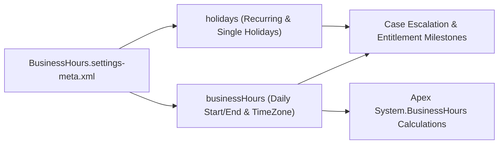

## Architectural Overview

In global Service Cloud and Field Service architectures, SLA milestone clocks, Case escalation timers, and Omni-Channel support schedules must accurately reflect regional working hours and statutory holidays. The `BusinessHoursSettings` metadata type stores the organization's `BusinessHoursEntry` schedules (such as `Default`, `EMEA_Support_24x5`, or `APAC_Gold_SLA`) alongside `Holiday` definitions in a single declarative settings file.

Architecturally, `BusinessHoursSettings` bridges metadata and data: while `BusinessHours` and `Holiday` can be queried via standard SOQL at runtime (and passed into `System.BusinessHours` Apex calculations), Salesforce exposes them in the Metadata API (`BusinessHours.settings-meta.xml`) so DevOps pipelines can version-control SLA operating hours alongside Case Escalation Rules and Entitlement Processes.



## SFDX Directory & File Suffix

| Property | Value |
| :--- | :--- |
| **Metadata Type Name** | `BusinessHoursSettings` |
| **Classic Directory** | `settings/` |
| **Classic File Suffix** | `.settings` (`BusinessHours.settings`) |
| **SFDX Source Directory** | `force-app/main/default/settings/` |
| **SFDX File Suffix** | `.settings-meta.xml` (`BusinessHours.settings-meta.xml`) |

## Key Metadata Fields

The `BusinessHoursSettings` metadata type contains two top-level arrays (`businessHours` and `holidays`):

| Field Name | Field Type | Required | Architectural Description |
| :--- | :--- | :--- | :--- |
| `businessHours` | `BusinessHoursEntry[]` | No | List of named operating schedules (`name`, `active`, `default`, `timeZoneId`, and `mondayStartTime` through `sundayEndTime`). |
| `holidays` | `Holiday[]` | No | List of single or recurring holidays (`name`, `activityDate`, `isRecurring`, `recurrenceType`, and `businessHours` bindings). |
| `businessHours.name` | `string` | Yes | Unique name of the business hours schedule (for example, `Default` or `US_East_Support`). |
| `businessHours.default` | `boolean` | Yes | Marks whether this schedule is the org-wide default business hours record (`true` for exactly one active entry). |
| `businessHours.timeZoneId` | `string` | Yes | IANA time zone identifier (such as `America/New_York` or `Europe/London`). |
| `businessHours.<day>StartTime` / `<day>EndTime` | `time` | No | Start and end time for each day of the week (`00:00:00.000Z` to `00:00:00.000Z` indicates 24-hour coverage; omitted indicates closed). |

> [!TIP]
> To configure 24-hour coverage for a specific day of the week in XML, set both `<mondayStartTime>` and `<mondayEndTime>` to `00:00:00.000Z`. To mark a day as closed (such as Saturday or Sunday), omit the start and end time tags for that day entirely.

## Declarative XML & `package.xml` Examples

### SFDX Source File Example

```xml title="force-app/main/default/settings/BusinessHours.settings-meta.xml"
<?xml version="1.0" encoding="UTF-8"?>
<BusinessHoursSettings xmlns="http://soap.sforce.com/2006/04/metadata">
    <businessHours>
        <active>true</active>
        <default>true</default>
        <fridayEndTime>17:00:00.000Z</fridayEndTime>
        <fridayStartTime>09:00:00.000Z</fridayStartTime>
        <mondayEndTime>17:00:00.000Z</mondayEndTime>
        <mondayStartTime>09:00:00.000Z</mondayStartTime>
        <name>Default</name>
        <thursdayEndTime>17:00:00.000Z</thursdayEndTime>
        <thursdayStartTime>09:00:00.000Z</thursdayStartTime>
        <timeZoneId>America/New_York</timeZoneId>
        <tuesdayEndTime>17:00:00.000Z</tuesdayEndTime>
        <tuesdayStartTime>09:00:00.000Z</tuesdayStartTime>
        <wednesdayEndTime>17:00:00.000Z</wednesdayEndTime>
        <wednesdayStartTime>09:00:00.000Z</wednesdayStartTime>
    </businessHours>
    <holidays>
        <activityDate>2026-01-01</activityDate>
        <businessHours>Default</businessHours>
        <description>New Year Day Holiday</description>
        <isRecurring>true</isRecurring>
        <name>New Year Day</name>
        <recurrenceDayOfMonth>1</recurrenceDayOfMonth>
        <recurrenceMonthOfYear>January</recurrenceMonthOfYear>
        <recurrenceStartDate>2026-01-01</recurrenceStartDate>
        <recurrenceType>RecursYearly</recurrenceType>
    </holidays>
</BusinessHoursSettings>
```

### Package Manifest (`package.xml`)

```xml title="manifest/package.xml"
<?xml version="1.0" encoding="UTF-8"?>
<Package xmlns="http://soap.sforce.com/2006/04/metadata">
    <types>
        <members>BusinessHours</members>
        <name>Settings</name>
    </types>
    <version>68.0</version>
</Package>
```

## Querying via SOQL & SFDX CLI

Because `BusinessHours` is exposed as a standard SObject at runtime, you can query it directly in SOQL for use in [ApexClass](/docs/metadata/apex-class-metadata-type/) SLA utilities or [Flow](/docs/metadata/flow-metadata-type/) actions:

```soql
SELECT Id, Name, IsActive, IsDefault, TimeZoneSidKey,
       MondayStartTime, MondayEndTime, FridayStartTime, FridayEndTime
FROM BusinessHours
WHERE IsActive = true
ORDER BY IsDefault DESC, Name ASC
```

Retrieve and deploy `BusinessHoursSettings` via Salesforce CLI:

```bash
# Retrieve BusinessHoursSettings (all schedules and holidays)
sf project retrieve start --metadata Settings:BusinessHours

# Deploy BusinessHoursSettings to a target environment
sf project deploy start --metadata Settings:BusinessHours
```

## Senior Architect Best Practices & Gotchas

- **Holiday Recurrence Start Dates:** A `Holiday` with `<isRecurring>true</isRecurring>` will fail deployment if `<recurrenceStartDate>` is set in the past relative to the first deployment into a new org unless properly aligned with the recurrence pattern. Prefer `RecursYearly` or `RecursYearlyNth` rules for annual holidays.
- **Avoid Hardcoding BusinessHours IDs in Flows:** Never hardcode an 18-character `BusinessHoursId` in a Flow or Apex class. Query `BusinessHours` by `Name` (which matches `<name>` in `BusinessHours.settings-meta.xml`) or `IsDefault = true`.
- **Cannot Delete BusinessHours via Settings Deployment:** Removing a `<businessHours>` entry from `BusinessHours.settings-meta.xml` and redeploying does not delete the schedule in the target org; instead, set `<active>false</active>` to retire an obsolete schedule.
