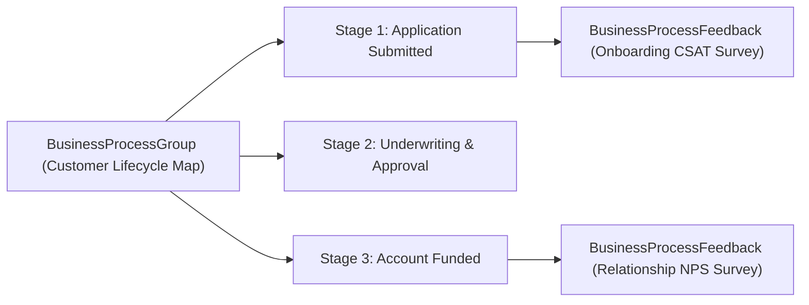

## Architectural Overview

The `BusinessProcessGroup` metadata type powers **Customer Lifecycle Maps** in Salesforce Feedback Management and Industry Clouds. Rather than treating customer satisfaction (CSAT) or Net Promoter Score (NPS) surveys as isolated touchpoints, `BusinessProcessGroup` lets architects model an end-to-end business journey (such as *Wealth Client Onboarding* or *Order-to-Delivery*) composed of sequential `BusinessProcessDefinition` stages and `BusinessProcessFeedback` survey mappings.

When deployed alongside record-triggered [Flow](/docs/metadata/flow-metadata-type/) automation, `BusinessProcessGroup` aggregates survey response scores by lifecycle stage so executives can pinpoint exactly where customer sentiment drops across the enterprise journey.



## SFDX Directory & File Suffix

| Property | Value |
| :--- | :--- |
| **Metadata Type Name** | `BusinessProcessGroup` |
| **Classic Directory** | `businessProcessGroups/` |
| **Classic File Suffix** | `.businessProcessGroup` |
| **SFDX Source Directory** | `force-app/main/default/businessProcessGroups/` |
| **SFDX File Suffix** | `.businessProcessGroup-meta.xml` |

## Key Metadata Fields

The `BusinessProcessGroup` metadata type and its nested stage definitions include the following key fields:

| Field Name | Field Type | Required | Architectural Description |
| :--- | :--- | :--- | :--- |
| `businessProcessDefinitions` | `BusinessProcessDefinition[]` | No | The ordered collection of stages that make up the customer lifecycle map. |
| `customerSatisfactionMetric` | `CustomerSatisfactionMetric` | Yes | The primary feedback metric tracked across the lifecycle (`NetPromoterScore` or `CustomerSatisfactionScore`). |
| `description` | `string` | No | Documents the customer journey and business unit covered by the process group. |
| `masterLabel` | `string` | Yes | Display name of the Customer Lifecycle Map in Setup. |
| `businessProcessDefinitions.developerName` | `string` | Yes | Unique API name for the individual lifecycle stage. |
| `businessProcessDefinitions.masterLabel` | `string` | Yes | Human-readable stage label (such as `Initial Consultation` or `Claim Resolved`). |
| `businessProcessDefinitions.sequenceNumber` | `int` | Yes | Integer ordering of the stage within the overall lifecycle journey. |
| `businessProcessDefinitions.businessProcessFeedbacks` | `BusinessProcessFeedback[]` | No | Maps a specific Survey question (`actionName`, `actionParam`, `actionType`) to the stage. |

> [!NOTE]
> Do not confuse `BusinessProcessGroup` with `BusinessProcess` (`objects/<Object>/businessProcesses/*.businessProcess-meta.xml`), which governs Lead, Opportunity, Solution, and Case status picklist values per Record Type.

## Declarative XML & `package.xml` Examples

### SFDX Source File Example

```xml title="force-app/main/default/businessProcessGroups/Commercial_Loan_Lifecycle.businessProcessGroup-meta.xml"
<?xml version="1.0" encoding="UTF-8"?>
<BusinessProcessGroup xmlns="http://soap.sforce.com/2006/04/metadata">
    <businessProcessDefinitions>
        <businessProcessFeedbacks>
            <actionName>Loan_Application_CSAT</actionName>
            <actionParam>How easy was it to submit your commercial loan application?</actionParam>
            <actionType>CustomerSatisfactionScore</actionType>
        </businessProcessFeedbacks>
        <description>Customer submits initial loan documentation.</description>
        <developerName>Application_Intake</developerName>
        <masterLabel>Application Intake</masterLabel>
        <sequenceNumber>1</sequenceNumber>
    </businessProcessDefinitions>
    <businessProcessDefinitions>
        <businessProcessFeedbacks>
            <actionName>Loan_Closing_CSAT</actionName>
            <actionParam>How satisfied were you with the loan closing process?</actionParam>
            <actionType>CustomerSatisfactionScore</actionType>
        </businessProcessFeedbacks>
        <description>Final loan underwriting approval and disbursement.</description>
        <developerName>Closing_And_Funding</developerName>
        <masterLabel>Closing and Funding</masterLabel>
        <sequenceNumber>2</sequenceNumber>
    </businessProcessDefinitions>
    <customerSatisfactionMetric>CustomerSatisfactionScore</customerSatisfactionMetric>
    <description>Tracks borrower satisfaction across commercial loan intake and funding stages.</description>
    <masterLabel>Commercial Loan Lifecycle</masterLabel>
</BusinessProcessGroup>
```

### Package Manifest (`package.xml`)

```xml title="manifest/package.xml"
<?xml version="1.0" encoding="UTF-8"?>
<Package xmlns="http://soap.sforce.com/2006/04/metadata">
    <types>
        <members>Commercial_Loan_Lifecycle</members>
        <name>BusinessProcessGroup</name>
    </types>
    <version>68.0</version>
</Package>
```

## Querying via SOQL & SFDX CLI

You can query deployed `BusinessProcessGroup` and stage definitions in SOQL:

```soql
SELECT Id, DeveloperName, MasterLabel, CustomerSatisfactionMetric, Description
FROM BusinessProcessGroup
ORDER BY MasterLabel ASC
```

Retrieve and deploy `BusinessProcessGroup` metadata using the Salesforce CLI:

```bash
# Retrieve BusinessProcessGroup definitions
sf project retrieve start --metadata BusinessProcessGroup:Commercial_Loan_Lifecycle

# Deploy BusinessProcessGroup to target environment
sf project deploy start --metadata BusinessProcessGroup:Commercial_Loan_Lifecycle
```

## Senior Architect Best Practices & Gotchas

- **Active Survey Prerequisite:** Every `<actionName>` inside `<businessProcessFeedbacks>` references the DeveloperName of an active `Survey` containing a matching CSAT or NPS question (`<actionParam>`). Deploy and activate the target Survey before deploying `BusinessProcessGroup`.
- **Metric Type Consistency:** Every `BusinessProcessFeedback` entry's `actionType` inside a group must match the parent group's `customerSatisfactionMetric` (`CustomerSatisfactionScore` or `NetPromoterScore`), or the Metadata API validation fails.
