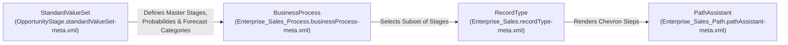

The `BusinessProcess` metadata type defines a **Sales Process** (`Opportunity`), **Support Process** (`Case`), **Lead Process** (`Lead`), or **Solution Process** (`Solution`). Introduced in API version 17.0, `BusinessProcess` acts as the mandatory bridge between the org-wide master lifecycle picklist ([StandardValueSet](/docs/metadata/standard-value-set-metadata-type/): `OpportunityStage`, `CaseStatus`, `LeadStatus`) and an object's [RecordType](/docs/metadata/record-type-metadata-type/).

In Salesforce DX projects, business processes are decomposed inside their parent object folder at `force-app/main/default/objects/<ObjectName>/businessProcesses/<ProcessName>.businessProcess-meta.xml`.



## Key Metadata Fields

| Field | Location | Required | Description |
|---|---|---|---|
| `fullName` | Root | Yes | Developer name of the business process (qualified as `Object.ProcessName` in `package.xml`) |
| `isActive` | Root | No | Whether the business process is active (`true` or `false`) |
| `description` | Root | No | Explains which sales, support, or lead lifecycle this process models |
| `values` | Root | No | Ordered subset of picklist values (`fullName` and `default`) selected from the master `StandardValueSet` |
| `default` | `values` | Yes | Marks the default status (`true` for Case/Lead/Solution processes; `false` on `Opportunity` stages) |

## Production-Grade XML Example (`Opportunity` Sales Process)

Below is a `BusinessProcess` for `Opportunity` (`force-app/main/default/objects/Opportunity/businessProcesses/Enterprise_Sales_Process.businessProcess-meta.xml`):

```xml
<?xml version="1.0" encoding="UTF-8"?>
<BusinessProcess xmlns="http://soap.sforce.com/2006/04/metadata">
    <fullName>Enterprise_Sales_Process</fullName>
    <description>Multi-stage sales process for B2B Enterprise direct sales opportunities.</description>
    <isActive>true</isActive>
    <values>
        <fullName>Discovery</fullName>
        <default>false</default>
    </values>
    <values>
        <fullName>Technical Validation</fullName>
        <default>false</default>
    </values>
    <values>
        <fullName>Contract Negotiation</fullName>
        <default>false</default>
    </values>
    <values>
        <fullName>Closed Won</fullName>
        <default>false</default>
    </values>
    <values>
        <fullName>Closed Lost</fullName>
        <default>false</default>
    </values>
</BusinessProcess>
```

> [!WARNING]
> **Deploy Order for New Stage Values**: If you introduce a brand-new stage (such as `Technical Validation`) in a `BusinessProcess`, that value **must** already exist in the target org's `StandardValueSet` (`OpportunityStage`) or be deployed in the same `package.xml` transaction—otherwise the `BusinessProcess` deployment will fail with `Picklist value: Technical Validation in picklist: StageName not found`.

## Querying `BusinessProcess` with SOQL

```sql
-- 1. List all active Sales, Support, and Lead Processes in the org
SELECT Id, Name, TableEnumOrId, Description, IsActive, LastModifiedDate
FROM BusinessProcess
WHERE IsActive = true
ORDER BY TableEnumOrId, Name ASC

-- 2. Inspect which BusinessProcess is linked to each RecordType
SELECT Id, DeveloperName, Name, SobjectType, BusinessProcessId
FROM RecordType
WHERE SobjectType IN ('Opportunity', 'Case', 'Lead') AND IsActive = true
ORDER BY SobjectType, Name ASC
```

