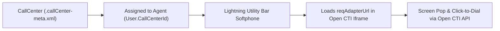

## Architectural Overview

The `CallCenter` metadata type is the foundation of Computer-Telephony Integration (CTI) in Salesforce Service Cloud and Sales Engagement. Whether your organization uses an Open CTI third-party softphone (such as Genesys Cloud, Five9, NICE CXone, or Cisco Webex) or a Partner Telephony contact center in Service Cloud Voice, `CallCenter` defines the adapter endpoint (`adapterUrl`), softphone utility bar dimensions, and vendor-specific configuration sections.

At runtime, Salesforce checks the logged-in agent's `User.CallCenterId` lookup field. If populated, the Lightning Experience Softphone utility loads the `reqAdapterUrl` configured in that `CallCenter` metadata definition inside a secure iframe and initializes the Open CTI JavaScript SDK (`sforce.opencti`).



## SFDX Directory & File Suffix

| Property | Value |
| :--- | :--- |
| **Metadata Type Name** | `CallCenter` |
| **Classic Directory** | `callCenters/` |
| **Classic File Suffix** | `.callCenter` |
| **SFDX Source Directory** | `force-app/main/default/callCenters/` |
| **SFDX File Suffix** | `.callCenter-meta.xml` |

## Key Metadata Fields

The `CallCenter` metadata type exposes the following XML fields:

| Field Name | Field Type | Required | Architectural Description |
| :--- | :--- | :--- | :--- |
| `adapterUrl` | `string` | No | The URL (or relative Visualforce page path `/apex/SoftphonePage`) hosting the Open CTI softphone adapter. |
| `customSettings` | `string` | No | JSON-encoded or key-value string storing the call center's section and item attributes (such as `reqStandAloneUrl`, `reqSoftphoneHeight`, `reqSoftphoneWidth`, and `reqUseApi`). |
| `displayName` | `string` | Yes | The human-readable name of the Call Center displayed in Setup -> Call Centers. |
| `displayNameLabel` | `string` | Yes | Label for the Display Name field (typically `Display Name` or `InternalNameLabel`). |
| `internalNameLabel` | `string` | Yes | Label for the Internal Name field (typically `InternalNameLabel` or `Internal Name`). |
| `sections` | `CallCenterSection[]` | No | Structured representation of call center configuration sections (`items` with `label`, `name`, `value`). |
| `version` | `string` | No | Version number of the CTI adapter specification. |

> [!TIP]
> When deploying Open CTI call centers across sandboxes and production, use a relative path or environment-specific SFDX string replacement for `reqAdapterUrl` so sandbox agents connect to your UAT telephony environment rather than production trunks.

## Declarative XML & `package.xml` Examples

### SFDX Source File Example

```xml title="force-app/main/default/callCenters/Global_OpenCTI_Center.callCenter-meta.xml"
<?xml version="1.0" encoding="UTF-8"?>
<CallCenter xmlns="http://soap.sforce.com/2006/04/metadata">
    <adapterUrl>https://cti-adapter.acme.enterprise/softphone/index.html</adapterUrl>
    <customSettings>{&quot;reqSoftphoneHeight&quot;:&quot;550&quot;,&quot;reqUseApi&quot;:&quot;true&quot;,&quot;reqSoftphoneWidth&quot;:&quot;380&quot;,&quot;reqSalesforceCompatibilityMode&quot;:&quot;Lightning&quot;}</customSettings>
    <displayName>Global Open CTI Contact Center</displayName>
    <displayNameLabel>Display Name</displayNameLabel>
    <internalNameLabel>Internal Name</internalNameLabel>
    <sections>
        <items>
            <label>CTI Adapter URL</label>
            <name>reqAdapterUrl</name>
            <value>https://cti-adapter.acme.enterprise/softphone/index.html</value>
        </items>
        <items>
            <label>Use CTI API</label>
            <name>reqUseApi</name>
            <value>true</value>
        </items>
        <items>
            <label>Softphone Height</label>
            <name>reqSoftphoneHeight</name>
            <value>550</value>
        </items>
        <items>
            <label>Softphone Width</label>
            <name>reqSoftphoneWidth</name>
            <value>380</value>
        </items>
        <items>
            <label>Salesforce Compatibility Mode</label>
            <name>reqSalesforceCompatibilityMode</name>
            <value>Lightning</value>
        </items>
        <label>General Info</label>
        <name>reqGeneralInfo</name>
    </sections>
    <version>6.0</version>
</CallCenter>
```

### Package Manifest (`package.xml`)

```xml title="manifest/package.xml"
<?xml version="1.0" encoding="UTF-8"?>
<Package xmlns="http://soap.sforce.com/2006/04/metadata">
    <types>
        <members>Global_OpenCTI_Center</members>
        <name>CallCenter</name>
    </types>
    <version>68.0</version>
</Package>
```

## Querying via SOQL & SFDX CLI

You can query the `CallCenter` standard object in SOQL to inspect deployed call centers or audit how many agents are assigned to each call center:

```soql
SELECT Id, Name, InternalName, AdapterUrl, Version, CreatedDate
FROM CallCenter
ORDER BY Name ASC
```

Retrieve and deploy `CallCenter` metadata with the Salesforce CLI:

```bash
# Retrieve CallCenter metadata
sf project retrieve start --metadata CallCenter:Global_OpenCTI_Center

# Deploy CallCenter metadata
sf project deploy start --metadata CallCenter:Global_OpenCTI_Center
```

## Senior Architect Best Practices & Gotchas

- **Keep `customSettings` and `sections` Synchronized:** In `CallCenter` XML, both `<customSettings>` (escaped JSON) and `<sections>` hold softphone attributes like `reqSoftphoneHeight` and `reqSalesforceCompatibilityMode`. Always update both when modifying dimensions or URLs in source control.
- **CSP and Framing Security:** If `adapterUrl` points to an external domain, add that domain to `CspTrustedSite` and verify that the external telephony web server sends a `Content-Security-Policy: frame-ancestors https://*.my.salesforce.com https://*.lightning.force.com` header so browsers do not block the softphone iframe.
- **User Assignment Automation:** `CallCenter` metadata does not store the list of assigned users. Automate `User.CallCenterId` population in post-deployment scripts or user-provisioning [Flow](/docs/metadata/flow-metadata-type/) logic by querying `CallCenter WHERE InternalName = 'Global_OpenCTI_Center'`.
