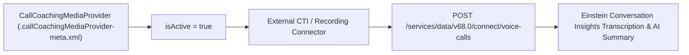

## Architectural Overview

**Einstein Conversation Insights (ECI)** transcribes and analyzes sales and service voice/video calls to surface keyword mentions, competitor tracking, objection handling, and generative AI call summaries. To ingest call recordings from external CTI or unified communications platforms (such as Dialpad, RingCentral, Aircall, Zoom, or a custom enterprise PBX), the external provider must be registered in Salesforce via the `CallCoachingMediaProvider` metadata type.

Architecturally, `CallCoachingMediaProvider` establishes the trusted media source identity (`providerName`) and activation state (`isActive`). When an external recording connector pushes call metadata and audio streams to the Salesforce `/connect/voice-calls` REST API, it authenticates via a [ConnectedApp](/docs/metadata/connected-app-metadata-type/) and references the registered `CallCoachingMediaProvider` so ECI knows which provider pipeline owns the `VoiceCall` record.



## SFDX Directory & File Suffix

| Property | Value |
| :--- | :--- |
| **Metadata Type Name** | `CallCoachingMediaProvider` |
| **Classic Directory** | `callCoachingMediaProviders/` |
| **Classic File Suffix** | `.callCoachingMediaProvider` |
| **SFDX Source Directory** | `force-app/main/default/callCoachingMediaProviders/` |
| **SFDX File Suffix** | `.callCoachingMediaProvider-meta.xml` |

## Key Metadata Fields

The `CallCoachingMediaProvider` metadata type exposes the following declarative XML fields:

| Field Name | Field Type | Required | Architectural Description |
| :--- | :--- | :--- | :--- |
| `isActive` | `boolean` | Yes | Enables (`true`) or disables (`false`) call recording ingestion from this media provider. |
| `providerDescription` | `string` | No | Describes the external CTI or recording system integrated with Einstein Conversation Insights. |
| `providerName` | `string` | Yes | The display and API identifier of the media provider (must match the provider name passed in ECI ingestion payloads). |

> [!NOTE]
> Deploying `CallCoachingMediaProvider` requires Einstein Conversation Insights (`CallCoaching`) to be enabled in the target org.

## Declarative XML & `package.xml` Examples

### SFDX Source File Example

```xml title="force-app/main/default/callCoachingMediaProviders/Enterprise_SIP_Recorder.callCoachingMediaProvider-meta.xml"
<?xml version="1.0" encoding="UTF-8"?>
<CallCoachingMediaProvider xmlns="http://soap.sforce.com/2006/04/metadata">
    <isActive>true</isActive>
    <providerDescription>Enterprise SIP trunk recording connector for Einstein Conversation Insights.</providerDescription>
    <providerName>Enterprise_SIP_Recorder</providerName>
</CallCoachingMediaProvider>
```

### Package Manifest (`package.xml`)

```xml title="manifest/package.xml"
<?xml version="1.0" encoding="UTF-8"?>
<Package xmlns="http://soap.sforce.com/2006/04/metadata">
    <types>
        <members>Enterprise_SIP_Recorder</members>
        <name>CallCoachingMediaProvider</name>
    </types>
    <version>68.0</version>
</Package>
```

## Querying via SOQL & SFDX CLI

You can query registered media providers at runtime using SOQL:

```soql
SELECT Id, ProviderName, ProviderDescription, IsActive, CreatedDate
FROM CallCoachingMediaProvider
ORDER BY ProviderName ASC
```

Retrieve and deploy `CallCoachingMediaProvider` metadata using Salesforce CLI:

```bash
# Retrieve all CallCoachingMediaProvider definitions
sf project retrieve start --metadata CallCoachingMediaProvider

# Deploy a specific CallCoachingMediaProvider
sf project deploy start --metadata CallCoachingMediaProvider:Enterprise_SIP_Recorder
```

## Senior Architect Best Practices & Gotchas

- **Exact `providerName` Matching in Connect API:** When your middleware calls the `/services/data/v68.0/connect/voice-calls` API to upload call metadata, the `mediaProviderName` or associated Connected App configuration must align with an active `CallCoachingMediaProvider` (`isActive = true`), or the API rejects the payload.
- **Permission Set Requirements for Users:** Even after deploying and activating a `CallCoachingMediaProvider`, call recordings will only be ingested for users who hold the Einstein Conversation Insights [PermissionSet](/docs/metadata/permission-set-metadata-type/) (`CallCoachingUser` / `ConversationInsightsIntegrationUser`).
- **Deactivating vs. Deleting:** You cannot delete a `CallCoachingMediaProvider` that is already referenced by historical `VoiceCall` records. Set `<isActive>false</isActive>` to decommission an old telephony provider while preserving historical call transcripts.
