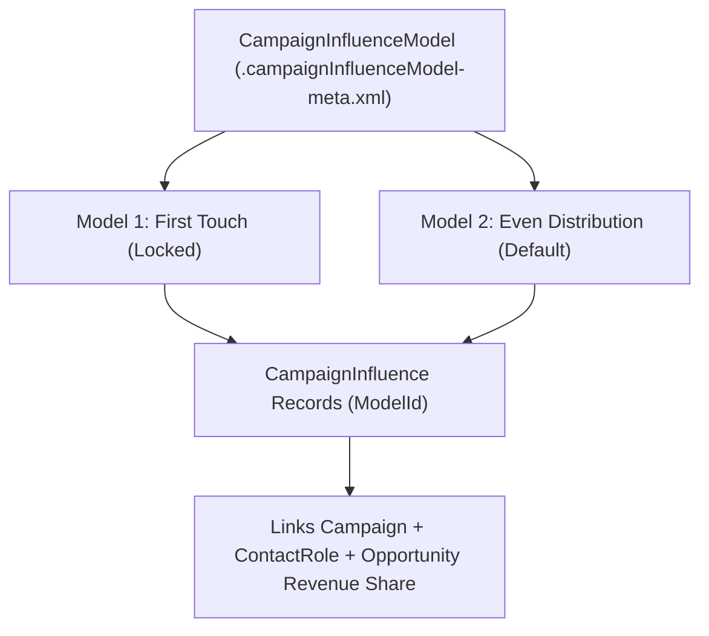

## Architectural Overview

In B2B revenue operations (RevOps), attributing Opportunity pipeline and closed-won revenue to a single "Primary Campaign Source" obscures multi-touch buyer journeys. The `CampaignInfluenceModel` metadata type powers **Customizable Campaign Influence**, allowing architects to define multiple parallel attribution models (such as *First Touch*, *Last Touch*, *Linear/Even Distribution*, or *W-Shaped Custom Attribution*).

Architecturally, each `CampaignInfluenceModel` acts as a partitioning key (`ModelId`) on the `CampaignInfluence` junction object between `Campaign`, `Opportunity`, and `Contact`. By setting `<isModelLocked>true</isModelLocked>` on custom attribution models, architects ensure that sales reps cannot manually tamper with revenue attribution percentages in the UI while allowing record-triggered [Flow](/docs/metadata/flow-metadata-type/) or batch [ApexClass](/docs/metadata/apex-class-metadata-type/) jobs to calculate exact `Influence` percentages totaling 100% per Opportunity.



## SFDX Directory & File Suffix

| Property | Value |
| :--- | :--- |
| **Metadata Type Name** | `CampaignInfluenceModel` |
| **Classic Directory** | `campaignInfluenceModels/` |
| **Classic File Suffix** | `.campaignInfluenceModel` |
| **SFDX Source Directory** | `force-app/main/default/campaignInfluenceModels/` |
| **SFDX File Suffix** | `.campaignInfluenceModel-meta.xml` |

## Key Metadata Fields

The `CampaignInfluenceModel` metadata type exposes the following XML fields:

| Field Name | Field Type | Required | Architectural Description |
| :--- | :--- | :--- | :--- |
| `isActive` | `boolean` | No | Activates (`true`) or deactivates (`false`) the attribution model for reporting and calculation. |
| `isDefaultModel` | `boolean` | Yes | Designates whether this model is the org's default Campaign Influence model (`true` for exactly one active model, which displays in the Opportunity related list by default). |
| `isModelLocked` | `boolean` | Yes | When `true`, blocks manual UI edits to `CampaignInfluence` records belonging to this model (API and Apex/Flow edits remain permitted). |
| `modelDescription` | `string` | No | Explains the attribution weighting methodology (for example, 40% First Touch, 20% Middle, 40% Last Touch). |
| `name` | `string` | Yes | Display name of the Campaign Influence Model in Setup and reports. |
| `recordPreference` | `string` | No | Controls which records are created (`AllRecords` or `RecordsWithAttribution`—only creating records when influence percentage > 0%). |

> [!TIP]
> Set `<recordPreference>RecordsWithAttribution</recordPreference>` on First-Touch and Last-Touch custom models to avoid storing zero-percent (`0%`) `CampaignInfluence` rows that consume data storage without adding reporting value.

## Declarative XML & `package.xml` Examples

### SFDX Source File Example

```xml title="force-app/main/default/campaignInfluenceModels/Multi_Touch_Linear_Model.campaignInfluenceModel-meta.xml"
<?xml version="1.0" encoding="UTF-8"?>
<CampaignInfluenceModel xmlns="http://soap.sforce.com/2006/04/metadata">
    <isActive>true</isActive>
    <isDefaultModel>false</isDefaultModel>
    <isModelLocked>true</isModelLocked>
    <modelDescription>Distributes Opportunity revenue share equally across all responded Campaigns linked to Opportunity Contact Roles prior to CloseDate.</modelDescription>
    <name>Multi-Touch Linear Attribution</name>
    <recordPreference>RecordsWithAttribution</recordPreference>
</CampaignInfluenceModel>
```

### Package Manifest (`package.xml`)

```xml title="manifest/package.xml"
<?xml version="1.0" encoding="UTF-8"?>
<Package xmlns="http://soap.sforce.com/2006/04/metadata">
    <types>
        <members>Multi_Touch_Linear_Model</members>
        <name>CampaignInfluenceModel</name>
    </types>
    <version>68.0</version>
</Package>
```

## Querying via SOQL & SFDX CLI

Query `CampaignInfluenceModel` in SOQL to dynamically look up the `ModelId` inside your attribution Apex classes or Flows (never hardcode `ModelId`):

```soql
SELECT Id, DeveloperName, MasterLabel, IsActive, IsDefaultModel, IsModelLocked, ModelType
FROM CampaignInfluenceModel
WHERE IsActive = true
ORDER BY IsDefaultModel DESC, DeveloperName ASC
```

Retrieve and deploy `CampaignInfluenceModel` metadata using Salesforce CLI:

```bash
# Retrieve CampaignInfluenceModel definitions
sf project retrieve start --metadata CampaignInfluenceModel:Multi_Touch_Linear_Model

# Deploy CampaignInfluenceModel to target org
sf project deploy start --metadata CampaignInfluenceModel:Multi_Touch_Linear_Model
```

## Senior Architect Best Practices & Gotchas

- **Prerequisite Feature & Permission Set:** Before deploying `CampaignInfluenceModel`, Customizable Campaign Influence must be enabled in `CampaignSettings` (`enableCampaignInfluence2: true`), and the deploying user must hold the **Campaign Influence** (`CampaignInfluence2`) permission (often granted via a CRM User or Marketing [PermissionSet](/docs/metadata/permission-set-metadata-type/)).
- **100% Influence Ceiling per Opportunity & Model:** The platform enforces a hard database constraint that the sum of `Influence` percentages across all `CampaignInfluence` records for a single `OpportunityId` + `ModelId` combination cannot exceed `100.0%`. When recalculating weights in Apex or Flow, update existing rows or redistribute weights in a single DML list to avoid `FIELD_INTEGRITY_EXCEPTION` errors.
- **Switching `isDefaultModel`:** Exactly one active model must have `isDefaultModel` set to `true`. When promoting a custom model to default, deploy the new default model (`isDefaultModel: true`) and the previous default model (`isDefaultModel: false`) in the same deployment.
