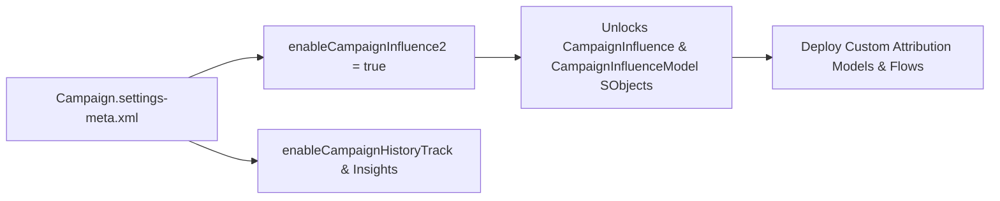

## Architectural Overview

The `CampaignSettings` metadata type governs org-wide behavior for Salesforce Campaigns, Marketing Attribution, and Account Engagement (Pardot) campaign features. From an architectural standpoint, `CampaignSettings` is a critical foundation artifact in CI/CD pipelines: until `<enableCampaignInfluence2>true</enableCampaignInfluence2>` is deployed in `Campaign.settings-meta.xml`, the standard `CampaignInfluence` and `CampaignInfluenceModel` SObjects remain hidden in the target org's schema, causing any dependent [CampaignInfluenceModel](/docs/metadata/campaign-influence-model-metadata-type/), Apex classes, Flows, or custom report types to fail compilation.

In addition to unlocking Customizable Campaign Influence, `CampaignSettings` defines the org's automatic campaign influence association window (`autoAssociationSettings`) and Einstein Campaign Insights (`enableCampaignInsights`).



## SFDX Directory & File Suffix

| Property | Value |
| :--- | :--- |
| **Metadata Type Name** | `CampaignSettings` |
| **Classic Directory** | `settings/` |
| **Classic File Suffix** | `.settings` (`Campaign.settings`) |
| **SFDX Source Directory** | `force-app/main/default/settings/` |
| **SFDX File Suffix** | `.settings-meta.xml` (`Campaign.settings-meta.xml`) |

## Key Metadata Fields

The `CampaignSettings` metadata type exposes the following configuration fields:

| Field Name | Field Type | Required | Architectural Description |
| :--- | :--- | :--- | :--- |
| `enableAccountsAsCM` | `boolean` | No | Allows Accounts to be added directly as Campaign Members (`true`) without requiring a Contact or Person Account. |
| `enableCampaignHistoryTrack` | `boolean` | No | Enables field history tracking on the standard `Campaign` object. |
| `enableCampaignInfluence2` | `boolean` | No | Enables Customizable Campaign Influence across the org (`true` or `false`). |
| `enableCampaignInsights` | `boolean` | No | Enables Einstein Campaign Insights to surface AI-driven engagement patterns on campaigns. |
| `enableCampaignMemberTWCF` | `boolean` | No | Enables Campaign Member field sharing and visibility rules across integrated marketing workspaces. |

> [!TIP]
> Enabling `<enableAccountsAsCM>true</enableAccountsAsCM>` is a game-changer for Account-Based Marketing (ABM) architectures, allowing target `Account` records to be added directly to `CampaignMember` lists before individual buyer contacts are identified.

## Declarative XML & `package.xml` Examples

### SFDX Source File Example

```xml title="force-app/main/default/settings/Campaign.settings-meta.xml"
<?xml version="1.0" encoding="UTF-8"?>
<CampaignSettings xmlns="http://soap.sforce.com/2006/04/metadata">
    <enableAccountsAsCM>true</enableAccountsAsCM>
    <enableCampaignHistoryTrack>true</enableCampaignHistoryTrack>
    <enableCampaignInfluence2>true</enableCampaignInfluence2>
    <enableCampaignInsights>false</enableCampaignInsights>
</CampaignSettings>
```

### Package Manifest (`package.xml`)

```xml title="manifest/package.xml"
<?xml version="1.0" encoding="UTF-8"?>
<Package xmlns="http://soap.sforce.com/2006/04/metadata">
    <types>
        <members>Campaign</members>
        <name>Settings</name>
    </types>
    <version>68.0</version>
</Package>
```

### Scratch Org Definition (`project-scratch-def.json`)

```json title="config/project-scratch-def.json"
{
  "orgName": "RevOps Attribution Scratch Org",
  "edition": "Enterprise",
  "features": ["PardotScFeaturesCampaignInfluence"],
  "settings": {
    "campaignSettings": {
      "enableAccountsAsCM": true,
      "enableCampaignHistoryTrack": true,
      "enableCampaignInfluence2": true
    }
  }
}
```

## SFDX CLI Retrieval & Deployment Commands

Retrieve and deploy `CampaignSettings` using the `Settings:Campaign` component name:

```bash
# Retrieve CampaignSettings from an org
sf project retrieve start --metadata Settings:Campaign

# Deploy CampaignSettings to enable Customizable Campaign Influence
sf project deploy start --metadata Settings:Campaign
```

## Senior Architect Best Practices & Gotchas

- **Scratch Org Feature Requirement for `enableCampaignInfluence2`:** In scratch org builds, setting `enableCampaignInfluence2: true` requires the `"PardotScFeaturesCampaignInfluence"` or `"CampaignInfluence2"` feature in `project-scratch-def.json` and the `CampaignInfluence2` user permission on the running user.
- **Marketing User Checkbox Dependency:** Users deploying or configuring Campaign settings and records often require the standard **Marketing User** (`UserPermissionsMarketingUser = true`) checkbox enabled on their `User` record in addition to profile or [PermissionSet](/docs/metadata/permission-set-metadata-type/) CRUD access on `Campaign`.
- **Stage Deployment Before Attribution Code:** If your repository contains Apex classes querying `CampaignInfluence` and `Campaign.settings-meta.xml` in a brand-new org, deploy `Settings:Campaign` first (or ensure `campaignSettings` is set in `project-scratch-def.json`) so the `CampaignInfluence` SObject exists before Apex compilation runs.
