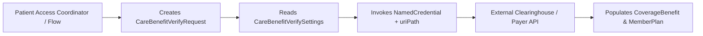

## Architectural Overview

In Salesforce Health Cloud and Life Sciences Cloud, care coordinators and patient access specialists must verify a patient's active health insurance coverage, copays, deductibles, and prior-authorization requirements before scheduling treatments. The `CareBenefitVerifySettings` metadata type configures the integration wiring for Health Cloud's automated **Benefit Verification** component and ANSI X12 270/271 or FHIR `CoverageEligibilityRequest` clearinghouse callouts.

Architecturally, `CareBenefitVerifySettings` decouples the UI/Flow verification request (`CareBenefitVerifyRequest`) from hardcoded integration endpoints by binding the verification service to a Salesforce `NamedCredential`, relative `uriPath`, and default requesting provider/organization National Provider Identifier (NPI) attributes.



## SFDX Directory & File Suffix

| Property | Value |
| :--- | :--- |
| **Metadata Type Name** | `CareBenefitVerifySettings` |
| **Classic Directory** | `careBenefitVerifySettings/` |
| **Classic File Suffix** | `.careBenefitVerifySettings` |
| **SFDX Source Directory** | `force-app/main/default/careBenefitVerifySettings/` |
| **SFDX File Suffix** | `.careBenefitVerifySettings-meta.xml` |

## Key Metadata Fields

The `CareBenefitVerifySettings` metadata type includes the following declarative XML fields:

| Field Name | Field Type | Required | Architectural Description |
| :--- | :--- | :--- | :--- |
| `codeSetType` | `string` | No | Default medical coding system or service type code set used in benefit verification requests. |
| `defaultNpi` | `string` | No | Default 10-digit National Provider Identifier (NPI) used when a request does not specify a rendering provider NPI. |
| `defaultOrganizationName` | `string` | No | Default healthcare organization or facility name sent in the eligibility request payload. |
| `defaultProviderFirstName` | `string` | No | Fallback provider first name for eligibility inquiries. |
| `defaultProviderLastName` | `string` | No | Fallback provider last name for eligibility inquiries. |
| `defaultServiceTypeCode` | `string` | No | Default X12 270 service type code (for example, `30` for Health Benefit Plan Coverage). |
| `generalPlanNamedCredential` | `string` | No | The DeveloperName of the `NamedCredential` used to authenticate benefit verification callouts. |
| `isDefault` | `boolean` | No | Marks whether this configuration is the default Benefit Verification setting in the org (`true` or `false`). |
| `masterLabel` | `string` | Yes | Human-readable label displayed in Setup -> Care Benefit Verify Settings. |
| `uriPath` | `string` | No | Relative REST path appended to the `NamedCredential` base URL (such as `/v1/eligibility/verify`). |

> [!TIP]
> Always store payer clearinghouse client secrets and mutual TLS certificates in External Credentials / `NamedCredential` and reference only `generalPlanNamedCredential` and `uriPath` in `CareBenefitVerifySettings`.

## Declarative XML & `package.xml` Examples

### SFDX Source File Example

```xml title="force-app/main/default/careBenefitVerifySettings/National_Clearinghouse_BV.careBenefitVerifySettings-meta.xml"
<?xml version="1.0" encoding="UTF-8"?>
<CareBenefitVerifySettings xmlns="http://soap.sforce.com/2006/04/metadata">
    <defaultNpi>1234567893</defaultNpi>
    <defaultOrganizationName>Acme Regional Health System</defaultOrganizationName>
    <defaultServiceTypeCode>30</defaultServiceTypeCode>
    <generalPlanNamedCredential>Clearinghouse_Eligibility_API</generalPlanNamedCredential>
    <isDefault>true</isDefault>
    <masterLabel>National Clearinghouse Benefit Verification</masterLabel>
    <uriPath>/api/v2/coverage-eligibility/check</uriPath>
</CareBenefitVerifySettings>
```

### Package Manifest (`package.xml`)

```xml title="manifest/package.xml"
<?xml version="1.0" encoding="UTF-8"?>
<Package xmlns="http://soap.sforce.com/2006/04/metadata">
    <types>
        <members>National_Clearinghouse_BV</members>
        <name>CareBenefitVerifySettings</name>
    </types>
    <version>68.0</version>
</Package>
```

## Querying via SOQL & SFDX CLI

Inspect deployed `CareBenefitVerifySettings` configurations in a Health Cloud org using SOQL:

```soql
SELECT Id, DeveloperName, MasterLabel, IsDefault, GeneralPlanNamedCredential,
       UriPath, DefaultNpi, DefaultOrganizationName
FROM CareBenefitVerifySettings
ORDER BY IsDefault DESC, DeveloperName ASC
```

Retrieve and deploy `CareBenefitVerifySettings` with Salesforce CLI:

```bash
# Retrieve CareBenefitVerifySettings metadata
sf project retrieve start --metadata CareBenefitVerifySettings:National_Clearinghouse_BV

# Deploy NamedCredential and CareBenefitVerifySettings together
sf project deploy start --metadata NamedCredential:Clearinghouse_Eligibility_API CareBenefitVerifySettings:National_Clearinghouse_BV
```

## Senior Architect Best Practices & Gotchas

- **Named Credential Dependency:** Deploying `CareBenefitVerifySettings` will fail if the `NamedCredential` referenced in `<generalPlanNamedCredential>` does not exist in the target org. Always include the `NamedCredential` in the same deployment package.
- **Health Cloud License Prerequisite:** The `CareBenefitVerifySettings` metadata type is only available in orgs provisioned with the Health Cloud (`HealthCloudAddOn`) license and permission set licenses.
- **Single Default Rule:** Ensure only one `CareBenefitVerifySettings` record has `<isDefault>true</isDefault>` so standard Health Cloud Benefit Verification Lightning components know which clearinghouse endpoint to invoke by default.
