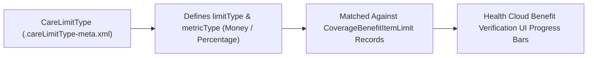

## Architectural Overview

When payer clearinghouses return an electronic benefit verification response (ANSI X12 271 or FHIR `CoverageEligibilityResponse`) to Salesforce Health Cloud, the response contains dozens of financial accumulators and utilization limits—such as individual vs. family deductibles, out-of-pocket (OOP) maximums, coinsurance percentages, and annual physical therapy visit caps. The `CareLimitType` metadata type defines how Health Cloud classifies, formats, and renders each of these benefit limits in the Care Benefit Verification Lightning component.

Architecturally, `CareLimitType` maps a `limitType` name (such as `Deductible`, `OutOfPocketMax`, or `VisitLimit`) to a `metricType` (`Money`, `Percentage`, or `Amount`/`Count`) so the Health Cloud UI knows whether to render a progress bar in currency, a percentage badge, or a visit counter.



## SFDX Directory & File Suffix

| Property | Value |
| :--- | :--- |
| **Metadata Type Name** | `CareLimitType` |
| **Classic Directory** | `careLimitTypes/` |
| **Classic File Suffix** | `.careLimitType` |
| **SFDX Source Directory** | `force-app/main/default/careLimitTypes/` |
| **SFDX File Suffix** | `.careLimitType-meta.xml` |

## Key Metadata Fields

The `CareLimitType` metadata type exposes the following XML fields:

| Field Name | Field Type | Required | Architectural Description |
| :--- | :--- | :--- | :--- |
| `isProtected` | `boolean` | No | Reserved for managed packages; indicates whether the component is protected inside a managed package namespace. |
| `limitType` | `string` | Yes | The benefit limit classification name matched against benefit verification payloads (for example, `Deductible`, `Copay`, `Coins`, or `AnnualVisitMax`). |
| `masterLabel` | `string` | Yes | The human-readable label for the care limit type in Setup. |
| `metricType` | `string` | Yes | The unit of measurement used to format the limit value (`Money`, `Percentage`, or numeric count). |

> [!NOTE]
> The `<limitType>` string in `CareLimitType` must exactly match the `LimitType` value populated on `CoverageBenefitItemLimit` or returned by your [CareBenefitVerifySettings](/docs/metadata/care-benefit-verify-settings-metadata-type/) integration transformer.

## Declarative XML & `package.xml` Examples

### SFDX Source File Example

```xml title="force-app/main/default/careLimitTypes/Annual_Out_Of_Pocket_Max.careLimitType-meta.xml"
<?xml version="1.0" encoding="UTF-8"?>
<CareLimitType xmlns="http://soap.sforce.com/2006/04/metadata">
    <isProtected>false</isProtected>
    <limitType>OutOfPocketMaximum</limitType>
    <masterLabel>Annual Out of Pocket Maximum</masterLabel>
    <metricType>Money</metricType>
</CareLimitType>
```

### Package Manifest (`package.xml`)

```xml title="manifest/package.xml"
<?xml version="1.0" encoding="UTF-8"?>
<Package xmlns="http://soap.sforce.com/2006/04/metadata">
    <types>
        <members>Annual_Out_Of_Pocket_Max</members>
        <name>CareLimitType</name>
    </types>
    <version>68.0</version>
</Package>
```

## Querying via SOQL & SFDX CLI

Audit configured `CareLimitType` definitions in your Health Cloud org using SOQL:

```soql
SELECT Id, DeveloperName, MasterLabel, LimitType, MetricType
FROM CareLimitType
ORDER BY MasterLabel ASC
```

Retrieve and deploy `CareLimitType` components using the Salesforce CLI:

```bash
# Retrieve all CareLimitType metadata definitions
sf project retrieve start --metadata CareLimitType

# Deploy a specific CareLimitType
sf project deploy start --metadata CareLimitType:Annual_Out_Of_Pocket_Max
```

## Senior Architect Best Practices & Gotchas

- **Standardize Clearinghouse Mapping Tables:** Different insurance clearinghouses (such as Availity, Change Healthcare, or Waystar) use varying terminology for copayment and coinsurance accumulators. Normalize external payer codes in your middleware or Apex response handler to a small, canonical set of `CareLimitType` definitions (`Deductible`, `OutOfPocketMaximum`, `Copayment`, `Coinsurance`, `VisitLimit`).
- **Bundle with `CareBenefitVerifySettings`:** Always version-control and deploy `CareLimitType` files in the same SFDX package directory as your `CareBenefitVerifySettings` so new sandboxes render benefit accumulators accurately during integration testing.
