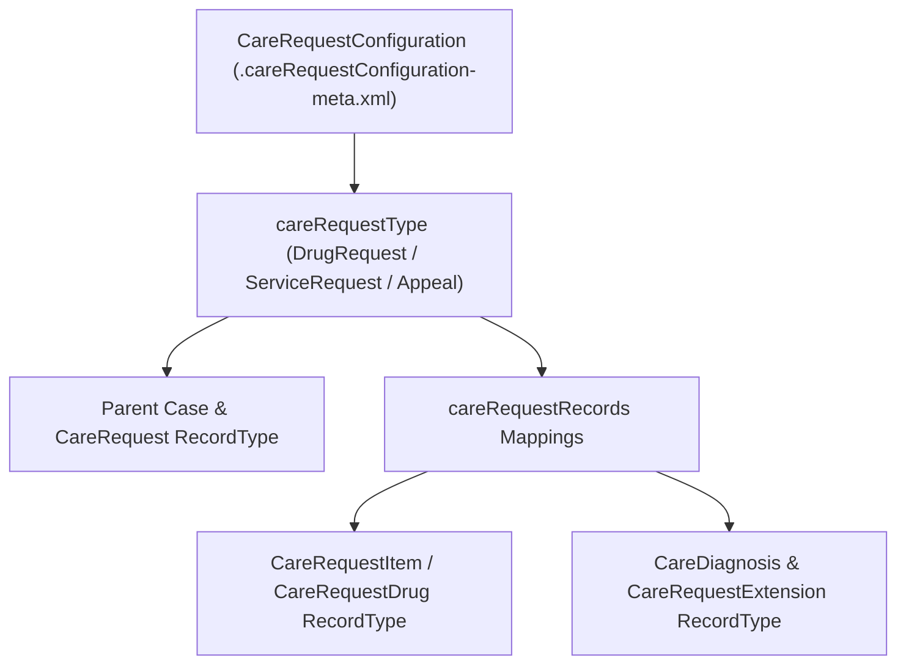

## Architectural Overview

In payer and provider **Utilization Management (UM)** workflows on Salesforce Health Cloud, clinical intake teams process diverse care requests: inpatient admissions, outpatient procedure prior authorizations, specialty pharmacy drug authorizations, concurrent stay reviews, and clinical appeals. Each request spans a complex composite object graph rooted at `Case` and `CareRequest`, with child records in `CareRequestItem`, `CareRequestDrug`, `CareDiagnosis`, and `CareRequestExtension`.

The `CareRequestConfiguration` metadata type binds a specific Utilization Management workflow (`careRequestType`, such as `ServiceRequest`, `DrugRequest`, `Admission`, or `Appeal`) to the exact `RecordType` names and page layouts across that entire composite clinical object graph. When a clinician launches the Health Cloud Care Request intake component, `CareRequestConfiguration` dynamically renders the mapped record types and fields for each child object.



## SFDX Directory & File Suffix

| Property | Value |
| :--- | :--- |
| **Metadata Type Name** | `CareRequestConfiguration` |
| **Classic Directory** | `careRequestConfigurations/` |
| **Classic File Suffix** | `.careRequestConfiguration` |
| **SFDX Source Directory** | `force-app/main/default/careRequestConfigurations/` |
| **SFDX File Suffix** | `.careRequestConfiguration-meta.xml` |

## Key Metadata Fields

The `CareRequestConfiguration` metadata type exposes the following XML elements:

| Field Name | Field Type | Required | Architectural Description |
| :--- | :--- | :--- | :--- |
| `careRequestRecordType` | `string` | Yes | The DeveloperName of the `Case` Record Type associated with this Utilization Management request. |
| `careRequestRecords` | `CareRequestRecord[]` | No | Maps each clinical child object (`careRequestObject`) to its corresponding `careRequestRecordType`. |
| `careRequestType` | `string` | Yes | The Utilization Management category (`ServiceRequest`, `DrugRequest`, `Admission`, `Appeal`, or custom category). |
| `isActive` | `boolean` | No | Activates (`true`) or deactivates (`false`) this care request configuration in the intake UI. |
| `isDefaultRequestType` | `boolean` | No | Marks whether this configuration is preselected by default when a clinician starts a new Care Request (`true` or `false`). |
| `masterLabel` | `string` | Yes | Display name shown in the Care Request Type selector in Health Cloud. |

> [!TIP]
> Always include the referenced `RecordType` metadata (`objects/Case/recordTypes/*`, `objects/CareRequest/recordTypes/*`, `objects/CareRequestDrug/recordTypes/*`, and `objects/CareDiagnosis/recordTypes/*`) in the same SFDX package or manifest as `CareRequestConfiguration`.

## Declarative XML & `package.xml` Examples

### SFDX Source File Example

```xml title="force-app/main/default/careRequestConfigurations/Specialty_Pharmacy_Prior_Auth.careRequestConfiguration-meta.xml"
<?xml version="1.0" encoding="UTF-8"?>
<CareRequestConfiguration xmlns="http://soap.sforce.com/2006/04/metadata">
    <careRequestRecordType>Specialty_Drug_Prior_Auth_Case</careRequestRecordType>
    <careRequestRecords>
        <careRequestObject>CareRequest</careRequestObject>
        <careRequestRecordType>Drug_Prior_Authorization</careRequestRecordType>
    </careRequestRecords>
    <careRequestRecords>
        <careRequestObject>CareRequestDrug</careRequestObject>
        <careRequestRecordType>Specialty_Medication_Request</careRequestRecordType>
    </careRequestRecords>
    <careRequestRecords>
        <careRequestObject>CareDiagnosis</careRequestObject>
        <careRequestRecordType>Primary_Clinical_Diagnosis</careRequestRecordType>
    </careRequestRecords>
    <careRequestType>DrugRequest</careRequestType>
    <isActive>true</isActive>
    <isDefaultRequestType>false</isDefaultRequestType>
    <masterLabel>Specialty Pharmacy Prior Authorization</masterLabel>
</CareRequestConfiguration>
```

### Package Manifest (`package.xml`)

```xml title="manifest/package.xml"
<?xml version="1.0" encoding="UTF-8"?>
<Package xmlns="http://soap.sforce.com/2006/04/metadata">
    <types>
        <members>Specialty_Pharmacy_Prior_Auth</members>
        <name>CareRequestConfiguration</name>
    </types>
    <version>68.0</version>
</Package>
```

## Querying via SOQL & SFDX CLI

Audit active Utilization Management request configurations in your Health Cloud org using SOQL:

```soql
SELECT Id, DeveloperName, MasterLabel, CareRequestType,
       CareRequestRecordType, IsActive, IsDefaultRequestType
FROM CareRequestConfiguration
ORDER BY IsDefaultRequestType DESC, MasterLabel ASC
```

Retrieve and deploy `CareRequestConfiguration` metadata using Salesforce CLI:

```bash
# Retrieve CareRequestConfiguration metadata
sf project retrieve start --metadata CareRequestConfiguration:Specialty_Pharmacy_Prior_Auth

# Deploy CareRequestConfiguration to target org
sf project deploy start --metadata CareRequestConfiguration:Specialty_Pharmacy_Prior_Auth
```

## Senior Architect Best Practices & Gotchas

- **RecordType Visibility on Profiles & Permission Sets:** Even when `CareRequestConfiguration` is deployed with `<isActive>true</isActive>`, clinical intake nurses will encounter runtime errors if their [PermissionSet](/docs/metadata/permission-set-metadata-type/) or Profile lacks `<recordTypeVisibilities>` for the mapped `Case`, `CareRequest`, `CareRequestDrug`, and `CareDiagnosis` Record Types.
- **Page Layout Assignments Required:** The Health Cloud Care Request Lightning component dynamically inspects the Page Layout assigned to each mapped `careRequestRecordType` to render intake form fields. Ensure `<layoutAssignments>` are deployed for every mapped child Record Type.
